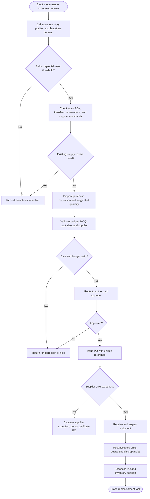
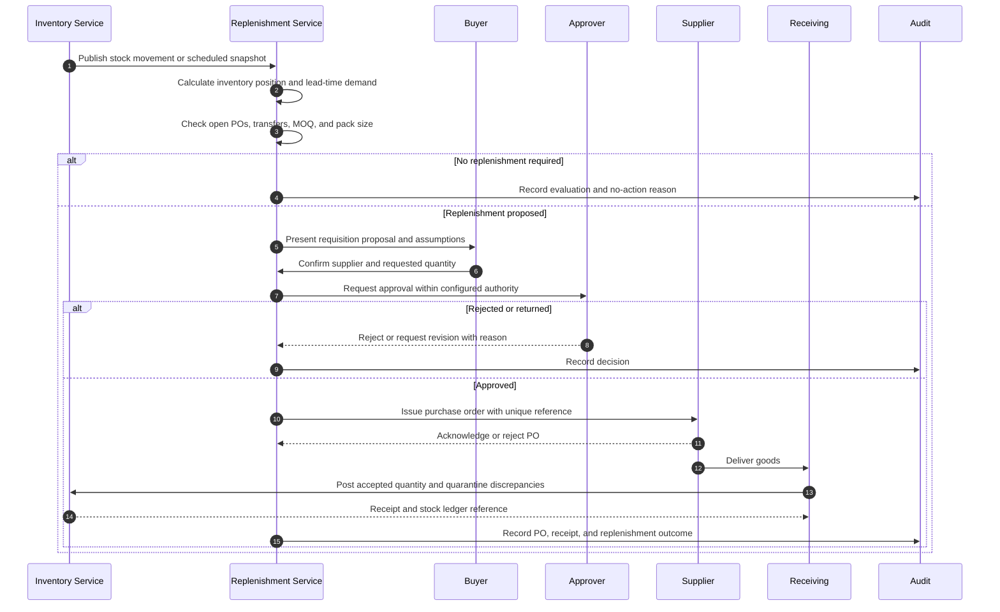
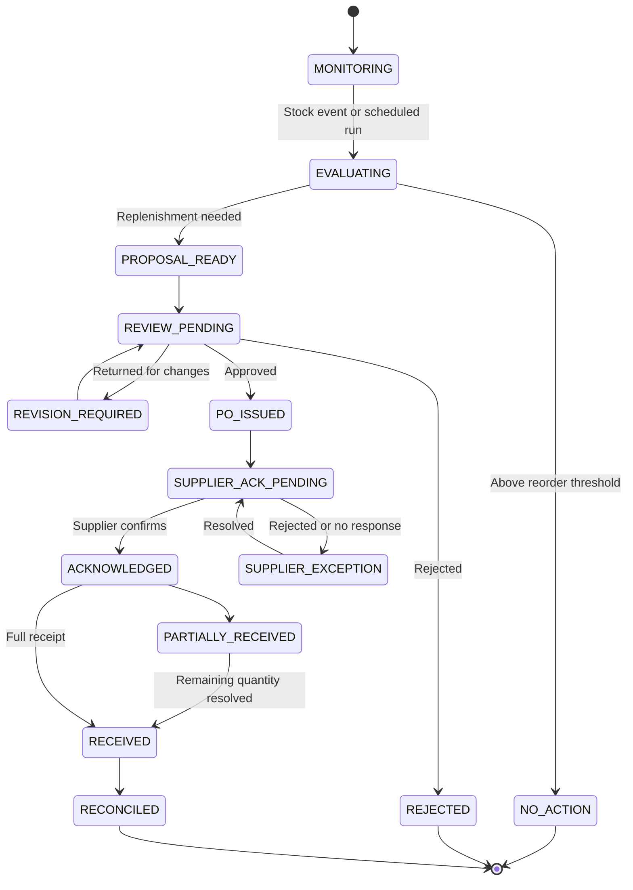

# Low-Stock Detection and Replenishment

> **Domain:** Retail inventory, procurement, supply chain  
> **Document type:** To-Be reference workflow  
> **Status:** Reference design — validate with process owners before implementation  
> **Audience:** Business Analysts, Systems Analysts, product teams, and developers

## 1. Problem statement

Replenishment based only on on-hand quantity can create duplicate purchase orders, stockouts, and excess inventory when open orders, reservations, lead times, or supplier constraints are ignored.

## 2. Objective and scope

**Objective:** Calculate replenishment need using available inventory and outstanding supply, then route purchase proposals through purchasing controls.

**In scope**
- Operational lifecycle from initiation through resolution and recordkeeping.
- Business decisions, system responsibilities, exception handling, and audit evidence.
- Minimum data and acceptance criteria needed for implementation planning.

**Out of scope**
- Organization-specific legal, tax, accounting, labor, or contractual conclusions.
- Fixed thresholds, fees, SLA targets, or financial outcomes not validated by the organization.
- Vendor-specific API contracts unless documented by the selected provider.

## 3. Actors and systems

| Actor / system | Responsibility |
|---|---|
| Inventory service | Maintains stock ledger and availability |
| Store or warehouse operator | Reports count and receiving exceptions |
| Buyer | Reviews demand and supplier options |
| Approver | Approves purchase commitments within authority |
| Supplier | Confirms and fulfills purchase order |

## 4. Trigger, preconditions, and postconditions

**Trigger:** An inventory event or scheduled stock evaluation finds an SKU-location available quantity at or below its configured reorder point.

**Preconditions**
- SKU, location, unit of measure, and inventory status are valid.
- On-hand, reserved, damaged, quarantined, and inbound quantities are distinguishable.
- Reorder point, safety stock, minimum order quantity, and lead time have approved sources or are explicitly marked as assumptions.
- Supplier/catalog availability and purchasing authority are configured.
- Duplicate alerts and open purchase orders can be checked before replenishment.

**Postconditions**
- Business object has an explicit final or pending status.
- Material decisions, external references, and exceptions are traceable.
- Related financial, inventory, customer, or access records are synchronized or visibly pending.

## 5. Business process view

This flow describes the human and organizational process, independent of a specific application architecture.

## 6. System interaction view

The sequence models stock-position calculation, alert deduplication, replenishment proposal, buyer approval, purchase-order transmission, and receipt reconciliation.

## 7. Business rules

| ID | Rule |
|---|---|
| BR-001 | Inventory position must account for on-hand, reserved, allocated, and confirmed inbound quantities. |
| BR-002 | Reorder points and safety stock are business parameters, not universal constants. |
| BR-003 | A new requisition must check open POs and transfers to avoid duplicate replenishment. |
| BR-004 | Suggested quantity must respect pack size, minimum order quantity, and supplier constraints. |
| BR-005 | Purchase order creation and supplier transmission must be idempotent. |
| BR-006 | Only authorized buyers may approve or transmit commitments within configured limits. |
| BR-007 | Receiving discrepancies must remain open against the PO until resolved. |

Policy-dependent rules must be confirmed by the process owner and recorded with an effective date or version before implementation.

## 8. Data requirements

| Entity | Minimum fields |
|---|---|
| InventoryPosition | sku, location, on_hand, reserved, allocated, inbound, available, calculated_at |
| ReplenishmentPolicy | sku, location, reorder_point, safety_stock, lead_time, review_period |
| PurchaseRequisition | request_id, suggested_qty, supplier_id, reason, status |
| PurchaseOrder | po_id, lines, approved_by, supplier_ack, expected_date, status |
| Receipt | receipt_id, po_id, received_qty, rejected_qty, discrepancy |
| Supplier | supplier_id, lead_time, MOQ, pack_multiple, status |

Use stable identifiers, explicit timestamps/time zones, currency and unit definitions where relevant, and versioned policy/rule references. Financial values must use integer minor units or fixed-precision decimal types, not binary floating-point arithmetic.

## 9. State model

The state names and transitions below describe the proposed lifecycle for this workflow. Confirm guards, role permissions, timeout transitions, and terminal-state behavior with the process owner and implementation team before production use.

## 10. Exceptions and recovery

| Scenario | Expected behavior and recovery |
|---|---|
| Stock ledger is stale | Flag calculation as provisional and request synchronization or count. |
| Existing PO is delayed | Escalate supplier risk; do not blindly create a duplicate order. |
| Supplier discontinues SKU | Route to approved substitute or assortment decision. |
| Budget or approval rejected | Keep requisition in REJECTED or NEEDS_REVISION with reason. |
| Partial delivery | Receive actual quantity and retain remaining PO balance as open/backordered. |
| Quality failure | Quarantine rejected units and initiate supplier claim. |

Every retryable action should define idempotency, retry limits, backoff, timeout, and manual escalation. Never treat an unknown external result as success.

## 11. Authorization, privacy, and audit

- Enforce permissions on the server/service boundary; hiding a button is not authorization.
- Apply least privilege and separation of duties for sensitive approvals, financial actions, inventory adjustments, or account changes.
- Record actor/service identity, timestamp, object ID, action, prior and new state, reason, correlation ID, and external reference where applicable.
- Protect personal and commercially sensitive data through purpose limitation, access control, retention, and secure evidence storage.
- Preserve history through append-only events or controlled reversals; do not silently overwrite material decisions.

## 12. Acceptance criteria

- **AC-01:** Given an open PO already covers replenishment need, when the reorder job runs, then it does not create a duplicate requisition.
- **AC-02:** Given inventory data is stale, when reorder calculation runs, then the proposal is marked provisional or blocked.
- **AC-03:** Given a PO is partially received, when receipt is posted, then received units update stock and the outstanding balance remains open.
- **AC-04:** Given a requisition exceeds an approver's authority, when submitted, then it routes to the next authorized level.
- **AC-05:** Given a replenishment proposal is calculated, when supplier pack size or minimum order quantity applies, then the suggested quantity respects those constraints.
- **AC-06:** Given an approved purchase order is transmitted, when the transmission is retried with the same request key, then no duplicate supplier commitment is created.

## 13. Operational metrics

- Stockout frequency and duration
- Reorder proposal acceptance rate
- Duplicate PO prevention count
- Supplier on-time/in-full delivery
- Inventory days on hand and excess stock value

- **Stockout rate:** SKU-location days with available quantity at zero ÷ active SKU-location days.
- **Alert conversion:** alerts resulting in an approved replenishment action ÷ actionable alerts.
- **Replenishment lead time:** receipt timestamp minus approved purchase-order timestamp; report median and P90 by supplier.
- Review weekly; segment by SKU, supplier, and location.

Assign a named metric owner, reporting window, and baseline before setting a target. These are measurement definitions, not promised improvements.

## 14. Assumptions and open decisions

- Demand forecast, safety stock, reorder point, and supplier lead time require business calibration.
- The reference does not automatically transmit POs without configured approval.
- Confirm role names, authority limits, thresholds, timeouts, retention, and escalation ownership with stakeholders.
- Record unresolved decisions explicitly; do not silently convert assumptions into requirements.

## 15. Traceability

| Business rule | Acceptance criterion | Verification focus |
|---|---|---|
| BR-001 | AC-02 | Requirement and test coverage for the rule |
| BR-002 | AC-02 | Requirement and test coverage for the rule |
| BR-003 | AC-01 | Requirement and test coverage for the rule |
| BR-004 | AC-05 | Requirement and test coverage for the rule |
| BR-005 | AC-06 | Requirement and test coverage for the rule |
| BR-006 | AC-04 | Requirement and test coverage for the rule |
| BR-007 | AC-03 | Requirement and test coverage for the rule |

---

**Validation note:** This is a reusable reference pattern, not an approved policy for every organization. Confirm assumptions and provider-specific behavior before implementation.
