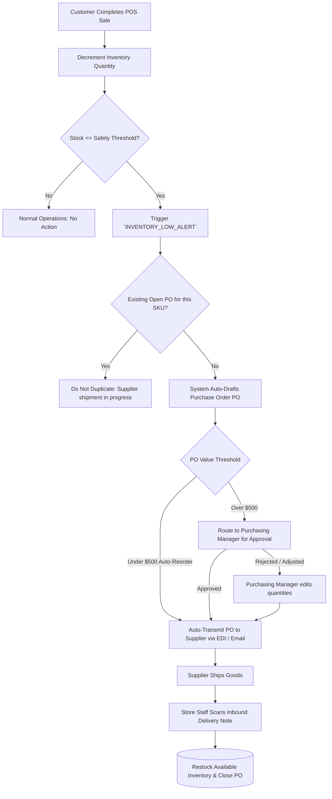

# Automated Low-Stock Alert & Supplier Purchase Order Flow

> **Domain:** Retail Inventory, Supermarket, Supply Chain  
> **Key Objective:** Automatically detect stock falling below minimum safety threshold, generate Purchase Orders (PO), and receive supplier shipments.

---

## 1. Process Flowchart

