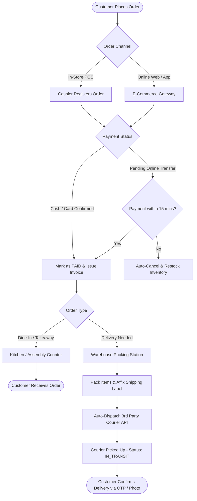
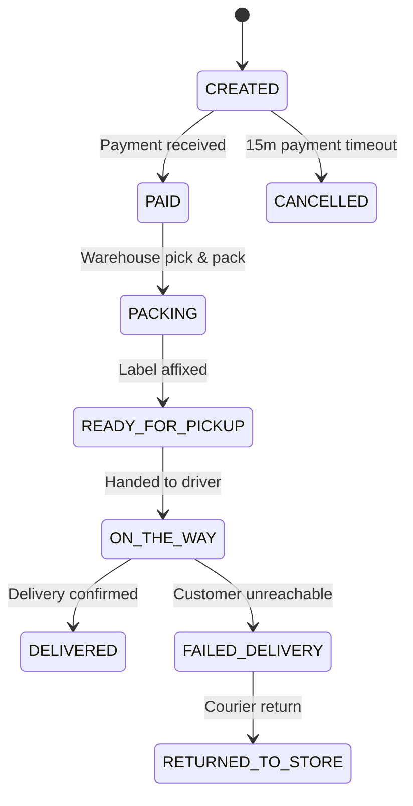

# Point-of-Sale Order to Fulfillment & Delivery Flow

> **Domain:** Omnichannel Retail, Fast Food / Restaurant, E-Commerce Express  
> **Key Objective:** Synchronize in-store orders with fulfillment dispatch and courier tracking.

---

## 1. Process Flowchart

---

## 2. Status Lifecycle Transitions

