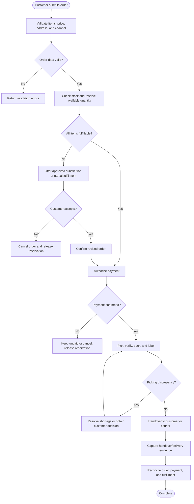
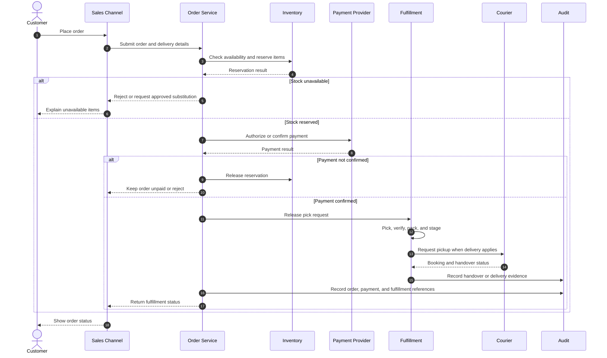
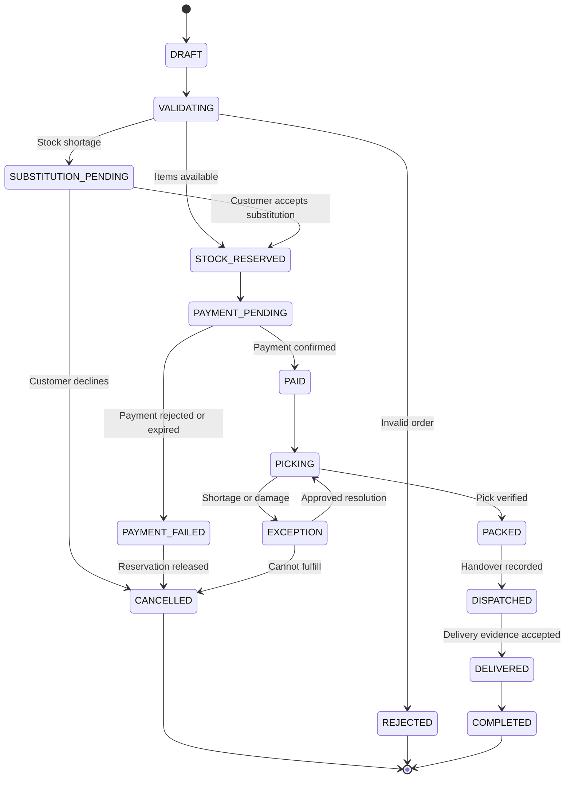

# Order-to-Fulfillment and Delivery

> **Domain:** Retail, food service, omnichannel commerce  
> **Document type:** To-Be reference workflow  
> **Status:** Reference design — validate with process owners before implementation  
> **Audience:** Business Analysts, Systems Analysts, product teams, and developers

## 1. Problem statement

Orders across channels can become inconsistent across payment, stock reservation, picking, courier handoff, and delivery status. This can cause unpaid dispatches, overselling, and false delivery completion.

## 2. Objective and scope

**Objective:** Trace an order from acceptance to handover with separate payment, inventory, fulfillment, and delivery states.

**In scope**
- Operational lifecycle from initiation through resolution and recordkeeping.
- Business decisions, system responsibilities, exception handling, and audit evidence.
- Minimum data and acceptance criteria needed for implementation planning.

**Out of scope**
- Organization-specific legal, tax, accounting, labor, or contractual conclusions.
- Fixed thresholds, fees, SLA targets, or financial outcomes not validated by the organization.
- Vendor-specific API contracts unless documented by the selected provider.

## 3. Actors and systems

| Actor / system | Responsibility |
|---|---|
| Customer | Places an order, pays, and receives goods |
| Sales channel | Captures order and customer selections |
| Fulfillment operator | Picks, packs, and stages items |
| Supervisor | Resolves stock and fulfillment exceptions |
| Courier provider | Accepts delivery job and reports delivery events |
| Payment provider | Confirms or rejects payment |

## 4. Trigger, preconditions, and postconditions

**Trigger:** A valid business event or authorized user action initiates the workflow.

**Preconditions**
- Initiating actor or service is authenticated.
- Required master data, policy versions, and reference records are available.
- Requested object is in a state that permits the operation.
- Required permissions and segregation-of-duty controls are configured.

**Postconditions**
- Business object has an explicit final or pending status.
- Material decisions, external references, and exceptions are traceable.
- Related financial, inventory, customer, or access records are synchronized or visibly pending.

## 5. Business process view

This flow describes the human and organizational process, independent of a specific application architecture.

## 6. System interaction view

This logical sequence shows system responsibilities. Adapt participants and messages to the selected architecture and provider contract.

## 7. Business rules

| ID | Rule |
|---|---|
| BR-001 | An order must have a unique order ID and channel reference where applicable. |
| BR-002 | Payment status and fulfillment status must be stored separately. |
| BR-003 | Stock reservation must be atomic per SKU and location to prevent overselling. |
| BR-004 | Only confirmed payment or an explicitly authorized credit/COD policy may release fulfillment. |
| BR-005 | A stock shortage must create an exception; substitutions require customer consent. |
| BR-006 | Courier booking requests must be idempotent and use a stable merchant reference. |
| BR-007 | Delivered status requires provider confirmation or approved proof-of-delivery evidence. |
| BR-008 | Cancellation must release reservations and reverse or void payment according to provider state. |

Policy-dependent rules must be confirmed by the process owner and recorded with an effective date or version before implementation.

## 8. Data requirements

| Entity | Minimum fields |
|---|---|
| Order | order_id, channel, customer_id, currency, total, order_status, payment_status, fulfillment_status |
| OrderLine | sku, quantity, unit_price, reserved_location, picked_quantity |
| Payment | provider, provider_reference, amount, status, idempotency_key |
| Reservation | sku, location, quantity, expires_at, status |
| Shipment | courier, booking_reference, tracking_reference, shipment_status |
| DeliveryEvidence | proof_type, reference, captured_at, captured_by |

Use stable identifiers, explicit timestamps/time zones, currency and unit definitions where relevant, and versioned policy/rule references. Financial values must use integer minor units or fixed-precision decimal types, not binary floating-point arithmetic.

## 9. State model

The following is a lifecycle scaffold. Rename, add, or remove states to reflect the domain and define permitted transitions in the implementation specification.

## 10. Exceptions and recovery

| Scenario | Expected behavior and recovery |
|---|---|
| Payment remains pending | Keep order in PAYMENT_PENDING; do not release fulfillment unless an approved COD/credit rule applies. |
| Payment callback arrives late | Re-query provider using transaction reference; reconcile before creating a refund or second charge. |
| Reserved item becomes unavailable | Pause fulfillment, record shortage, and request approved substitution or cancellation. |
| Courier cannot be assigned | Keep order READY_FOR_DISPATCH and retry within policy or route to manual dispatch. |
| Delivery fails | Record reason and attempt; follow redelivery, pickup, or return-to-origin policy. |
| Duplicate provider event | Deduplicate by provider event ID and preserve one state transition. |

Every retryable action should define idempotency, retry limits, backoff, timeout, and manual escalation. Never treat an unknown external result as success.

## 11. Authorization, privacy, and audit

- Enforce permissions on the server/service boundary; hiding a button is not authorization.
- Apply least privilege and separation of duties for sensitive approvals, financial actions, inventory adjustments, or account changes.
- Record actor/service identity, timestamp, object ID, action, prior and new state, reason, correlation ID, and external reference where applicable.
- Protect personal and commercially sensitive data through purpose limitation, access control, retention, and secure evidence storage.
- Preserve history through append-only events or controlled reversals; do not silently overwrite material decisions.

## 12. Acceptance criteria

- **AC-01:** Given an order is unpaid, when fulfillment is requested, then release is blocked unless an explicit payment policy permits it.
- **AC-02:** Given stock is reserved, when another order requests unavailable quantity, then the second reservation is rejected or partially allocated according to policy.
- **AC-03:** Given a courier callback is delivered twice, when processed, then only one state transition and audit event are applied.
- **AC-04:** Given delivery fails, when the provider reports failure, then the order remains unresolved and a recovery action is available.

## 13. Operational metrics

- Order-to-ready time by channel
- Payment-to-fulfillment release latency
- Pick accuracy = correctly picked lines / total picked lines
- Delivery success rate and failed-delivery reasons
- Orders with stale or inconsistent payment/fulfillment states

Define numerator, denominator, source system, measurement window, owner, and baseline before setting targets. Metrics are measurement proposals, not promised improvements.

## 14. Assumptions and open decisions

- Payment methods have different confirmation semantics; define them per provider and tender type.
- Reservation expiry, COD eligibility, substitution policy, and delivery proof requirements are organization decisions.
- Confirm role names, authority limits, thresholds, timeouts, retention, and escalation ownership with stakeholders.
- Record unresolved decisions explicitly; do not silently convert assumptions into requirements.

## 15. Traceability

| Rule group | Acceptance criteria | Implementation evidence |
|---|---|---|
| BR-001 to BR-008 | AC-01 to AC-04 | Unit/integration tests, audit events, and process-owner sign-off |

---

**Validation note:** This is a reusable reference pattern, not an approved policy for every organization. Confirm assumptions and provider-specific behavior before implementation.
