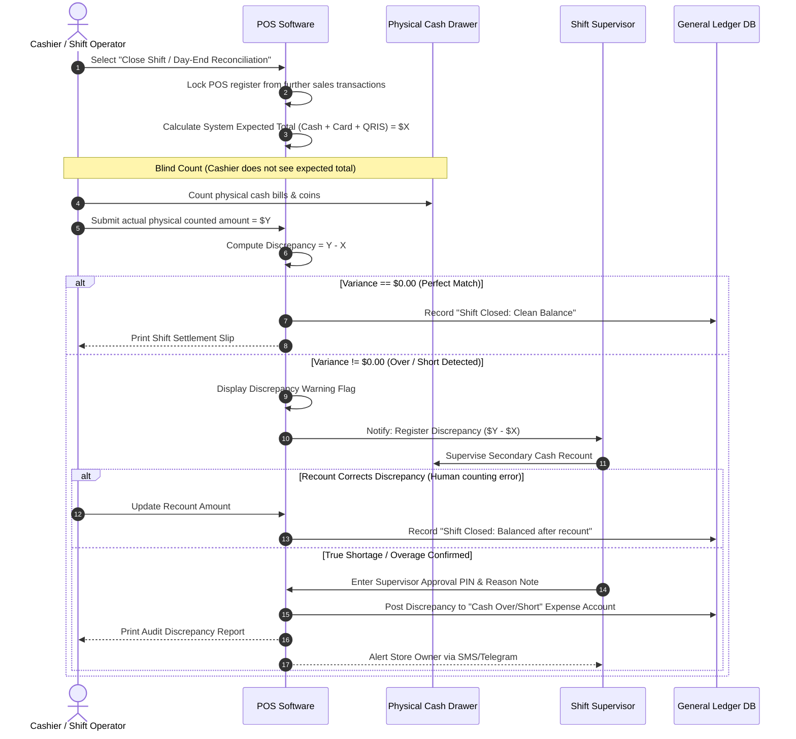

# End-of-Day POS Cashier Reconciliation & Drawer Balancing

> **Domain:** Retail, Food & Beverage, Brick-and-Mortar POS  
> **Key Objective:** Prevent internal cash leakage, enforce blind cash counting, and record verified ledger settlements.

---

## 1. Process Sequence Flow

---

## 2. Business Invariants & Edge Cases

* **Blind Count Invariant:** The POS terminal must never show the cashier the system's expected cash total before they input their physical count. Showing the expected balance invites cashiers to adjust physical numbers to cover up missing cash.
* **Dual Authorization:** Any cash variance exceeding `±$10.00` must require a manager PIN before the register can be handed over to the next shift.
