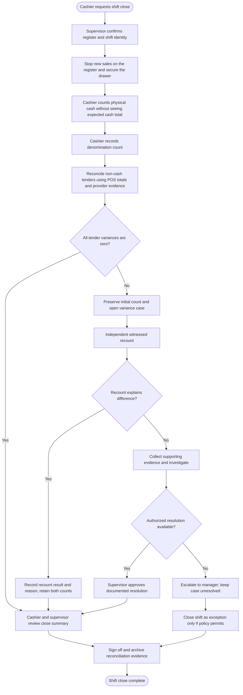
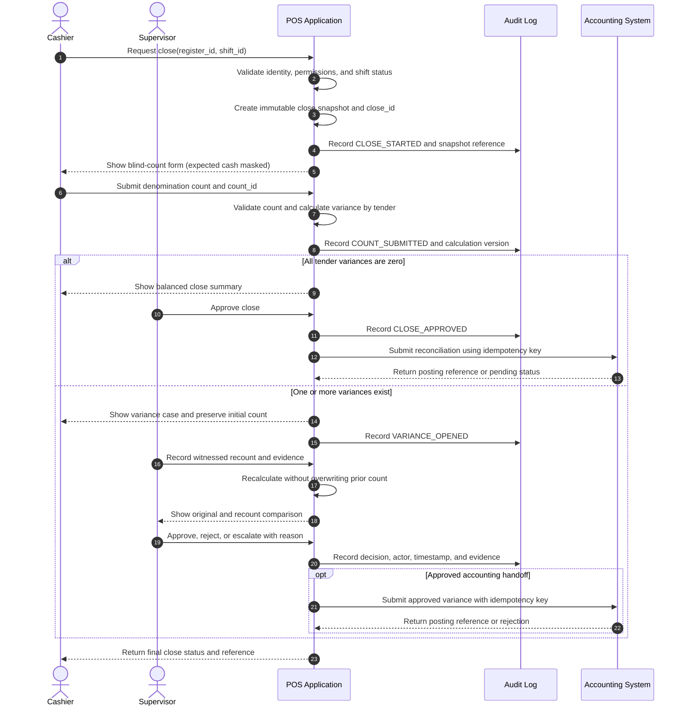
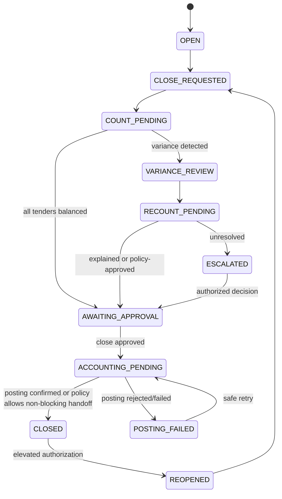

# POS End-of-Shift Reconciliation and Cash Variance Control

> **Domain:** Retail, food service, multi-register operations  
> **Document type:** To-Be workflow pattern  
> **Status:** Reference design — validate against local policy before implementation  
> **Primary objective:** Establish a controlled, auditable process for reconciling recorded tender amounts against independently counted physical funds.

## 1. Problem statement

At shift close, the amount recorded by the POS may differ from the cash and other tender evidence physically available. Common causes include counting mistakes, incorrect tender selection, unrecorded payouts, duplicate or reversed transactions, timing differences, and potential misconduct.

The process must detect and explain differences without allowing staff to conceal them through undocumented adjustments or unauthorized cash movements.

## 2. Scope

**In scope**
- Closing a register or cashier shift.
- Capturing expected tender totals from a stable transaction snapshot.
- Blind physical cash count and non-cash tender reconciliation.
- Recount, investigation, approval, evidence, and accounting handoff.
- Audit trail and controlled reopening.

**Out of scope**
- Payroll deductions or disciplinary decisions.
- Automatic assignment of every shortage to a cashier or driver.
- Bank settlement reconciliation beyond recording available settlement references.
- Tax treatment and accounting policy configuration.

These decisions require organization-specific policy and authorized review.

## 3. Actors and systems

| Actor / system | Responsibility |
|---|---|
| Cashier | Initiates close, counts assigned drawer, submits count, explains known differences |
| Shift supervisor | Witnesses recount, reviews evidence, approves permitted resolution |
| Store manager / owner | Reviews material or unresolved variances and policy exceptions |
| POS | Freezes the shift snapshot, masks expected totals during blind count, calculates variance, records events |
| Payment provider / acquirer | Supplies settlement or transaction references for non-cash tenders |
| Accounting system | Receives approved reconciliation and variance records; does not silently rewrite source transactions |

**Segregation of duties:** Where staffing permits, the person who performs the initial count should not be the sole approver of a non-zero variance or manual adjustment.

## 4. Trigger, preconditions, and outcomes

**Trigger:** Cashier requests end-of-shift close for a specific register and shift.

**Preconditions**
- Cashier is authenticated and assigned to the register/shift.
- No other close operation is already in progress for the same shift.
- POS has persisted all locally accepted transactions, or explicitly records pending synchronization.
- Cash drawer and tender evidence are available.
- Supervisor coverage or an approved exception route is defined.

**Successful postconditions**
- A reconciliation record exists for each tender type.
- The physical count and expected amount are preserved as separate values.
- Every variance has a status, owner, evidence reference, and approval history.
- The shift is closed only when required controls are satisfied or an authorized exception is recorded.

## 5. Business process view

This view describes human responsibilities and operational decisions, independent of a specific POS implementation.

## 6. System interaction view

This sequence is a logical design. It does not prescribe a vendor API, database schema, or specific payment-provider integration.

## 7. Business rules

| ID | Rule | Implementation implication |
|---|---|---|
| BR-001 | A close operation must reference one register and one shift. | Enforce unique active close per register/shift. |
| BR-002 | Expected tender totals must be calculated from a persisted transaction snapshot. | Store snapshot ID, cutoff time, and calculation version. |
| BR-003 | Expected cash must remain hidden from the cashier until the initial physical count is submitted. | Enforce server-side role-based visibility, not merely CSS masking. |
| BR-004 | Initial counts are immutable after submission. | Corrections create a new count attempt linked to the original. |
| BR-005 | Variance is calculated separately for each tender type. | Do not net cash shortage against card or QRIS overage. |
| BR-006 | Every non-zero variance requires a reason code and supporting note; evidence is required according to risk policy. | Make reason and evidence requirements configurable and auditable. |
| BR-007 | A recount must identify the counter, witness, time, and count attempt. | Preserve both initial and recount records. |
| BR-008 | Only an authorized role may approve a variance resolution or exception close. | Check permission on the server for every approval command. |
| BR-009 | No user may silently edit the expected total, delete a count, or overwrite a variance. | Use append-only event history and controlled reversal entries. |
| BR-010 | Cash overage and shortage remain separately visible. | Do not offset one tender or shift against another without an explicit, approved accounting policy. |
| BR-011 | Accounting handoff must be idempotent. | Use a stable key derived from close ID and posting type; handle duplicate delivery safely. |
| BR-012 | A failed accounting handoff must remain visible as pending or failed. | Retry safely and provide an operational queue; never mark posted without confirmation. |
| BR-013 | Reopening a closed shift requires elevated authorization and a recorded reason. | Create a reopen event; retain the previous close and its audit history. |
| BR-014 | An unresolved variance must not be represented as balanced. | Use explicit statuses such as OPEN, UNDER_REVIEW, APPROVED_EXCEPTION, and RESOLVED. |

## 8. Calculation and data requirements

For each tender type:

- **Expected amount:** sum of eligible, persisted POS tender entries within the close snapshot, adjusted only by explicitly recorded and authorized cash movements.
- **Counted amount:** physical amount counted for cash; provider/acquirer evidence or settlement reference for non-cash tender.
- **Variance:** counted amount minus expected amount.

For cash denomination counting:

`counted_cash = Σ(denomination_value × denomination_quantity)`

`cash_variance = counted_cash − expected_cash`

The system must define how opening float, paid-in, paid-out, cash drops, refunds, tips, foreign currency, and pending offline transactions affect expected cash. Do not assume they are included or excluded without an explicit policy.

**Minimum data entities**

| Entity | Key fields |
|---|---|
| ShiftClose | close_id, register_id, shift_id, snapshot_id, status, started_at, closed_at |
| TenderSummary | close_id, tender_type, expected_amount, counted_amount, variance_amount, currency |
| CountAttempt | count_id, close_id, attempt_no, counted_by, witnessed_by, submitted_at |
| CountLine | count_id, denomination, quantity, line_total |
| VarianceCase | case_id, close_id, tender_type, reason_code, status, assigned_to |
| Evidence | evidence_id, case_id, file/reference, uploaded_by, uploaded_at |
| Approval | approval_id, case_id/close_id, decision, approver_id, reason, decided_at |
| AuditEvent | event_id, aggregate_id, event_type, actor_id, timestamp, correlation_id |
| AccountingPosting | posting_id, close_id, idempotency_key, external_reference, status |

Amounts must use fixed-precision decimal or integer minor units, never binary floating-point arithmetic. Currency and rounding rules must be explicit.

## 9. State model

The organization must decide whether accounting posting is a hard prerequisite for operational close. If it is not, the close status and accounting-posting status must remain separate.

## 10. Exceptions and recovery

| Scenario | Required behavior | Must not happen |
|---|---|---|
| Cashier submits malformed denomination count | Reject input with validation feedback; preserve draft if safe | Calculate from invalid quantities |
| Network drops after count submission | Return the same result on retry using request/idempotency key | Create duplicate count attempts unintentionally |
| POS has unsynchronized offline sales | Flag snapshot as incomplete and follow an approved offline-close procedure | Claim reconciliation is final using incomplete data |
| Supervisor unavailable | Route to designated alternate approver or keep close pending | Allow cashier to approve their own exception without policy authorization |
| Recount differs from initial count | Preserve both attempts and require explanation | Replace the initial count |
| Accounting endpoint unavailable | Queue idempotent posting and expose pending state | Report successful posting without acknowledgement |
| Suspected fraud or unexplained material variance | Preserve evidence and escalate under investigation policy | Automatically deduct wages or assign liability |
| Shift closed in error | Require elevated reopen approval and append audit event | Delete or rewrite the original close |

## 11. Authorization and audit requirements

- Cashier: initiate close, submit own count, add explanation; cannot approve own non-zero variance unless an explicit policy permits it.
- Supervisor: witness recount, review evidence, approve within configured authority limit.
- Manager/owner: review escalations and approve exceptions above supervisor authority.
- Auditor: read-only access to close records, evidence references, and event history.
- System/service account: create snapshots and submit accounting handoffs; cannot impersonate a human approver.

Every material event should record actor or service identity, timestamp, register, shift, close ID, correlation ID, action, prior state, new state, and reason/evidence reference where applicable. Protect evidence access according to privacy and retention policy.

## 12. Acceptance criteria

1. **AC-01 — Blind count:** Given a cashier starts a close, when the initial count form is displayed, then expected cash is not exposed through the UI or the cashier-facing API response.
2. **AC-02 — Snapshot consistency:** Given a close has started, when eligible transactions are calculated, then the result references a stable snapshot and cutoff time.
3. **AC-03 — Tender separation:** Given cash is short and card is over, when variance is calculated, then the two differences remain separate and are not netted.
4. **AC-04 — Immutable attempts:** Given an initial count is submitted, when a recount is required, then a new count attempt is created and the original remains readable.
5. **AC-05 — Approval control:** Given a non-zero variance, when an unauthorized user attempts approval, then the server rejects the command and records the denied action where required.
6. **AC-06 — Evidence traceability:** Given a variance case is escalated, when an auditor opens it, then the initial count, recounts, reason, evidence references, decisions, and timestamps are available.
7. **AC-07 — Idempotent posting:** Given an accounting request is retried with the same idempotency key, then no duplicate posting is created.
8. **AC-08 — Failure visibility:** Given accounting rejects or cannot receive a posting, then the close retains a visible pending/failed posting state and a retry path.
9. **AC-09 — No silent adjustment:** Given a user attempts to change expected totals or delete a submitted count, then the operation is rejected or represented as a separately authorized correction event.
10. **AC-10 — Reopen control:** Given a closed shift is reopened, then elevated authorization and a reason are required and the original close history remains intact.

## 13. Operational metrics

Use these as measurement definitions, not promised outcomes:

- Variance incidence: number of shifts with non-zero variance / total closed shifts.
- Net and gross variance by tender type and register.
- Recount rate and percentage resolved after recount.
- Median time from close request to final operational close.
- Percentage of accounting handoffs pending or failed beyond the agreed SLA.
- Repeat variance by register, shift, reason code, and process step.

Establish a baseline before setting targets. Review metrics for unintended incentives; a low reported variance is not proof that controls are effective.

## 14. Assumptions and open decisions

The following must be confirmed with stakeholders before implementation:

- Whether each cashier has an individual drawer or shares a register.
- Treatment of opening float, cash drops, paid-in/paid-out, tips, refunds, and foreign currency.
- Source of truth for QRIS, card, and other non-cash tender totals.
- Offline transaction policy and when a close snapshot is considered complete.
- Variance thresholds, reason codes, evidence requirements, and approval limits.
- Whether accounting posting blocks operational close.
- Retention period, privacy controls, and investigation procedures.
- Applicable labor, accounting, tax, and payment-provider requirements.

## 15. Traceability

| Business rule | Acceptance criterion | Verification focus |
|---|---|---|
| BR-001 | AC-02 | the result references a stable snapshot and cutoff time |
| BR-002 | AC-02 | the result references a stable snapshot and cutoff time |
| BR-003 | AC-01 | expected cash is not exposed through the UI or the cashier-facing API response |
| BR-004 | AC-04 | a new count attempt is created and the original remains readable |
| BR-005 | AC-03 | the two differences remain separate and are not netted |
| BR-006 | AC-06 | the initial count, recounts, reason, evidence references, decisions, and timestamps are available |
| BR-007 | AC-04, AC-06 | a new count attempt is created and the original remains readable; the initial count, recounts, reason, evidence references, decisions, and timestamps are available |
| BR-008 | AC-05 | the server rejects the command and records the denied action where required |
| BR-009 | AC-09 | the operation is rejected or represented as a separately authorized correction event |
| BR-010 | AC-03 | the two differences remain separate and are not netted |
| BR-011 | AC-07 | no duplicate posting is created |
| BR-012 | AC-08 | the close retains a visible pending/failed posting state and a retry path |
| BR-013 | AC-10 | elevated authorization and a reason are required and the original close history remains intact |
| BR-014 | AC-05, AC-06 | the server rejects the command and records the denied action where required; the initial count, recounts, reason, evidence references, decisions, and timestamps are available |

---

**Implementation note:** This is a reference pattern, not a validated policy for every retailer. Confirm the open decisions and obtain operational, finance, security, and legal review before building or deploying it.
