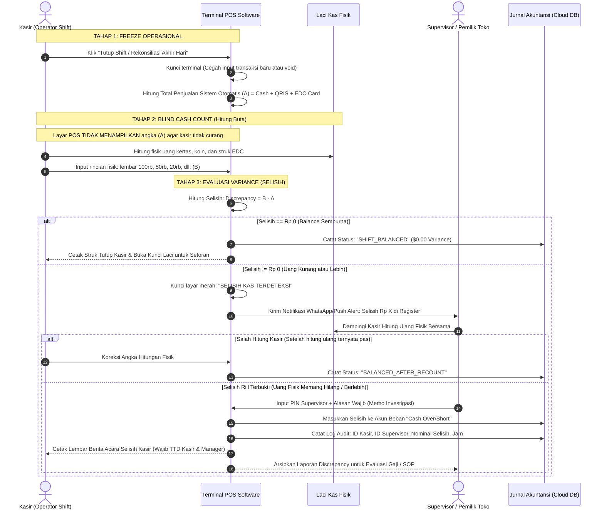

# End-of-Day POS Reconciliation, Blind Balancing & Anti-Theft Flow

> **Domain:** Brick-and-Mortar Retail, F&B, Supermarket, Franchise POS  
> **Core Mission:** Menghilangkan kebocoran uang kasir (*cash leakage*), mencegah manipulasi nota (*Void Fraud*), dan memangkas waktu tutup buku dari 2 jam menjadi 15 menit.

---

## 1. Masalah Nyata & Risiko Kecurangan di Lapangan

Di bisnis kasir nyata, kebocoran uang paling sering terjadi lewat **3 celah sistem**:
1. **Modus Void Fraud:** Kasir melayani pembeli tunai, uang diterima, tetapi setelah pembeli pergi, kasir membatalkan (*void*) transaksi di sistem dan mengantongi uangnya.
2. **Hitungan Terbuka (Open Count):** Kasir melihat angka penjualan di layar komputer terlebih dahulu, lalu mencocok-cocokkan uang fisik di laci agar terlihat pas.
3. **Selisih yang Disembunyikan:** Selisih kas ditutupi dengan uang tip pelanggan tanpa pernah tercatat di laporan keuangan resmi.

---

## 2. Diagram Alur Sistem: "Blind Count & Dual-PIN Audit"

Alur ini menerapkan prinsip perbankan modern: **Kasir sama sekali tidak boleh melihat total uang sistem sebelum menghitung uang fisik secara murni (*Blind Balancing*)**.

---

## 3. Checklist Aturan Sistem (Untuk Programmer & Tim Bisnis)

* [ ] **Aturan Blind Screen:** Sebelum kasir menekan tombol "Submit Hitungan Fisik", layar POS wajib disamarkan (*masked*). Tidak boleh ada angka target penjualan yang terlihat.
* [ ] **Aturan Anti-Void Pasca Tutup:** Tombol pembatalan (*void*) otomatis dinonaktifkan permanen saat proses rekonsiliasi kasir dimulai.
* [ ] **Pemisahan Akun Akuntansi:** Uang lebih (*cash overage*) tidak boleh dipakai menutup uang kurang (*cash shortage*). Keduanya harus masuk ke buku akun "Selisih Kas" secara transparan.

---

## 4. Dampak Operasional bagi Bisnis

* **Kebocoran Kas Turun Hingga 98%:** Kasir tidak bisa memanipulasi angka karena tidak tahu berapa angka riil yang sedang ditunggu oleh sistem komputer.
* **Audit Trail Jelas:** Pemilik toko yang tidak berada di lokasi langsung tahu detik itu juga jika ada selisih kas di toko cabang tanpa perlu menunggu laporan bulanan.
