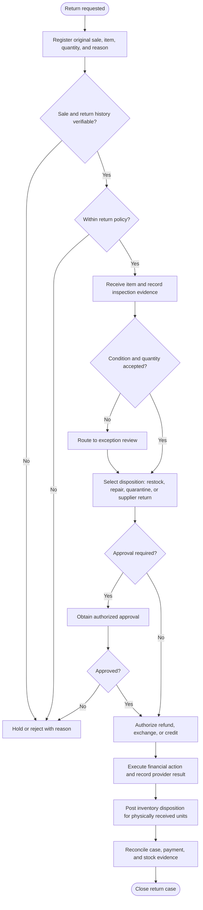
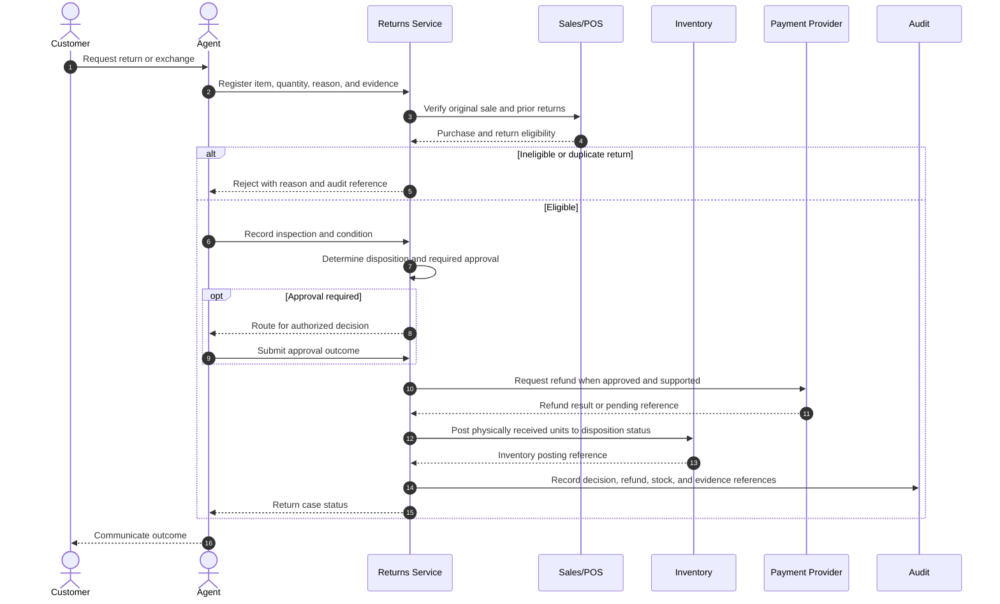
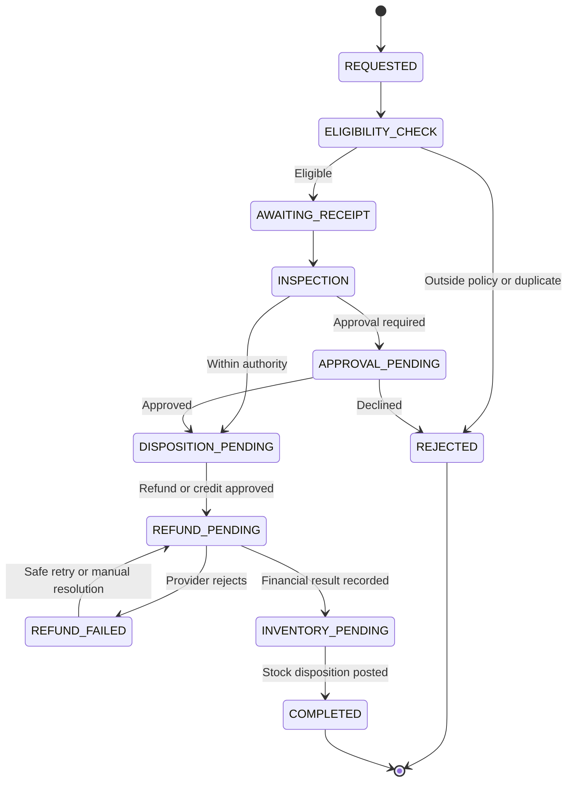

# Customer Returns, Inspection, and Refund Control

> **Domain:** Retail, e-commerce, consumer goods  
> **Document type:** To-Be reference workflow  
> **Status:** Reference design — validate with process owners before implementation  
> **Audience:** Business Analysts, Systems Analysts, product teams, and developers

## 1. Problem statement

Returns affect customer experience, inventory valuation, and cash. Weak controls can return the wrong item to saleable stock, issue duplicate refunds, or accept returns outside policy.

## 2. Objective and scope

**Objective:** Validate return eligibility, inspect returned goods, route inventory to the correct disposition, and reconcile the approved financial resolution.

**In scope**
- Operational lifecycle from initiation through resolution and recordkeeping.
- Business decisions, system responsibilities, exception handling, and audit evidence.
- Minimum data and acceptance criteria needed for implementation planning.

**Out of scope**
- Organization-specific legal, tax, accounting, labor, or contractual conclusions.
- Fixed thresholds, fees, SLA targets, or financial outcomes not validated by the organization.
- Vendor-specific API contracts unless documented by the selected provider.

## 3. Actors and systems

| Actor / system | Responsibility |
|---|---|
| Customer | Requests a return and supplies proof of purchase |
| Frontline staff | Registers request and checks eligibility |
| QC / supervisor | Inspects item and determines disposition |
| Inventory system | Tracks sellable, quarantine, and supplier-return stock |
| Payment provider / finance | Executes or records refund or store credit |

## 4. Trigger, preconditions, and postconditions

**Trigger:** A customer or authorized service agent submits a return, exchange, or refund request against an identifiable order item.

**Preconditions**
- The original order, payment, and item-level fulfillment record can be retrieved.
- The return window, eligible item conditions, exclusions, and refund method are configured as policy inputs.
- The requester and receiving location/agent are identified.
- Refund authority limits and inspection/disposition roles are defined.
- Payment-provider reversal or refund references can be recorded.

**Postconditions**
- Business object has an explicit final or pending status.
- Material decisions, external references, and exceptions are traceable.
- Related financial, inventory, customer, or access records are synchronized or visibly pending.

## 5. Business process view

This flow describes the human and organizational process, independent of a specific application architecture.

## 6. System interaction view

This logical sequence shows system responsibilities. Adapt participants and messages to the selected architecture and provider contract.

## 7. Business rules

| ID | Rule |
|---|---|
| BR-001 | Every return must reference an original sale or an explicitly authorized no-receipt exception. |
| BR-002 | Returned quantity cannot exceed eligible sold quantity less prior returns. |
| BR-003 | Inspection outcome and inventory disposition must be recorded separately from refund approval. |
| BR-004 | Quarantined or defective goods must not increase saleable available stock. |
| BR-005 | Refund amount cannot exceed the refundable balance of the original transaction. |
| BR-006 | Refund and exchange actions must be idempotent and linked to the return case. |
| BR-007 | Manual overrides require role authorization, reason, and audit evidence. |

Policy-dependent rules must be confirmed by the process owner and recorded with an effective date or version before implementation.

## 8. Data requirements

| Entity | Minimum fields |
|---|---|
| ReturnCase | return_id, original_order_id, customer_id, reason_code, status |
| ReturnLine | sku, quantity_requested, quantity_approved, serial_or_lot |
| Inspection | condition, inspector_id, inspected_at, evidence_refs, disposition |
| Refund | original_payment_id, amount, currency, provider_ref, status, idempotency_key |
| InventoryMovement | sku, from_location, to_location, quantity, movement_reason |
| Approval | approver_id, decision, reason, timestamp |

Use stable identifiers, explicit timestamps/time zones, currency and unit definitions where relevant, and versioned policy/rule references. Financial values must use integer minor units or fixed-precision decimal types, not binary floating-point arithmetic.

## 9. State model

The state names and transitions below describe the proposed lifecycle for this workflow. Confirm guards, role permissions, timeout transitions, and terminal-state behavior with the process owner and implementation team before production use.

## 10. Exceptions and recovery

| Scenario | Expected behavior and recovery |
|---|---|
| Original sale not found | Place case in MANUAL_REVIEW; do not issue automatic refund. |
| Serial or item identity mismatch | Quarantine case and request supervisor inspection. |
| Item damaged or missing components | Apply configured policy and record evidence; do not infer liability automatically. |
| Refund provider timeout | Query provider status before retrying; prevent duplicate refund. |
| Refund rejected | Keep case FINANCIAL_PENDING and route to finance. |
| Item received but inspection incomplete | Track in RECEIVED_PENDING_INSPECTION, not saleable inventory. |

Every retryable action should define idempotency, retry limits, backoff, timeout, and manual escalation. Never treat an unknown external result as success.

## 11. Authorization, privacy, and audit

- Enforce permissions on the server/service boundary; hiding a button is not authorization.
- Apply least privilege and separation of duties for sensitive approvals, financial actions, inventory adjustments, or account changes.
- Record actor/service identity, timestamp, object ID, action, prior and new state, reason, correlation ID, and external reference where applicable.
- Protect personal and commercially sensitive data through purpose limitation, access control, retention, and secure evidence storage.
- Preserve history through append-only events or controlled reversals; do not silently overwrite material decisions.

## 12. Acceptance criteria

- **AC-01:** Given a return has no eligible original sale, when submitted, then automatic refund is blocked and a review case is created.
- **AC-02:** Given an item is classified defective, when disposition is confirmed, then it is moved to quarantine and excluded from saleable availability.
- **AC-03:** Given a refund request times out, when retried, then provider status is checked and duplicate refund is prevented.
- **AC-04:** Given a return exceeds refundable quantity, when submitted, then validation rejects the excess.
- **AC-05:** Given a manual return override is requested, when the requester lacks the required role or evidence, then the override is blocked and audited.

## 13. Operational metrics

- Return rate by SKU and reason
- Time from request to resolution
- Refund failure and duplicate-prevention incidents
- Percentage of returned items correctly dispositioned
- Repeat return patterns requiring policy review

- **Return rate:** returned units ÷ sold units for the same cohort and period; source: sales and return lines.
- **Refund cycle time:** refund-confirmed timestamp minus approved-refund timestamp; report median and P90.
- **Inspection disposition mix:** units by restock, repair, quarantine, supplier claim, or write-off ÷ inspected units.
- Review weekly; segment by SKU, reason code, channel, and location.

Assign a named metric owner, reporting window, and baseline before setting a target. These are measurement definitions, not promised improvements.

## 14. Assumptions and open decisions

- Return windows, warranty rules, restocking fees, refund methods, and tax treatment vary by merchant and jurisdiction.
- Evidence requirements should be proportionate to product value and risk.
- Confirm role names, authority limits, thresholds, timeouts, retention, and escalation ownership with stakeholders.
- Record unresolved decisions explicitly; do not silently convert assumptions into requirements.

## 15. Traceability

| Business rule | Acceptance criterion | Verification focus |
|---|---|---|
| BR-001 | AC-01 | Requirement and test coverage for the rule |
| BR-002 | AC-04 | Requirement and test coverage for the rule |
| BR-003 | AC-02 | Requirement and test coverage for the rule |
| BR-004 | AC-02 | Requirement and test coverage for the rule |
| BR-005 | AC-04 | Requirement and test coverage for the rule |
| BR-006 | AC-03 | Requirement and test coverage for the rule |
| BR-007 | AC-05 | Requirement and test coverage for the rule |

---

**Validation note:** This is a reusable reference pattern, not an approved policy for every organization. Confirm assumptions and provider-specific behavior before implementation.
