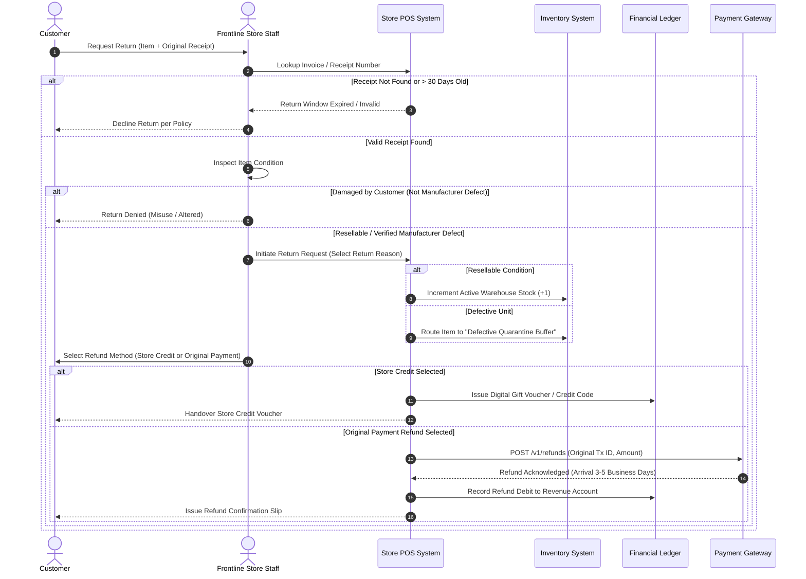

# Customer Return, Defect Inspection, and Refund Flow

> **Domain:** Retail, E-Commerce, Consumer Electronics  
> **Key Objective:** Manage customer return requests, inspect item condition, adjust inventory, and issue proper financial refunds or store credits.

---

## 1. Process Sequence Flow

