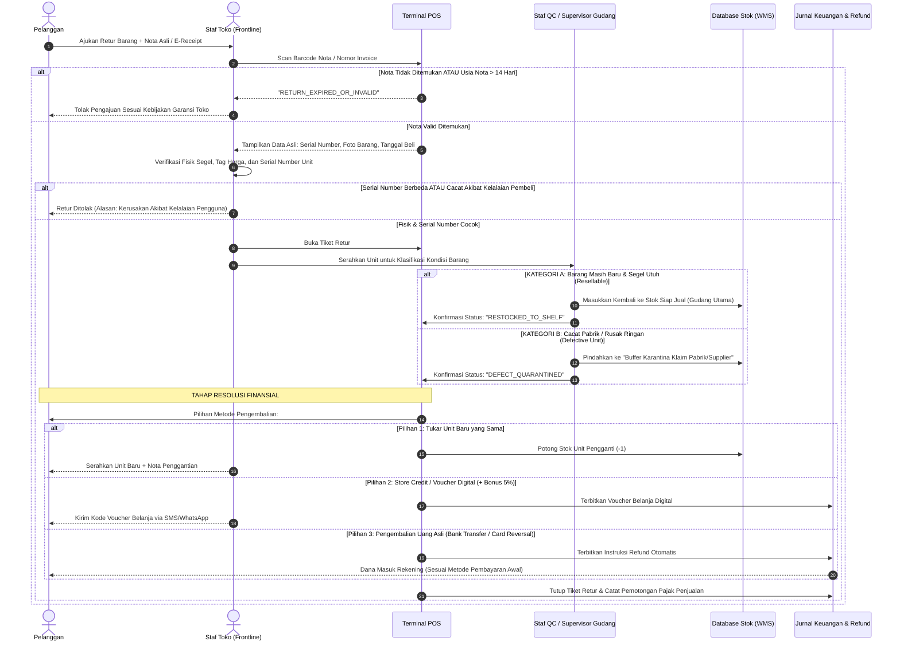

# Customer Return, Defect Quarantine & Anti-Return Fraud Flow

> **Domain:** Retail, E-Commerce, Consumer Electronics, Fashion  
> **Core Mission:** Menghilangkan kejahatan retur barang palsu/rusak (*Return Fraud*), membedakan karantina barang cacat pabrik vs barang layak jual, dan menjaga keakuratan stok akuntansi.

---

## 1. Masalah Nyata & Risiko Kerugian di Lapangan

Retur barang adalah lubang hitam kebocoran biaya bagi bisnis ritel:
1. **Wardrobing / Pemakaian Sepintas:** Pelanggan membeli baju/elektronik untuk dipakai di satu pesta/acara, lalu mereturnya ke toko pura-pura tidak suka.
2. **Switching Fraud (Tukar Barang):** Pelanggan membeli barang baru original, tetapi mengembalikan barang lama mereka yang sudah rusak dengan kotak barang baru.
3. **Ghost Return (Retur Hantu):** Kasir nakal membuat retur palsu di komputer seolah-olah ada pelanggan yang meretur barang, lalu kasir mengambil uang tunai pengembalian dari laci kasir.

---

## 2. Diagram Alur Sistem: "3-Way Inspection & Quarantine Protocol"

---

## 3. Checklist Aturan Sistem (Untuk Tim Programmer & Bisnis)

* [ ] **Aturan Anti Ghost Return:** Setiap transaksi retur wajib mencantumkan Nomor Seri Produk (*Serial Number*) dan Foto Bukti Fisik Barang yang diunggah kasir ke sistem.
* [ ] **Pemisahan Lokasi Gudang:** Barang retur yang cacat pabrik **dilarang keras** langsung menambah stok jual di kasir. Sistem harus otomatis memasukkannya ke ID Gudang Karantina agar tidak terambil oleh kasir lain untuk dijual ke pembeli berikutnya.
* [ ] **Incentive Store Credit:** Tawarkan opsi *Store Credit* (Voucher Belanja) dengan tambahan bonus 5% daripada pengembalian uang tunai, agar uang tetap berputar di dalam bisnis Anda.

---

## 4. Dampak Operasional bagi Bisnis

* **Mencegah Kerugian Barang Rusak:** Toko tidak akan pernah salah menjual barang cacat bekas returan ke pelanggan baru yang bisa merusak nama baik merek.
* **Mencegah Kasir "Mencuri Lewat Retur Palsu":** Karena setiap retur membutuhkan pencocokan nomor invoice lama dan fisik serial number barang.
