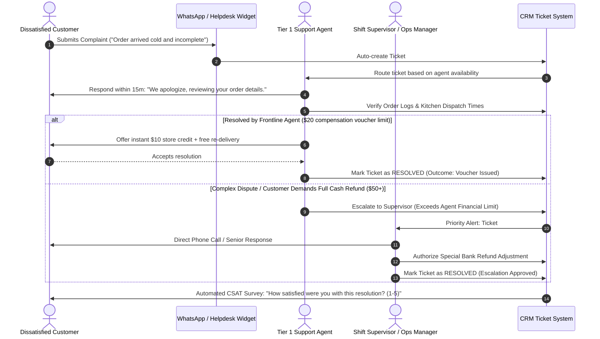

# Customer Complaint & Support Ticket Escalation Flow

> **Domain:** Customer Service, Helpdesk, After-Sales Support  
> **Key Objective:** Ensure timely complaint resolution, enforce SLA response times, and prevent unresolved escalations.

---

## 1. Process Sequence Flow

