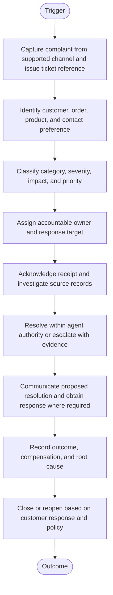
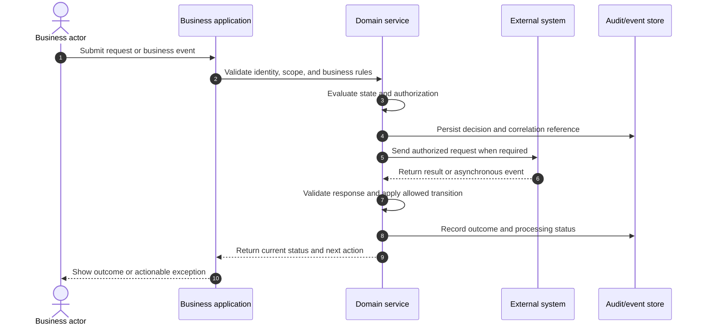
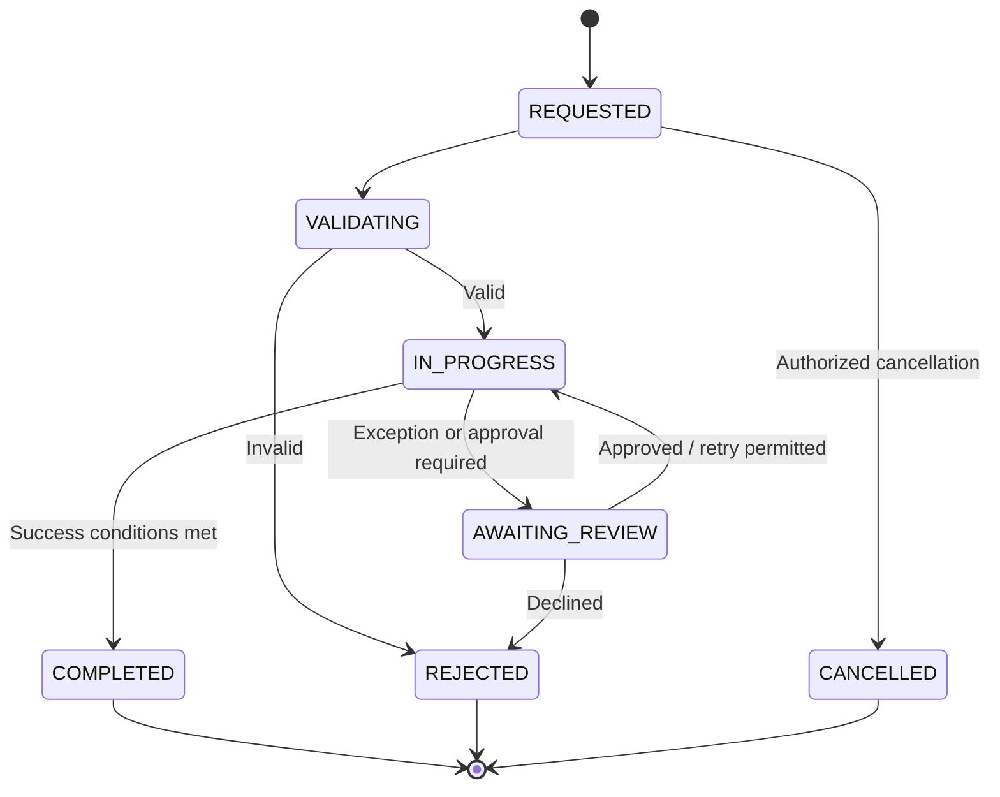

# Customer Complaint and Support Ticket Resolution

> **Domain:** Customer service, helpdesk, after-sales support  
> **Document type:** To-Be reference workflow  
> **Status:** Reference design — validate with process owners before implementation  
> **Audience:** Business Analysts, Systems Analysts, product teams, and developers

## 1. Problem statement

Complaints can be lost across channels, assigned without ownership, or closed before the customer confirms an acceptable resolution. SLA promises are unreliable without pause and escalation rules.

## 2. Objective and scope

**Objective:** Create a traceable complaint lifecycle with classification, ownership, response targets, evidence, escalation, and customer-confirmed closure.

**In scope**
- Operational lifecycle from initiation through resolution and recordkeeping.
- Business decisions, system responsibilities, exception handling, and audit evidence.
- Minimum data and acceptance criteria needed for implementation planning.

**Out of scope**
- Organization-specific legal, tax, accounting, labor, or contractual conclusions.
- Fixed thresholds, fees, SLA targets, or financial outcomes not validated by the organization.
- Vendor-specific API contracts unless documented by the selected provider.

## 3. Actors and systems

| Actor / system | Responsibility |
|---|---|
| Customer | Submits complaint and confirms outcome |
| Support agent | Registers, investigates, and resolves within authority |
| Team lead | Reassigns and approves escalations |
| Specialist team | Investigates technical, logistics, or financial issues |
| Ticket platform | Tracks status, SLA clocks, and communications |

## 4. Trigger, preconditions, and postconditions

**Trigger:** A valid business event or authorized user action initiates the workflow.

**Preconditions**
- Initiating actor or service is authenticated.
- Required master data, policy versions, and reference records are available.
- Requested object is in a state that permits the operation.
- Required permissions and segregation-of-duty controls are configured.

**Postconditions**
- Business object has an explicit final or pending status.
- Material decisions, external references, and exceptions are traceable.
- Related financial, inventory, customer, or access records are synchronized or visibly pending.

## 5. Business process view

This flow describes the human and organizational process, independent of a specific application architecture.

## 6. System interaction view

This logical sequence shows system responsibilities. Adapt participants and messages to the selected architecture and provider contract.

## 7. Business rules

| ID | Rule |
|---|---|
| BR-001 | Every complaint must have one ticket ID and an accountable owner. |
| BR-002 | Severity and priority definitions must be documented and configurable. |
| BR-003 | SLA clocks define business hours, holidays, pause conditions, first-response and resolution targets. |
| BR-004 | Compensation and refund authority must be role-based and amount-limited. |
| BR-005 | Escalation preserves investigation history and transfers ownership explicitly. |
| BR-006 | Ticket closure requires a resolution code and customer communication record. |
| BR-007 | A customer reply within the reopen window must reopen or create a linked follow-up. |
| BR-008 | Sensitive attachments must be access-controlled and retained according to policy. |

Policy-dependent rules must be confirmed by the process owner and recorded with an effective date or version before implementation.

## 8. Data requirements

| Entity | Minimum fields |
|---|---|
| Ticket | ticket_id, customer_id, channel, category, severity, priority, status |
| Assignment | ticket_id, owner_id, assigned_at, due_at, team |
| SLAClock | ticket_id, clock_type, started_at, paused_duration, breached_at |
| Interaction | ticket_id, channel, direction, timestamp, content_reference |
| Resolution | ticket_id, code, root_cause, compensation_ref, closed_at |
| Approval | ticket_id, approver_id, decision, authority_limit, reason |

Use stable identifiers, explicit timestamps/time zones, currency and unit definitions where relevant, and versioned policy/rule references. Financial values must use integer minor units or fixed-precision decimal types, not binary floating-point arithmetic.

## 9. State model

The following is a lifecycle scaffold. Rename, add, or remove states to reflect the domain and define permitted transitions in the implementation specification.

## 10. Exceptions and recovery

| Scenario | Expected behavior and recovery |
|---|---|
| Customer identity cannot be verified | Limit disclosure and route to secure verification. |
| SLA at risk | Notify owner and lead before breach; record escalation event. |
| Issue depends on another team | Create linked task with owner and due date; retain ticket accountability. |
| Compensation exceeds agent authority | Require supervisor approval before promise or issuance. |
| Customer disputes closure | Reopen or escalate without deleting prior resolution. |
| Channel integration unavailable | Queue inbound message safely and expose delayed ingestion status. |

Every retryable action should define idempotency, retry limits, backoff, timeout, and manual escalation. Never treat an unknown external result as success.

## 11. Authorization, privacy, and audit

- Enforce permissions on the server/service boundary; hiding a button is not authorization.
- Apply least privilege and separation of duties for sensitive approvals, financial actions, inventory adjustments, or account changes.
- Record actor/service identity, timestamp, object ID, action, prior and new state, reason, correlation ID, and external reference where applicable.
- Protect personal and commercially sensitive data through purpose limitation, access control, retention, and secure evidence storage.
- Preserve history through append-only events or controlled reversals; do not silently overwrite material decisions.

## 12. Acceptance criteria

- **AC-01:** Given a complaint is received, when ticket creation succeeds, then a unique ID and accountable owner are assigned.
- **AC-02:** Given an SLA approaches breach, when the warning threshold is reached, then the owner and escalation role are notified.
- **AC-03:** Given compensation exceeds agent authority, when submitted, then issuance is blocked pending approval.
- **AC-04:** Given a customer disputes a closed ticket within the reopen window, when the reply is ingested, then the ticket reopens or a linked follow-up is created.

## 13. Operational metrics

- First response and resolution time by severity
- SLA attainment and breach reasons
- Reopen rate
- Customer satisfaction by resolution type
- Recurring root causes by product/channel

Define numerator, denominator, source system, measurement window, owner, and baseline before setting targets. Metrics are measurement proposals, not promised improvements.

## 14. Assumptions and open decisions

- SLA targets, priority matrix, service hours, compensation limits, and reopen windows are organization-defined.
- Customer confirmation may not be practical for every case; define documented exception closure criteria.
- Confirm role names, authority limits, thresholds, timeouts, retention, and escalation ownership with stakeholders.
- Record unresolved decisions explicitly; do not silently convert assumptions into requirements.

## 15. Traceability

| Rule group | Acceptance criteria | Implementation evidence |
|---|---|---|
| BR-001 to BR-008 | AC-01 to AC-04 | Unit/integration tests, audit events, and process-owner sign-off |

---

**Validation note:** This is a reusable reference pattern, not an approved policy for every organization. Confirm assumptions and provider-specific behavior before implementation.
