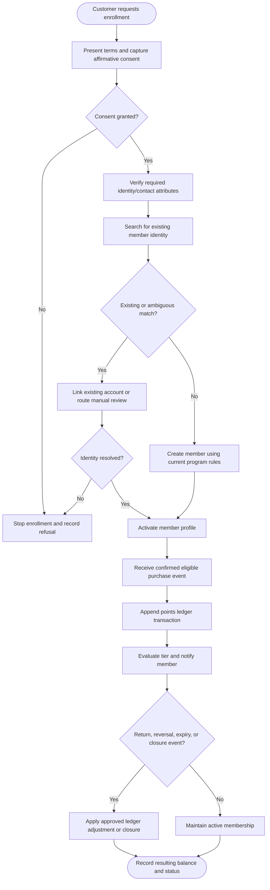
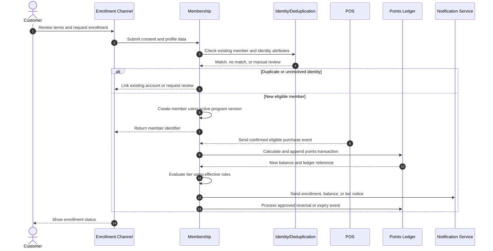
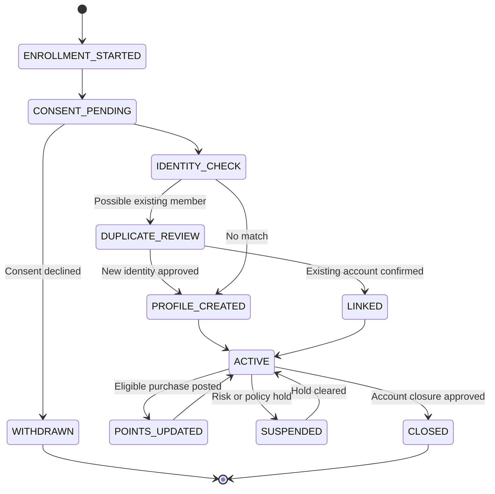

# Customer Loyalty Enrollment and Tier Management

> **Domain:** Customer loyalty, retail rewards, hospitality  
> **Document type:** To-Be reference workflow  
> **Status:** Reference design — validate with process owners before implementation  
> **Audience:** Business Analysts, Systems Analysts, product teams, and developers

## 1. Problem statement

Loyalty enrollment and reward balances become inconsistent when identity matching, consent, point accrual, reversals, and tier qualification are not controlled.

## 2. Objective and scope

**Objective:** Create a transparent membership lifecycle with verified enrollment, auditable point movements, and reproducible tier evaluation.

**In scope**
- Operational lifecycle from initiation through resolution and recordkeeping.
- Business decisions, system responsibilities, exception handling, and audit evidence.
- Minimum data and acceptance criteria needed for implementation planning.

**Out of scope**
- Organization-specific legal, tax, accounting, labor, or contractual conclusions.
- Fixed thresholds, fees, SLA targets, or financial outcomes not validated by the organization.
- Vendor-specific API contracts unless documented by the selected provider.

## 3. Actors and systems

| Actor / system | Responsibility |
|---|---|
| Customer | Provides enrollment details and consent |
| Frontline staff | Explains program and supports enrollment |
| Loyalty service | Creates member identity and calculates rewards |
| POS / commerce | Sends eligible purchase and return events |
| Program manager | Maintains reward and tier policy |

## 4. Trigger, preconditions, and postconditions

**Trigger:** A prospective customer submits a registration/enrollment request or accepts an authorized invitation.

**Preconditions**
- Required identity and contact fields, consent text, and terms version are available.
- Duplicate detection keys and manual-review rules are defined.
- Signup, invitation, and tenant/account eligibility policies are configured.
- Verification channels and expiry rules are available.
- Default role and access scope follow least-privilege policy.

**Postconditions**
- Business object has an explicit final or pending status.
- Material decisions, external references, and exceptions are traceable.
- Related financial, inventory, customer, or access records are synchronized or visibly pending.

## 5. Business process view

This flow describes the human and organizational process, independent of a specific application architecture.

## 6. System interaction view

This logical sequence shows system responsibilities. Adapt participants and messages to the selected architecture and provider contract.

## 7. Business rules

| ID | Rule |
|---|---|
| BR-001 | Enrollment requires recorded consent to program terms and relevant communications. |
| BR-002 | Identity matching must avoid duplicate profiles based only on an unverified shared attribute. |
| BR-003 | Points are earned only on eligible net spend according to a versioned rule set. |
| BR-004 | Refunds and reversals create compensating ledger entries; historical point events are not overwritten. |
| BR-005 | Tier qualification uses a defined measurement period, qualifying spend, and effective date. |
| BR-006 | Benefits are checked at redemption against member status, exclusions, and expiry. |
| BR-007 | Staff cannot manually edit balances without an authorized reason and audit record. |

Policy-dependent rules must be confirmed by the process owner and recorded with an effective date or version before implementation.

## 8. Data requirements

| Entity | Minimum fields |
|---|---|
| Member | member_id, verified_contact, enrollment_at, consent_version, status |
| PointLedger | entry_id, member_id, source_transaction, points_delta, rule_version, expires_at |
| TierHistory | member_id, tier, effective_from, effective_to, qualification_period |
| RewardRule | rule_version, eligible_spend_basis, earn_rate, exclusions |
| BenefitRedemption | member_id, benefit_id, transaction_id, status |
| ConsentRecord | member_id, purpose, channel, status, captured_at, policy_version |

Use stable identifiers, explicit timestamps/time zones, currency and unit definitions where relevant, and versioned policy/rule references. Financial values must use integer minor units or fixed-precision decimal types, not binary floating-point arithmetic.

## 9. State model

The state names and transitions below describe the proposed lifecycle for this workflow. Confirm guards, role permissions, timeout transitions, and terminal-state behavior with the process owner and implementation team before production use.

## 10. Exceptions and recovery

| Scenario | Expected behavior and recovery |
|---|---|
| Possible duplicate member | Route to identity review; do not merge automatically without matching policy. |
| Purchase event received twice | Deduplicate by source transaction and event ID. |
| Purchase later refunded | Post a reversing points entry linked to original earning event. |
| Tier calculation job fails | Retain previous tier and retry with same period and rule version. |
| Customer withdraws consent | Apply program closure and communication suppression policy. |
| Manual point adjustment requested | Require reason, evidence, and approval based on configured limits. |

Every retryable action should define idempotency, retry limits, backoff, timeout, and manual escalation. Never treat an unknown external result as success.

## 11. Authorization, privacy, and audit

- Enforce permissions on the server/service boundary; hiding a button is not authorization.
- Apply least privilege and separation of duties for sensitive approvals, financial actions, inventory adjustments, or account changes.
- Record actor/service identity, timestamp, object ID, action, prior and new state, reason, correlation ID, and external reference where applicable.
- Protect personal and commercially sensitive data through purpose limitation, access control, retention, and secure evidence storage.
- Preserve history through append-only events or controlled reversals; do not silently overwrite material decisions.

## 12. Acceptance criteria

- **AC-01:** Given an existing member match is found, when enrollment is attempted, then duplicate account creation is prevented or routed to review.
- **AC-02:** Given the same purchase event is received twice, when points are calculated, then only one earning entry exists.
- **AC-03:** Given an eligible purchase is refunded, when the refund event is processed, then a linked compensating points entry is posted.
- **AC-04:** Given a tier rule changes, when a member is evaluated, then the applicable rule version and period are recorded.

## 13. Operational metrics

- Enrollment completion and duplicate profile rate
- Active member rate by cohort
- Point liability and expiry
- Tier upgrade/downgrade counts
- Reward redemption and reversal rates

Define numerator, denominator, source system, measurement window, owner, and baseline before setting targets. Metrics are measurement proposals, not promised improvements.

## 14. Assumptions and open decisions

- Point rates, tier thresholds, expiry, and benefit terms are merchant-specific and must be versioned.
- Identity verification strength depends on reward value and privacy requirements.
- Confirm role names, authority limits, thresholds, timeouts, retention, and escalation ownership with stakeholders.
- Record unresolved decisions explicitly; do not silently convert assumptions into requirements.

## 15. Traceability

| Rule group | Acceptance criteria | Implementation evidence |
|---|---|---|
| BR-001 to BR-007 | AC-01 to AC-04 | Unit/integration tests, audit events, and process-owner sign-off |

---

**Validation note:** This is a reusable reference pattern, not an approved policy for every organization. Confirm assumptions and provider-specific behavior before implementation.
