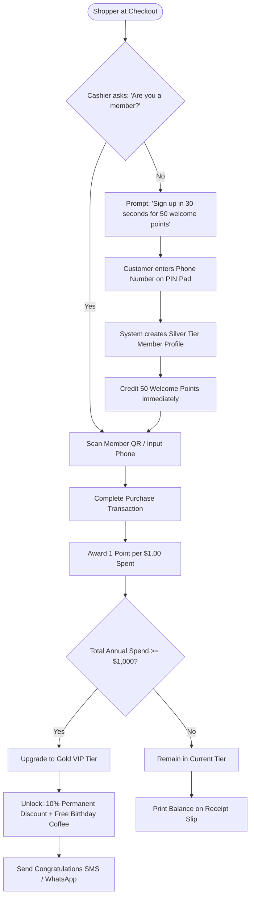

# Customer Loyalty Onboarding & Point Tier Upgrade Flow

> **Domain:** Customer Loyalty, Retail Rewards, Hospitality  
> **Key Objective:** Smoothly onboard new shoppers into the rewards program, track spending tiers, and trigger automated tier upgrades.

---

## 1. Process Flowchart

