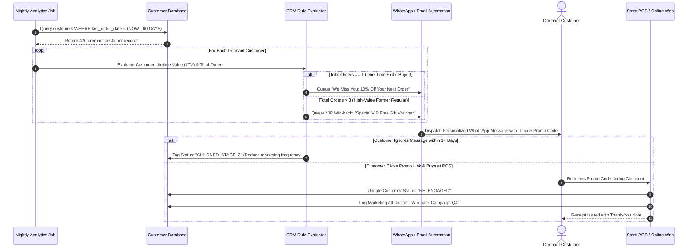
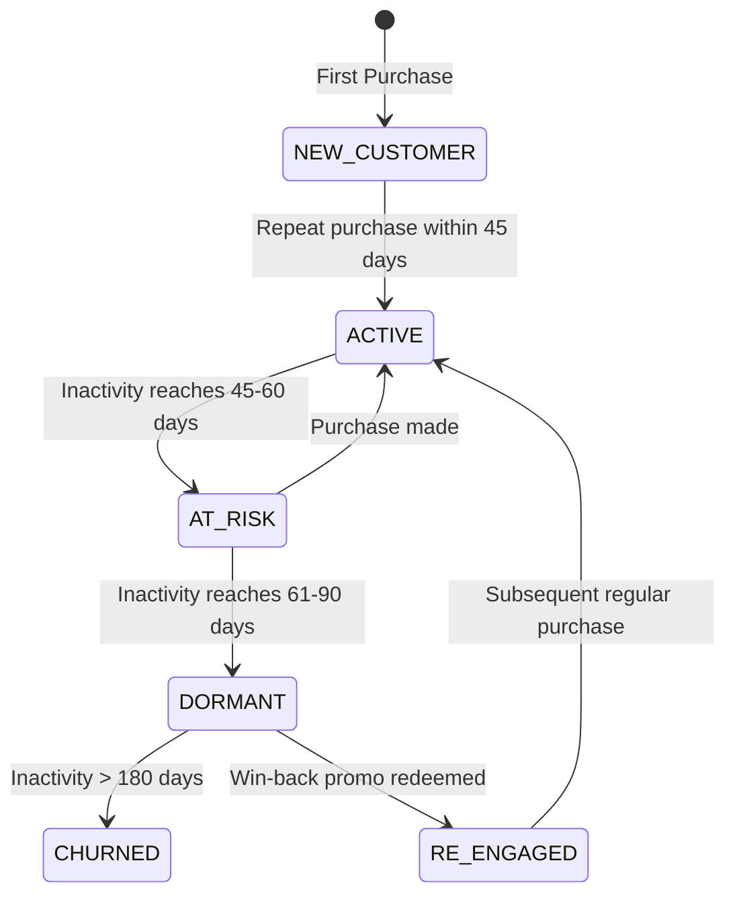

# Dormant Customer Detection & Re-Activation Workflow

> **Domain:** Customer Relationship Management (CRM), Retail Marketing, Direct-to-Consumer (D2C)  
> **Key Objective:** Automatically flag customers with prolonged inactivity and trigger personalized win-back offers before permanent churn.

---

## 1. Process Sequence Flow

---

## 2. Customer Health State Transitions

