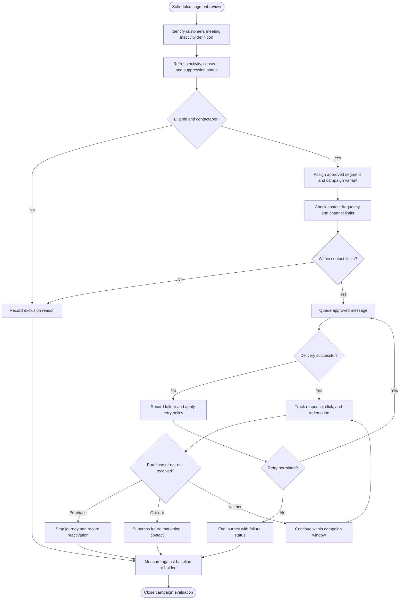
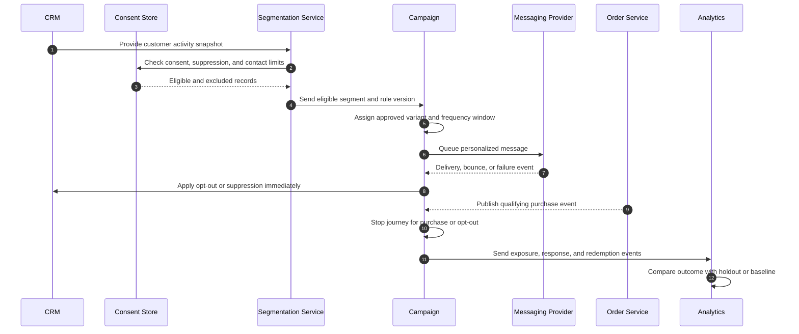
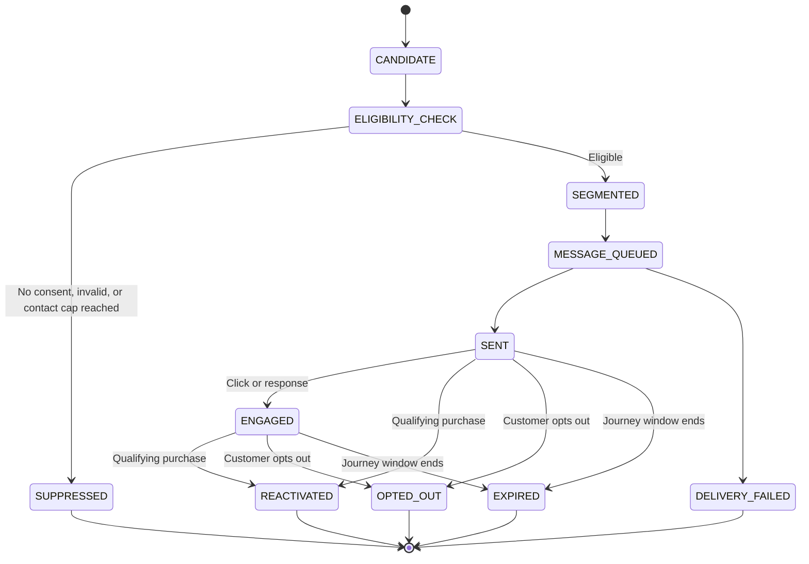

# Dormant Customer Identification and Reactivation

> **Domain:** CRM, lifecycle marketing, customer success  
> **Document type:** To-Be reference workflow  
> **Status:** Reference design — validate with process owners before implementation  
> **Audience:** Business Analysts, Systems Analysts, product teams, and developers

## 1. Problem statement

Customer inactivity is detected inconsistently, while campaigns may contact people who opted out, have already returned, or are not eligible for a promotion.

## 2. Objective and scope

**Objective:** Identify eligible inactive customers, orchestrate a controlled reactivation journey, and measure attributable engagement without violating consent or contact policy.

**In scope**
- Operational lifecycle from initiation through resolution and recordkeeping.
- Business decisions, system responsibilities, exception handling, and audit evidence.
- Minimum data and acceptance criteria needed for implementation planning.

**Out of scope**
- Organization-specific legal, tax, accounting, labor, or contractual conclusions.
- Fixed thresholds, fees, SLA targets, or financial outcomes not validated by the organization.
- Vendor-specific API contracts unless documented by the selected provider.

## 3. Actors and systems

| Actor / system | Responsibility |
|---|---|
| CRM analytics | Calculates inactivity segments from customer activity |
| Marketing operator | Defines campaign and offer eligibility |
| Messaging provider | Delivers approved communication |
| Customer | Receives or opts out of communication |
| Commerce platform | Records purchases and redemption |

## 4. Trigger, preconditions, and postconditions

**Trigger:** A valid business event or authorized user action initiates the workflow.

**Preconditions**
- Initiating actor or service is authenticated.
- Required master data, policy versions, and reference records are available.
- Requested object is in a state that permits the operation.
- Required permissions and segregation-of-duty controls are configured.

**Postconditions**
- Business object has an explicit final or pending status.
- Material decisions, external references, and exceptions are traceable.
- Related financial, inventory, customer, or access records are synchronized or visibly pending.

## 5. Business process view

This flow describes the human and organizational process, independent of a specific application architecture.

## 6. System interaction view

This logical sequence shows system responsibilities. Adapt participants and messages to the selected architecture and provider contract.

## 7. Business rules

| ID | Rule |
|---|---|
| BR-001 | Inactivity thresholds must be configurable by business model and purchase frequency. |
| BR-002 | Consent, suppression lists, and channel preferences must be checked before every send. |
| BR-003 | A customer must not receive duplicate messages for the same campaign step. |
| BR-004 | Offer eligibility, expiry, stacking, and redemption limits must be validated at redemption. |
| BR-005 | A purchase or opt-out event must stop pending messages within the defined processing SLA. |
| BR-006 | Campaign attribution must distinguish delivered, clicked, redeemed, and incremental outcomes. |
| BR-007 | Sensitive customer attributes must not be inferred without an approved basis. |

Policy-dependent rules must be confirmed by the process owner and recorded with an effective date or version before implementation.

## 8. Data requirements

| Entity | Minimum fields |
|---|---|
| CustomerProfile | customer_id, last_activity_at, lifecycle_segment, consent_state, channel_preferences |
| Campaign | campaign_id, segment_rule_version, offer_id, frequency_cap, start_end |
| JourneyEnrollment | customer_id, campaign_id, step, status, next_action_at |
| MessageEvent | provider_message_id, channel, status, delivered_at, failure_code |
| OfferRedemption | token_id, customer_id, order_id, redeemed_at, discount_amount |
| Suppression | customer_id, channel, reason, effective_at, source |

Use stable identifiers, explicit timestamps/time zones, currency and unit definitions where relevant, and versioned policy/rule references. Financial values must use integer minor units or fixed-precision decimal types, not binary floating-point arithmetic.

## 9. State model

The following is a lifecycle scaffold. Rename, add, or remove states to reflect the domain and define permitted transitions in the implementation specification.

## 10. Exceptions and recovery

| Scenario | Expected behavior and recovery |
|---|---|
| Customer has opted out | Suppress immediately and record suppression source. |
| Customer purchases before send | Cancel queued win-back messages and mark journey converted organically. |
| Message provider rejects delivery | Record failure and follow channel fallback policy without uncontrolled retries. |
| Offer token reused or expired | Reject redemption and preserve audit event. |
| Customer data incomplete | Exclude from personalization or use an approved generic message. |
| Consent status unavailable | Fail closed for promotional messaging until status is confirmed. |

Every retryable action should define idempotency, retry limits, backoff, timeout, and manual escalation. Never treat an unknown external result as success.

## 11. Authorization, privacy, and audit

- Enforce permissions on the server/service boundary; hiding a button is not authorization.
- Apply least privilege and separation of duties for sensitive approvals, financial actions, inventory adjustments, or account changes.
- Record actor/service identity, timestamp, object ID, action, prior and new state, reason, correlation ID, and external reference where applicable.
- Protect personal and commercially sensitive data through purpose limitation, access control, retention, and secure evidence storage.
- Preserve history through append-only events or controlled reversals; do not silently overwrite material decisions.

## 12. Acceptance criteria

- **AC-01:** Given a customer opted out, when the audience is generated, then the customer is excluded.
- **AC-02:** Given a customer purchases before a queued message is sent, when the event is processed, then the pending message is cancelled.
- **AC-03:** Given a journey step is retried, when submitted twice, then only one logical message is created.
- **AC-04:** Given an offer token is expired or already redeemed, when checkout validates it, then redemption is rejected.

## 13. Operational metrics

- Eligible audience size and suppression rate
- Delivery, click, redemption, and opt-out rates
- Reactivation rate by cohort
- Incremental revenue versus holdout or baseline
- Campaign cost per incremental reactivated customer

Define numerator, denominator, source system, measurement window, owner, and baseline before setting targets. Metrics are measurement proposals, not promised improvements.

## 14. Assumptions and open decisions

- Inactivity windows and offers must be defined from customer purchase cadence and unit economics.
- Consent and marketing rules must be reviewed for operating jurisdictions and channels.
- Confirm role names, authority limits, thresholds, timeouts, retention, and escalation ownership with stakeholders.
- Record unresolved decisions explicitly; do not silently convert assumptions into requirements.

## 15. Traceability

| Rule group | Acceptance criteria | Implementation evidence |
|---|---|---|
| BR-001 to BR-007 | AC-01 to AC-04 | Unit/integration tests, audit events, and process-owner sign-off |

---

**Validation note:** This is a reusable reference pattern, not an approved policy for every organization. Confirm assumptions and provider-specific behavior before implementation.
