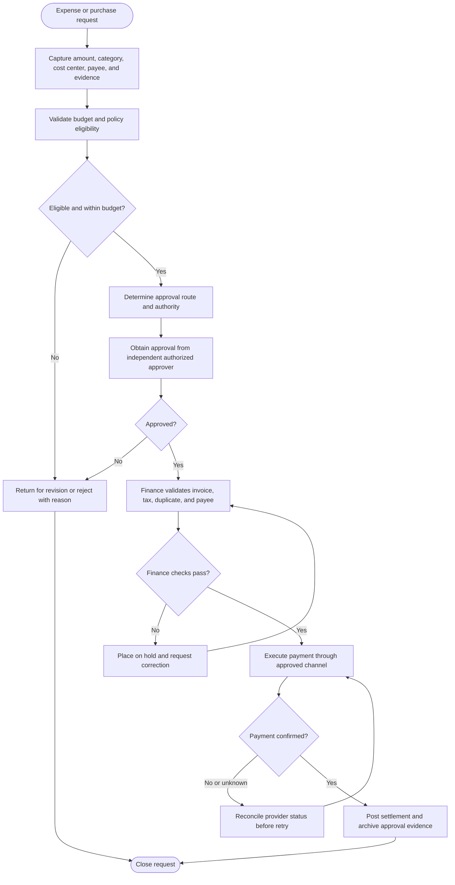
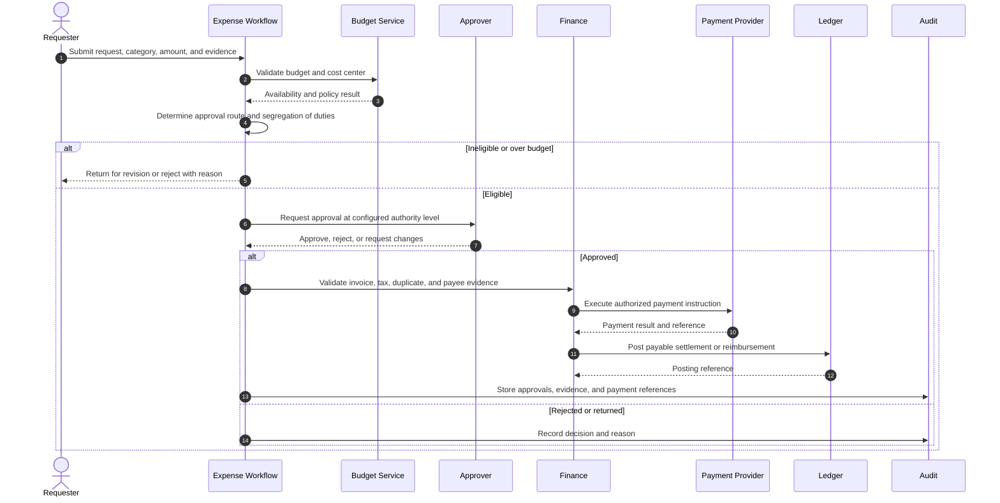
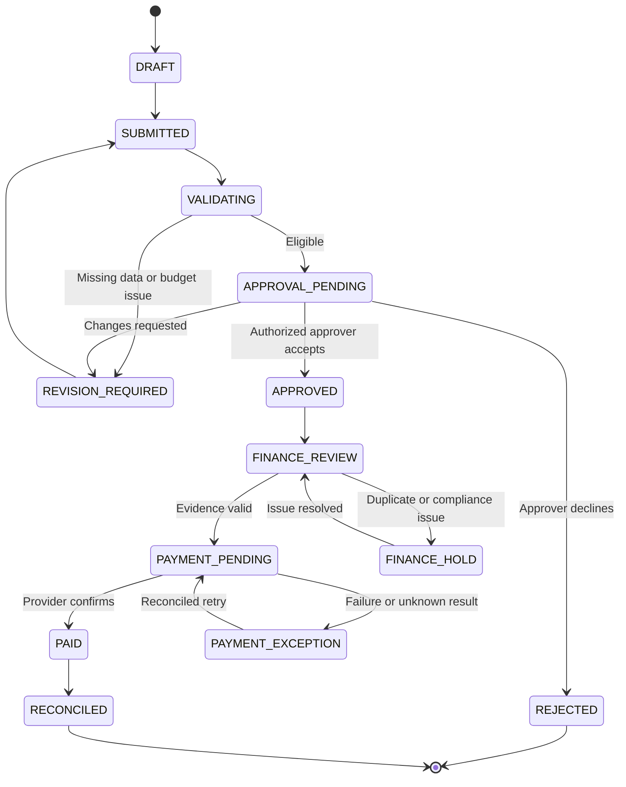

# Business Expense Request and Approval

> **Domain:** Finance operations, procurement, ERP  
> **Document type:** To-Be reference workflow  
> **Status:** Reference design — validate with process owners before implementation  
> **Audience:** Business Analysts, Systems Analysts, product teams, and developers

## 1. Problem statement

Expense requests can bypass budget ownership, split purchases to avoid approval limits, or be reimbursed without sufficient evidence and duplicate checks.

## 2. Objective and scope

**Objective:** Route expense commitments and reimbursements through documented authority, budget, evidence, and payment controls.

**In scope**
- Operational lifecycle from initiation through resolution and recordkeeping.
- Business decisions, system responsibilities, exception handling, and audit evidence.
- Minimum data and acceptance criteria needed for implementation planning.

**Out of scope**
- Organization-specific legal, tax, accounting, labor, or contractual conclusions.
- Fixed thresholds, fees, SLA targets, or financial outcomes not validated by the organization.
- Vendor-specific API contracts unless documented by the selected provider.

## 3. Actors and systems

| Actor / system | Responsibility |
|---|---|
| Requester | Submits purpose, amount, supplier, and evidence |
| Budget owner | Confirms business need and budget availability |
| Approver | Approves within delegated authority |
| Finance reviewer | Checks policy, tax evidence, and duplicate claims |
| Accounts payable | Schedules and records payment |

## 4. Trigger, preconditions, and postconditions

**Trigger:** A valid business event or authorized user action initiates the workflow.

**Preconditions**
- Initiating actor or service is authenticated.
- Required master data, policy versions, and reference records are available.
- Requested object is in a state that permits the operation.
- Required permissions and segregation-of-duty controls are configured.

**Postconditions**
- Business object has an explicit final or pending status.
- Material decisions, external references, and exceptions are traceable.
- Related financial, inventory, customer, or access records are synchronized or visibly pending.

## 5. Business process view

This flow describes the human and organizational process, independent of a specific application architecture.

## 6. System interaction view

This logical sequence shows system responsibilities. Adapt participants and messages to the selected architecture and provider contract.

## 7. Business rules

| ID | Rule |
|---|---|
| BR-001 | Approval thresholds and roles come from a version-controlled delegation-of-authority matrix. |
| BR-002 | Requesters cannot approve their own expense or reimbursement. |
| BR-003 | Related transactions are evaluated for split-purchase avoidance. |
| BR-004 | Budget availability is checked at the correct cost center and period. |
| BR-005 | Receipts, invoices, and business purpose are mandatory according to category and policy. |
| BR-006 | Duplicate detection considers supplier, invoice number, amount, date, and currency. |
| BR-007 | Material changes to amount, supplier, or cost center after approval require reapproval. |
| BR-008 | Payment release and accounting posting are traceable to the approved request. |

Policy-dependent rules must be confirmed by the process owner and recorded with an effective date or version before implementation.

## 8. Data requirements

| Entity | Minimum fields |
|---|---|
| ExpenseRequest | request_id, requester_id, category, amount, currency, cost_center, purpose |
| BudgetCheck | period, cost_center, available_amount, checked_at |
| Approval | request_id, approver_id, authority_version, decision, reason |
| Evidence | document_ref, supplier, invoice_no, invoice_date, amount, hash |
| Payable | payable_id, request_id, due_date, payment_status |
| Payment | payment_ref, amount, paid_at, bank_reference, status |

Use stable identifiers, explicit timestamps/time zones, currency and unit definitions where relevant, and versioned policy/rule references. Financial values must use integer minor units or fixed-precision decimal types, not binary floating-point arithmetic.

## 9. State model

The following is a lifecycle scaffold. Rename, add, or remove states to reflect the domain and define permitted transitions in the implementation specification.

## 10. Exceptions and recovery

| Scenario | Expected behavior and recovery |
|---|---|
| Budget unavailable | Return for revision or route to authorized budget exception approval. |
| Missing or invalid receipt | Place claim on hold and request corrected evidence. |
| Potential duplicate claim | Block payment pending finance review. |
| Approver unavailable | Use a formally designated delegate; do not bypass authority. |
| Material request change | Invalidate prior approval and restart required approval steps. |
| Payment rejected | Keep payable open and reconcile rejection reason. |

Every retryable action should define idempotency, retry limits, backoff, timeout, and manual escalation. Never treat an unknown external result as success.

## 11. Authorization, privacy, and audit

- Enforce permissions on the server/service boundary; hiding a button is not authorization.
- Apply least privilege and separation of duties for sensitive approvals, financial actions, inventory adjustments, or account changes.
- Record actor/service identity, timestamp, object ID, action, prior and new state, reason, correlation ID, and external reference where applicable.
- Protect personal and commercially sensitive data through purpose limitation, access control, retention, and secure evidence storage.
- Preserve history through append-only events or controlled reversals; do not silently overwrite material decisions.

## 12. Acceptance criteria

- **AC-01:** Given a requester submits their own claim for approval, when approval is attempted, then self-approval is rejected.
- **AC-02:** Given amount exceeds the current approver limit, when routed, then it moves to a higher authorized approver.
- **AC-03:** Given an approved request changes supplier or amount materially, when saved, then reapproval is required.
- **AC-04:** Given a duplicate invoice is detected, when payment is scheduled, then it is blocked for finance review.

## 13. Operational metrics

- Approval cycle time by amount/category
- Claims returned for missing evidence
- Duplicate claims prevented
- Budget variance by cost center
- Payment rejection and overdue payable rate

Define numerator, denominator, source system, measurement window, owner, and baseline before setting targets. Metrics are measurement proposals, not promised improvements.

## 14. Assumptions and open decisions

- Approval limits, budget ownership, allowable categories, tax evidence, and retention rules are company-specific.
- Purchase commitment and employee reimbursement may require separate routes.
- Confirm role names, authority limits, thresholds, timeouts, retention, and escalation ownership with stakeholders.
- Record unresolved decisions explicitly; do not silently convert assumptions into requirements.

## 15. Traceability

| Rule group | Acceptance criteria | Implementation evidence |
|---|---|---|
| BR-001 to BR-008 | AC-01 to AC-04 | Unit/integration tests, audit events, and process-owner sign-off |

---

**Validation note:** This is a reusable reference pattern, not an approved policy for every organization. Confirm assumptions and provider-specific behavior before implementation.
