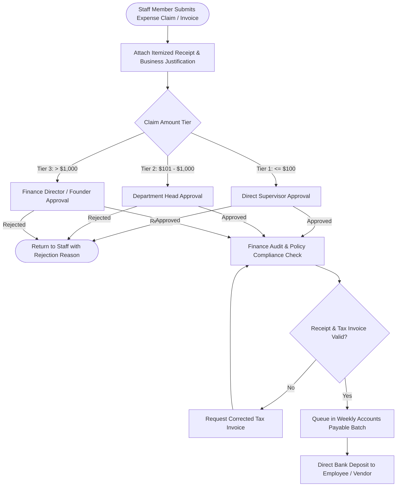

# Operational Expense Request & Multi-Tier Approval Workflow

> **Domain:** Corporate Finance, Operations Management, Enterprise Resource Planning (ERP)  
> **Key Objective:** Enforce strict financial governance over company spending based on monetary approval limits.

---

## 1. Multi-Tier Approval Decision Tree

