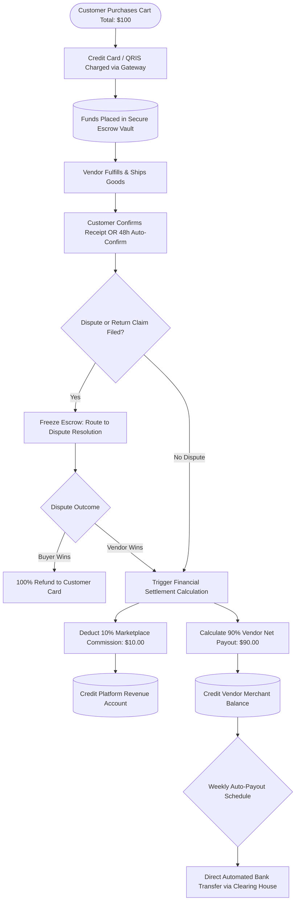

# Multi-Vendor Marketplace Payment Split & Escrow Settlement

> **Domain:** E-Commerce Marketplaces, Ride-Hailing, On-Demand Platforms  
> **Key Objective:** Hold customer payments safely in escrow, deduct platform commissions, and release net earnings to vendors upon delivery confirmation.

---

## 1. Process Flowchart

