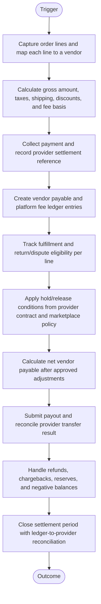
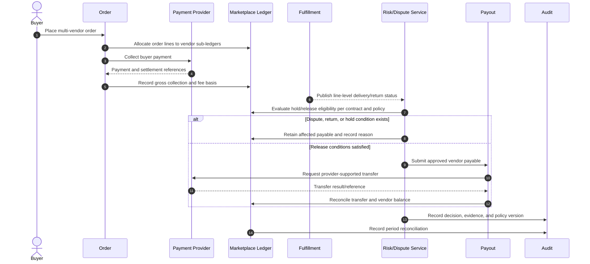
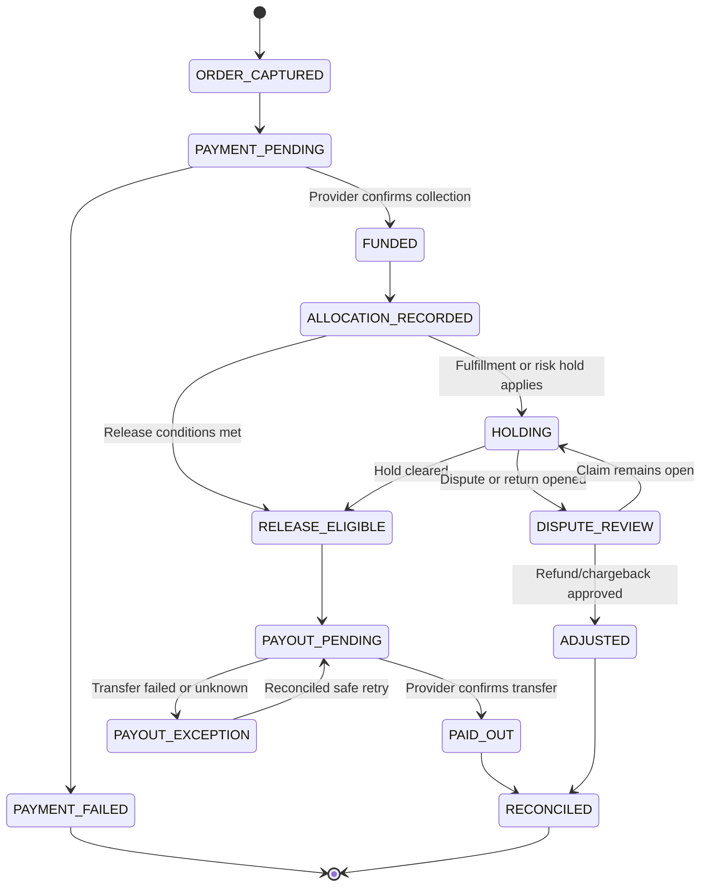

# Marketplace Vendor Settlement and Funds Allocation

> **Domain:** Multi-vendor marketplace, platform payments  
> **Document type:** To-Be reference workflow  
> **Status:** Reference design — validate with process owners before implementation  
> **Audience:** Business Analysts, Systems Analysts, product teams, and developers

## 1. Problem statement

Marketplace orders may involve multiple vendors, platform fees, refunds, disputes, taxes, and payout schedules. A simple percentage split can release funds too early or create unreconciled balances.

## 2. Objective and scope

**Objective:** Model order-level allocation and vendor settlement with explicit hold conditions, fee rules, dispute handling, and ledger reconciliation.

**In scope**
- Operational lifecycle from initiation through resolution and recordkeeping.
- Business decisions, system responsibilities, exception handling, and audit evidence.
- Minimum data and acceptance criteria needed for implementation planning.

**Out of scope**
- Organization-specific legal, tax, accounting, labor, or contractual conclusions.
- Fixed thresholds, fees, SLA targets, or financial outcomes not validated by the organization.
- Vendor-specific API contracts unless documented by the selected provider.

## 3. Actors and systems

| Actor / system | Responsibility |
|---|---|
| Buyer | Pays for one or more vendor items |
| Marketplace platform | Calculates allocation and coordinates settlement |
| Vendor | Fulfills assigned order lines |
| Payment provider | Collects, holds, refunds, or transfers funds under its product |
| Finance operations | Reconciles balances, disputes, and payout exceptions |

## 4. Trigger, preconditions, and postconditions

**Trigger:** A valid business event or authorized user action initiates the workflow.

**Preconditions**
- Initiating actor or service is authenticated.
- Required master data, policy versions, and reference records are available.
- Requested object is in a state that permits the operation.
- Required permissions and segregation-of-duty controls are configured.

**Postconditions**
- Business object has an explicit final or pending status.
- Material decisions, external references, and exceptions are traceable.
- Related financial, inventory, customer, or access records are synchronized or visibly pending.

## 5. Business process view

This flow describes the human and organizational process, independent of a specific application architecture.

## 6. System interaction view

This logical sequence shows system responsibilities. Adapt participants and messages to the selected architecture and provider contract.

## 7. Business rules

| ID | Rule |
|---|---|
| BR-001 | Do not describe funds as escrow unless provider and contractual structure actually provide escrow services. |
| BR-002 | Allocation is calculated at order-line level where multiple vendors or partial refunds are possible. |
| BR-003 | Commission, taxes, shipping, discounts, reserves, and fee basis must be versioned and disclosed. |
| BR-004 | Vendor payout cannot exceed available settled funds less approved reserves and adjustments. |
| BR-005 | Release conditions must reflect provider capability and marketplace legal/payment obligations. |
| BR-006 | Refunds and chargebacks create linked ledger reversals, not rewritten historical allocations. |
| BR-007 | Payout submission must be idempotent and reconciled to provider transfer IDs. |
| BR-008 | Negative vendor balances require a defined recovery and dispute policy. |

Policy-dependent rules must be confirmed by the process owner and recorded with an effective date or version before implementation.

## 8. Data requirements

| Entity | Minimum fields |
|---|---|
| MarketplaceOrder | order_id, buyer_id, currency, gross, tax, shipping, discount, status |
| OrderLineAllocation | line_id, vendor_id, gross, fee_basis, commission, net_payable |
| LedgerEntry | entry_id, account, debit, credit, currency, source_ref, rule_version |
| SettlementBatch | batch_id, vendor_id, period, amount, status |
| ProviderTransfer | provider_transfer_id, idempotency_key, amount, status |
| Dispute | dispute_id, order_line_id, reason, amount, status, evidence_refs |

Use stable identifiers, explicit timestamps/time zones, currency and unit definitions where relevant, and versioned policy/rule references. Financial values must use integer minor units or fixed-precision decimal types, not binary floating-point arithmetic.

## 9. State model

The following is a lifecycle scaffold. Rename, add, or remove states to reflect the domain and define permitted transitions in the implementation specification.

## 10. Exceptions and recovery

| Scenario | Expected behavior and recovery |
|---|---|
| Provider settlement is pending | Show collected/settlement-pending separately; exclude unsettled funds from available payout. |
| Partial fulfillment | Release only eligible fulfilled lines if provider and policy support it. |
| Buyer dispute or chargeback | Place affected balance in review/reserve under contract and policy. |
| Payout rejected | Retain payable balance and retry only after resolving provider failure. |
| Refund after vendor payout | Create receivable/negative balance and follow vendor recovery policy. |
| Fee or tax mismatch | Block settlement close and reconcile source transaction and rule version. |

Every retryable action should define idempotency, retry limits, backoff, timeout, and manual escalation. Never treat an unknown external result as success.

## 11. Authorization, privacy, and audit

- Enforce permissions on the server/service boundary; hiding a button is not authorization.
- Apply least privilege and separation of duties for sensitive approvals, financial actions, inventory adjustments, or account changes.
- Record actor/service identity, timestamp, object ID, action, prior and new state, reason, correlation ID, and external reference where applicable.
- Protect personal and commercially sensitive data through purpose limitation, access control, retention, and secure evidence storage.
- Preserve history through append-only events or controlled reversals; do not silently overwrite material decisions.

## 12. Acceptance criteria

- **AC-01:** Given an order has multiple vendors, when allocation is calculated, then each line is attributed to the correct vendor and fee rule version.
- **AC-02:** Given provider funds are unsettled, when payout eligibility is evaluated, then unsettled funds are excluded.
- **AC-03:** Given a partial refund is approved, when ledger entries are created, then only affected allocation components are reversed.
- **AC-04:** Given payout submission is retried, when the same batch key is used, then duplicate transfers are prevented or detected.

## 13. Operational metrics

- Gross-to-net allocation variance
- Settlement-to-payout cycle time
- Payout rejection rate
- Unreconciled ledger balance by currency
- Dispute and refund rate by vendor

Define numerator, denominator, source system, measurement window, owner, and baseline before setting targets. Metrics are measurement proposals, not promised improvements.

## 14. Assumptions and open decisions

- Provider product, jurisdiction, marketplace terms, tax rules, reserves, and money-transmission obligations require specialist review.
- This is a ledger/workflow reference, not legal authorization to hold customer funds.
- Confirm role names, authority limits, thresholds, timeouts, retention, and escalation ownership with stakeholders.
- Record unresolved decisions explicitly; do not silently convert assumptions into requirements.

## 15. Traceability

| Rule group | Acceptance criteria | Implementation evidence |
|---|---|---|
| BR-001 to BR-008 | AC-01 to AC-04 | Unit/integration tests, audit events, and process-owner sign-off |

---

**Validation note:** This is a reusable reference pattern, not an approved policy for every organization. Confirm assumptions and provider-specific behavior before implementation.
