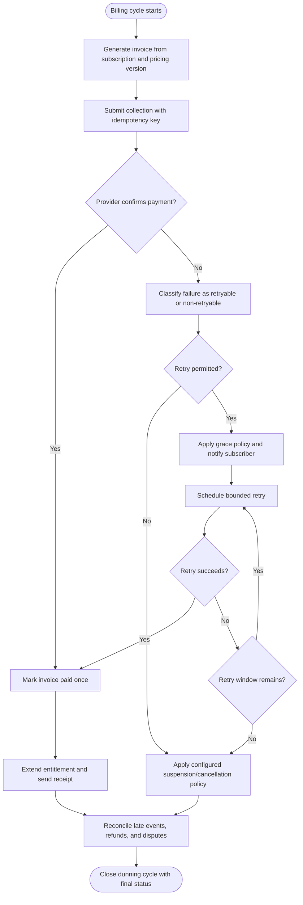
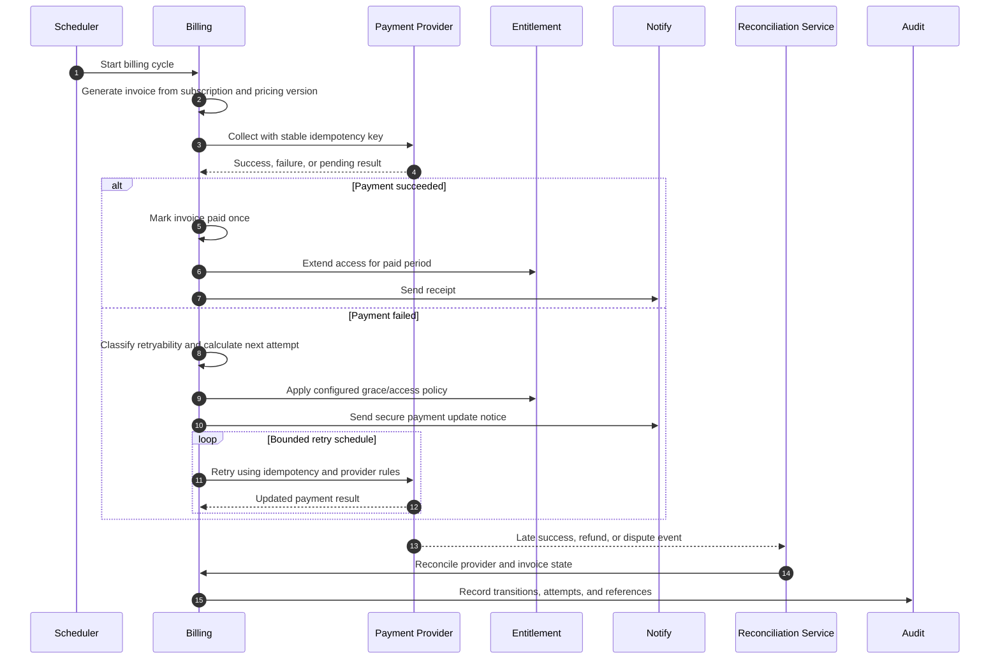
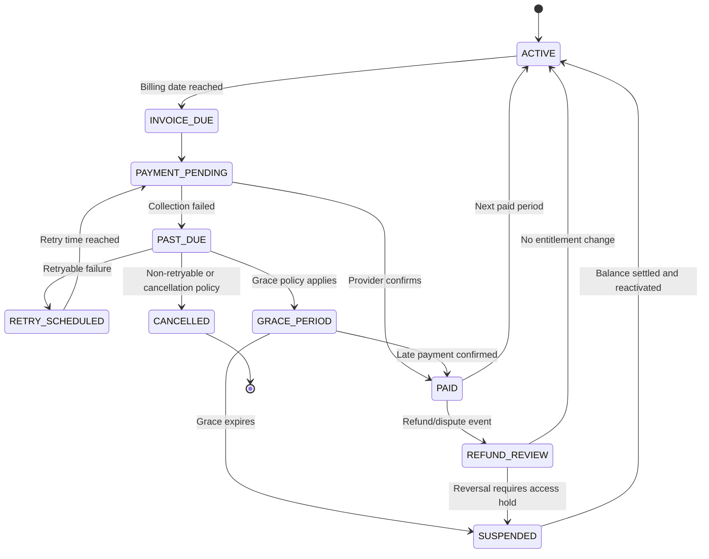

# Subscription Billing, Failed Payment Recovery, and Dunning

> **Domain:** SaaS subscriptions, memberships, recurring billing  
> **Document type:** To-Be reference workflow  
> **Status:** Reference design — validate with process owners before implementation  
> **Audience:** Business Analysts, Systems Analysts, product teams, and developers

## 1. Problem statement

Recurring charges can fail because of expired credentials, insufficient funds, provider outages, or authentication requirements. Immediate access termination and unsafe retries can harm customers or create duplicate charges.

## 2. Objective and scope

**Objective:** Manage invoices and payment retries with idempotency, clear communication, configurable grace policy, and accurate access states.

**In scope**
- Operational lifecycle from initiation through resolution and recordkeeping.
- Business decisions, system responsibilities, exception handling, and audit evidence.
- Minimum data and acceptance criteria needed for implementation planning.

**Out of scope**
- Organization-specific legal, tax, accounting, labor, or contractual conclusions.
- Fixed thresholds, fees, SLA targets, or financial outcomes not validated by the organization.
- Vendor-specific API contracts unless documented by the selected provider.

## 3. Actors and systems

| Actor / system | Responsibility |
|---|---|
| Billing scheduler | Creates invoices and schedules collection attempts |
| Payment provider | Authorizes, declines, or reports payment status |
| Subscriber | Updates payment method or resolves balance |
| Subscription service | Maintains entitlement and access state |
| Finance/support | Handles disputes and unresolved collection cases |

## 4. Trigger, preconditions, and postconditions

**Trigger:** A subscription billing date, renewal event, or authorized plan change creates a billable invoice obligation.

**Preconditions**
- Subscription, customer/tenant, plan version, billing cadence, currency, and tax configuration are valid.
- Entitlement and cancellation/effective-date rules are available.
- A payment method or permitted manual collection route exists.
- Retry schedule, grace period, suspension, and dunning communication rules are approved configuration.
- Invoice numbering and accounting handoff requirements are defined.

**Postconditions**
- Business object has an explicit final or pending status.
- Material decisions, external references, and exceptions are traceable.
- Related financial, inventory, customer, or access records are synchronized or visibly pending.

## 5. Business process view

This flow describes the human and organizational process, independent of a specific application architecture.

## 6. System interaction view

This logical sequence shows system responsibilities. Adapt participants and messages to the selected architecture and provider contract.

## 7. Business rules

| ID | Rule |
|---|---|
| BR-001 | Each invoice and collection attempt must have stable unique identifiers. |
| BR-002 | Payment retries use provider-supported idempotency and must not create duplicate charges. |
| BR-003 | Retry schedule, grace period, and access restriction are business policy parameters. |
| BR-004 | Do not retry hard declines, revoked authorization, or non-retryable errors without customer action. |
| BR-005 | Webhook events must be authenticated, deduplicated, and reconciled against provider status. |
| BR-006 | Entitlement state is separate from invoice state and follows documented grace policy. |
| BR-007 | Cancellation and access termination follow contract, notice, and data-retention policy. |
| BR-008 | Payment update links must be short-lived, scoped, and must not expose raw credentials. |

Policy-dependent rules must be confirmed by the process owner and recorded with an effective date or version before implementation.

## 8. Data requirements

| Entity | Minimum fields |
|---|---|
| Subscription | subscription_id, customer_id, plan_id, status, current_period_start/end |
| Invoice | invoice_id, pricing_version, amount, currency, due_at, status |
| PaymentAttempt | attempt_id, invoice_id, provider_ref, idempotency_key, failure_code, status |
| Entitlement | customer_id, product_id, access_state, effective_from/to |
| DunningEvent | invoice_id, step, scheduled_at, channel, delivery_status |
| PaymentEvent | provider_event_id, signature_valid, received_at, processed_at |

Use stable identifiers, explicit timestamps/time zones, currency and unit definitions where relevant, and versioned policy/rule references. Financial values must use integer minor units or fixed-precision decimal types, not binary floating-point arithmetic.

## 9. State model

The state names and transitions below describe the proposed lifecycle for this workflow. Confirm guards, role permissions, timeout transitions, and terminal-state behavior with the process owner and implementation team before production use.

## 10. Exceptions and recovery

| Scenario | Expected behavior and recovery |
|---|---|
| Provider timeout after charge attempt | Query provider by idempotency key/reference before retrying. |
| Late success after access restriction | Reconcile invoice and restore entitlement according to policy; preserve event chronology. |
| Hard decline or authentication required | Request customer action; do not run blind automatic retries. |
| Duplicate webhook | Deduplicate by provider event ID and preserve one posting. |
| Invoice amount differs after plan change | Apply effective-dated pricing and proration rules; trace the calculation. |
| Refund or chargeback | Create linked reversal/dispute state and update entitlement only under policy. |

Every retryable action should define idempotency, retry limits, backoff, timeout, and manual escalation. Never treat an unknown external result as success.

## 11. Authorization, privacy, and audit

- Enforce permissions on the server/service boundary; hiding a button is not authorization.
- Apply least privilege and separation of duties for sensitive approvals, financial actions, inventory adjustments, or account changes.
- Record actor/service identity, timestamp, object ID, action, prior and new state, reason, correlation ID, and external reference where applicable.
- Protect personal and commercially sensitive data through purpose limitation, access control, retention, and secure evidence storage.
- Preserve history through append-only events or controlled reversals; do not silently overwrite material decisions.

## 12. Acceptance criteria

- **AC-01:** Given collection request times out, when retry logic runs, then provider status is checked before another charge is attempted.
- **AC-02:** Given a non-retryable decline occurs, when classified, then automatic retry stops and customer action is requested.
- **AC-03:** Given a valid late-success event arrives, when processed, then invoice and entitlement are reconciled without duplicate posting.
- **AC-04:** Given a duplicate webhook is delivered, when processed, then it has no duplicate financial or entitlement effect.

## 13. Operational metrics

- Collection success by attempt and failure code
- Involuntary churn rate using a defined denominator
- Duplicate-charge and duplicate-webhook incidents
- Days sales outstanding for subscription invoices
- Time from payment success to entitlement restoration

- **Collection rate:** successfully collected amount ÷ amount due for the billing cohort.
- **Dunning recovery rate:** failed invoices recovered within the configured dunning window ÷ invoices entering dunning.
- **Involuntary churn rate:** subscriptions cancelled for non-payment ÷ subscriptions exposed to collection failure.
- **Retry success rate:** successful retries ÷ total retry attempts. Review by plan, payment method, and failure code.

Assign a named metric owner, reporting window, and baseline before setting a target. These are measurement definitions, not promised improvements.

## 14. Assumptions and open decisions

- Grace duration, retry cadence, access restrictions, cancellation notices, and proration are contract and policy decisions.
- Payment providers differ in decline codes, idempotency guarantees, and webhook semantics; implement provider adapters.
- Confirm role names, authority limits, thresholds, timeouts, retention, and escalation ownership with stakeholders.
- Record unresolved decisions explicitly; do not silently convert assumptions into requirements.

## 15. Traceability

| Rule group | Acceptance criteria | Implementation evidence |
|---|---|---|
| BR-001 to BR-008 | AC-01 to AC-04 | Unit/integration tests, audit events, and process-owner sign-off |

---

**Validation note:** This is a reusable reference pattern, not an approved policy for every organization. Confirm assumptions and provider-specific behavior before implementation.
