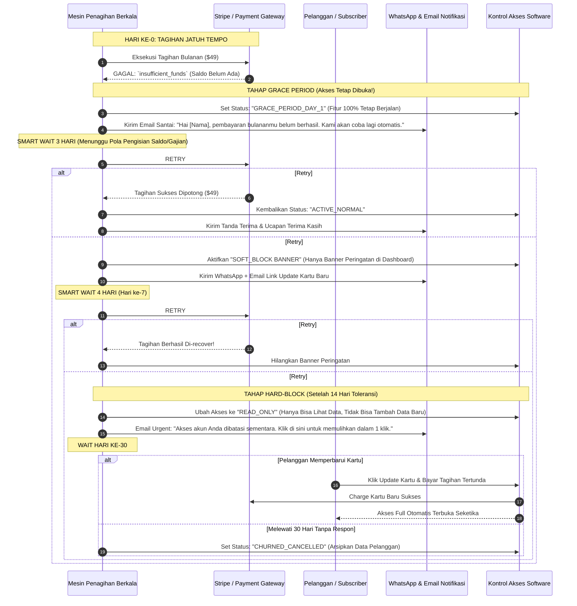

# SaaS Subscription Billing, Smart Dunning & Involuntary Churn Recovery Flow

> **Domain:** Subscription SaaS, Membership Digital, B2B Cloud Platform  
> **Core Mission:** Menyelamatkan 30-40% pendapatan langganan yang hilang akibat gagal bayar otomatis (*Involuntary Churn*), kartu kredit kedaluwarsa, atau saldo tidak cukup.

---

## 1. Masalah Nyata & Risiko Pendapatan di Lapangan

Di bisnis model langganan (SaaS / Membership), musuh terbesar bisnis bukanlah pelanggan yang berhenti secara sadar (*voluntary churn*), melainkan **Involuntary Churn**:
1. Pelanggan sebenarnya masih ingin memakai software Anda, tapi **kartu kredit mereka bermasalah / saldo sedang kosong saat sistem menagih**.
2. **Kesalahan Fatal Banyak Developer:** Begitu kartu gagal di-charge pada jam 00:00 tanggal 1, sistem langsung mematikan akun pelanggan. Pelanggan kaget, marah, dan akhirnya pindah ke kompetitor.
3. Menagih ulang di waktu yang salah (misalnya jam 2 pagi di akhir bulan saat saldo bank belum gajian) hanya akan menghabiskan batas kuota *retry* payment gateway.

---

## 2. Diagram Alur Sistem: "Smart Multi-Schedule Dunning Protocol"

---

## 3. Checklist Aturan Sistem (Untuk Programmer & Tim Bisnis)

* [ ] **Aturan Waktu Penagihan Pintar (Smart Scheduling):** Hindari mencoba penagihan ulang di jam tidur (tengah malam). Jadwalkan *retry* pada jam 10:00 pagi atau 14:00 siang waktu lokal saat orang cenderung mengecek rekening atau baru transfer uang.
* [ ] **Prinsip Grace Period (Masa Tenggang):** Jangan pernah mematikan akun pelanggan di hari pertama pembayaran gagal. Berikan minimal 7 hingga 14 hari masa tenggang dengan banner peringatan sopan di dalam aplikasi.
* [ ] **Satu Klik Update Kartu:** Email penagihan (*dunning email*) harus langsung memiliki tautan aman (*magic link*) langsung ke halaman ganti kartu tanpa mengharuskan pelanggan login ulang dengan password yang mungkin mereka lupa.

---

## 4. Dampak Operasional bagi Bisnis

* **Menyelamatkan 30% Hingga 40% Pendapatan Bulanan (MRR):** Bisnis tidak kehilangan pelanggan setia hanya karena masalah sepele seperti tanggal kartu kredit kedaluwarsa atau keterlambatan transfer saldo.
* **Tingkat Kepuasan Pelanggan Tetap Tinggi:** Pelanggan tidak merasa diperlakukan kasar atau langsung diusir dari aplikasi ketika sedang ada kendala teknis pada bank mereka.
