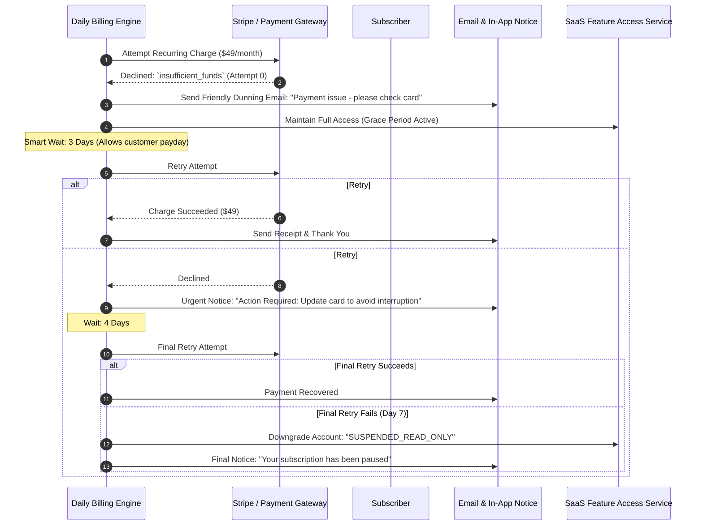
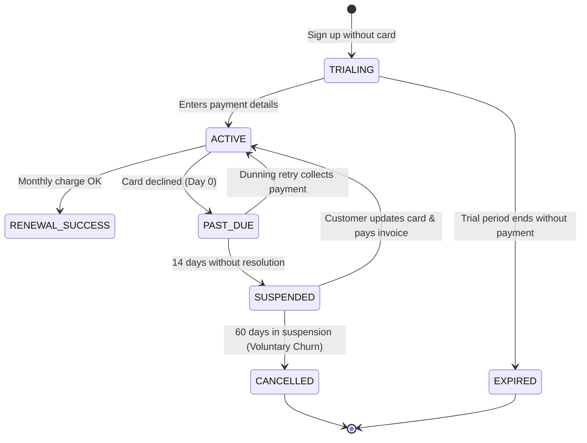

# SaaS Recurring Subscription Billing & Smart Dunning Flow

> **Domain:** Subscription SaaS, Digital Memberships, Recurring Billing  
> **Key Objective:** Maximize revenue recovery from involuntary churn (expired cards, insufficient funds) using automated dunning retries.

---

## 1. Dunning Retry Sequence Flow

---

## 2. Subscription Account State Transitions

