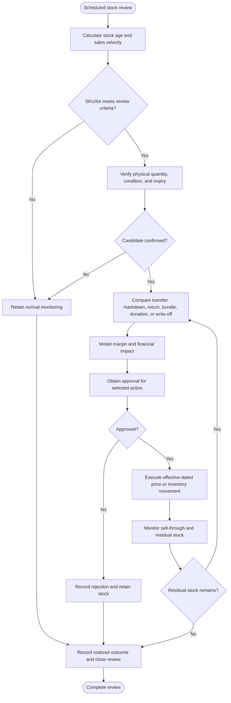
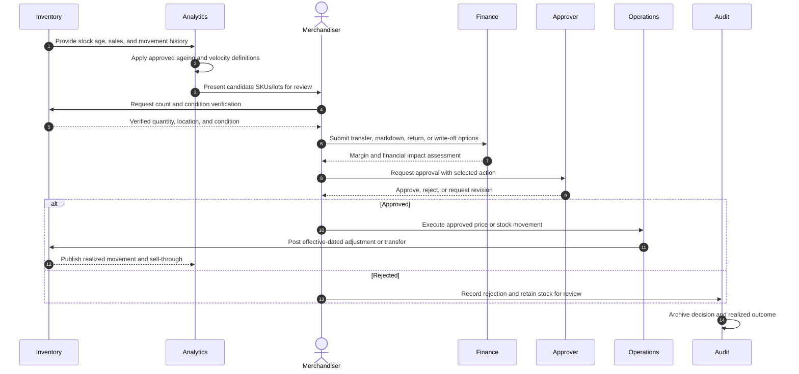
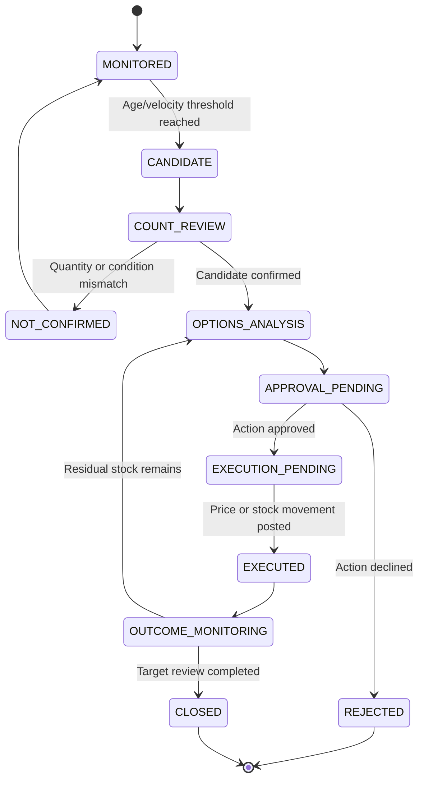

# Slow-Moving and Obsolete Inventory Review

> **Domain:** Retail merchandising, inventory planning, finance  
> **Document type:** To-Be reference workflow  
> **Status:** Reference design — validate with process owners before implementation  
> **Audience:** Business Analysts, Systems Analysts, product teams, and developers

## 1. Problem statement

Slow-moving goods tie up working capital and may become obsolete or expire. Arbitrary markdowns can destroy margin, while write-offs without evidence can conceal shrinkage.

## 2. Objective and scope

**Objective:** Identify inventory requiring review, evaluate disposition options using cost and demand context, and approve markdown, transfer, return, donation, or write-off actions.

**In scope**
- Operational lifecycle from initiation through resolution and recordkeeping.
- Business decisions, system responsibilities, exception handling, and audit evidence.
- Minimum data and acceptance criteria needed for implementation planning.

**Out of scope**
- Organization-specific legal, tax, accounting, labor, or contractual conclusions.
- Fixed thresholds, fees, SLA targets, or financial outcomes not validated by the organization.
- Vendor-specific API contracts unless documented by the selected provider.

## 3. Actors and systems

| Actor / system | Responsibility |
|---|---|
| Inventory analyst | Identifies slow-moving or aging stock |
| Merchandising manager | Evaluates demand, pricing, and assortment |
| Store/warehouse operator | Verifies physical quantity and condition |
| Finance | Reviews margin, valuation, and write-off impact |
| Approver | Authorizes disposition within delegated authority |

## 4. Trigger, preconditions, and postconditions

**Trigger:** A scheduled inventory review identifies stock meeting a configured aging, inactivity, expiry-risk, or turnover criterion.

**Preconditions**
- SKU, location, on-hand quantity, cost basis, last movement, expiry/batch, and reservation status are available.
- Aging and dead-stock criteria are approved, versioned, and differentiated by product category where needed.
- Stock valuation and markdown/liquidation authority are defined.
- Quality, recall, expiry, and legal restrictions are checked before disposition.
- Write-off, transfer, supplier return, discount, and disposal evidence requirements are specified.

**Postconditions**
- Business object has an explicit final or pending status.
- Material decisions, external references, and exceptions are traceable.
- Related financial, inventory, customer, or access records are synchronized or visibly pending.

## 5. Business process view

This flow describes the human and organizational process, independent of a specific application architecture.

## 6. System interaction view

The sequence models aging analysis, physical quantity validation, disposition recommendation, markdown/write-off approval, channel price synchronization, and recovery-value reporting.

## 7. Business rules

| ID | Rule |
|---|---|
| BR-001 | Aging thresholds are category-specific and reflect shelf life, seasonality, and sales cadence. |
| BR-002 | System quantity must be validated before material write-off or liquidation. |
| BR-003 | Markdown authority and minimum margin floors must be configured and approved. |
| BR-004 | Price changes are effective-dated and synchronized to selling channels. |
| BR-005 | Expired, recalled, damaged, or regulated goods follow mandatory disposal/return rules, not ordinary markdown. |
| BR-006 | Write-off requires reason, evidence, inventory movement, and finance approval. |
| BR-007 | Supplier return or transfer must have a confirmed receiving party and movement reference. |
| BR-008 | Campaign performance is measured against baseline margin and recovery value. |

Policy-dependent rules must be confirmed by the process owner and recorded with an effective date or version before implementation.

## 8. Data requirements

| Entity | Minimum fields |
|---|---|
| AgingSnapshot | sku, location, quantity, last_sale_at, days_on_hand, snapshot_at |
| DispositionCase | case_id, sku, quantity, reason, status, owner |
| OptionAnalysis | option, expected_recovery, margin_impact, cost, assumptions |
| Approval | approver_id, authority, decision, approved_qty, effective_at |
| PriceChange | sku, old_price, new_price, channels, starts_at, ends_at |
| StockMovement | sku, quantity, from_status, to_status, reason, reference |

Use stable identifiers, explicit timestamps/time zones, currency and unit definitions where relevant, and versioned policy/rule references. Financial values must use integer minor units or fixed-precision decimal types, not binary floating-point arithmetic.

## 9. State model

The state names and transitions below describe the proposed lifecycle for this workflow. Confirm guards, role permissions, timeout transitions, and terminal-state behavior with the process owner and implementation team before production use.

## 10. Exceptions and recovery

| Scenario | Expected behavior and recovery |
|---|---|
| Stock record differs from physical count | Pause disposition and investigate variance before financial write-off. |
| Item expired or recalled | Block sale and follow regulated disposal/return procedure. |
| Markdown breaches margin floor | Require higher approval or choose another disposition. |
| Channel price synchronization fails | Pause campaign or restrict sales until price consistency is restored. |
| Supplier refuses return | Reassess alternate approved disposition and document decision. |
| Stock sells during approval | Recalculate remaining quantity and avoid over-disposition. |

Every retryable action should define idempotency, retry limits, backoff, timeout, and manual escalation. Never treat an unknown external result as success.

## 11. Authorization, privacy, and audit

- Enforce permissions on the server/service boundary; hiding a button is not authorization.
- Apply least privilege and separation of duties for sensitive approvals, financial actions, inventory adjustments, or account changes.
- Record actor/service identity, timestamp, object ID, action, prior and new state, reason, correlation ID, and external reference where applicable.
- Protect personal and commercially sensitive data through purpose limitation, access control, retention, and secure evidence storage.
- Preserve history through append-only events or controlled reversals; do not silently overwrite material decisions.

## 12. Acceptance criteria

- **AC-01:** Given an item is flagged for liquidation, when material write-off is proposed, then physical quantity validation and finance approval are required.
- **AC-02:** Given a markdown breaches configured margin authority, when approval is requested, then it routes to a higher approver or is rejected.
- **AC-03:** Given a lot is expired or recalled, when disposition is evaluated, then sale markdown is blocked.
- **AC-04:** Given stock quantity changes during approval, when execution begins, then approved quantity is revalidated.
- **AC-05:** Given stock is flagged for review, when the aging rule is applied, then the effective category-specific threshold and seasonality rule are recorded.
- **AC-06:** Given supplier return or inter-location transfer is selected, when disposition is confirmed, then a receiving party and movement reference are required.
- **AC-07:** Given a liquidation campaign is closed, when performance is reviewed, then recovery value and margin are compared with the approved baseline.

## 13. Operational metrics

- Aged inventory value by bucket
- Sell-through after disposition action
- Net recovery versus carrying cost
- Markdown gross-margin impact
- Write-off value and reason-code trend

- **Aged inventory ratio:** inventory value beyond the approved aging threshold ÷ total inventory value.
- **Recovery value rate:** net proceeds from liquidation/return ÷ carrying value of disposed stock.
- **Disposition cycle time:** final disposition timestamp minus review-case creation timestamp.
- **Write-off rate:** written-off inventory value ÷ average inventory value for the period. Review monthly by category and location.

Assign a named metric owner, reporting window, and baseline before setting a target. These are measurement definitions, not promised improvements.

## 14. Assumptions and open decisions

- Aging windows, margin floors, recovery assumptions, and write-off limits are business-specific.
- Accounting valuation and tax treatment require finance review.
- Confirm role names, authority limits, thresholds, timeouts, retention, and escalation ownership with stakeholders.
- Record unresolved decisions explicitly; do not silently convert assumptions into requirements.

## 15. Traceability

| Business rule | Acceptance criterion | Verification focus |
|---|---|---|
| BR-001 | AC-05 | the effective category-specific threshold and seasonality rule are recorded |
| BR-002 | AC-01 | physical quantity validation and finance approval are required |
| BR-003 | AC-02 | it routes to a higher approver or is rejected |
| BR-004 | AC-04 | approved quantity is revalidated |
| BR-005 | AC-03 | sale markdown is blocked |
| BR-006 | AC-01 | physical quantity validation and finance approval are required |
| BR-007 | AC-06 | a receiving party and movement reference are required |
| BR-008 | AC-07 | recovery value and margin are compared with the approved baseline |

---

**Validation note:** This is a reusable reference pattern, not an approved policy for every organization. Confirm assumptions and provider-specific behavior before implementation.
