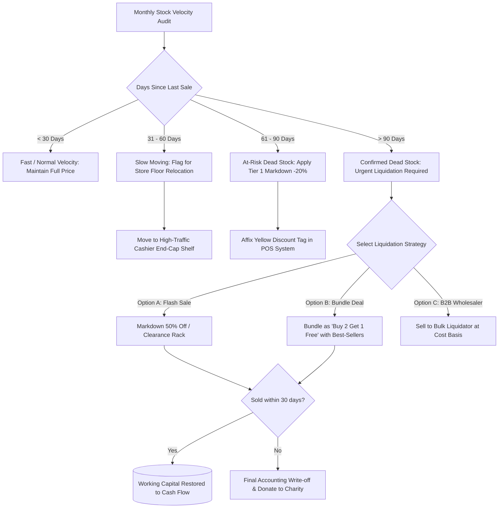

# Dead-Stock Identification & Progressive Discount Liquidation Flow

> **Domain:** Retail Merchandising, Fashion / Apparel, Seasonal FMCG  
> **Key Objective:** Detect slow-moving inventory before it turns into dead loss and execute progressive markdown pricing.

---

## 1. Process Flowchart

