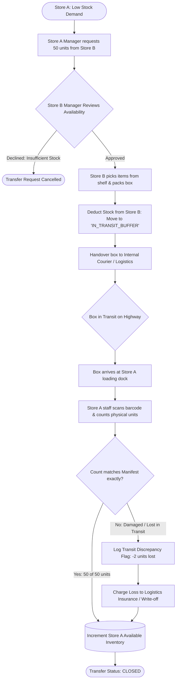

# Inter-Branch Store Inventory Transfer & Reconciliation Flow

> **Domain:** Multi-Store Retail, Chain Stores, Distributed Warehouses  
> **Key Objective:** Transfer stock between two physical retail locations safely without inventory disappearing in transit.

---

## 1. Process Flowchart

