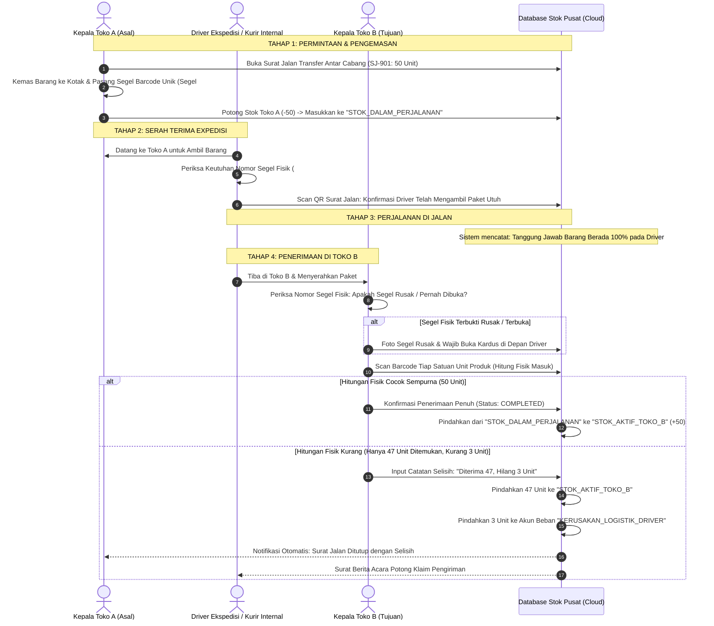

# Inter-Branch Inventory Transfer, Transit Shrinkage & Anti-Loss Flow

> **Domain:** Multi-Store Retail Chain, Franchise, Pergudangan Terdistribusi  
> **Core Mission:** Menghilangkan perselisihan antar kepala cabang toko ("Toko Asal kirim 100, tapi Toko Tujuan mengaku cuma terima 90"), serta melacak pertanggungjawaban barang hilang saat pengiriman di jalan.

---

## 1. Masalah Nyata & Risiko Kerugian di Lapangan

Di bisnis ritel dengan banyak cabang toko, perpindahan barang antar toko adalah sarang kebocoran stok:
1. **Saling Lempar Tanggung Jawab:** Toko A mengklaim sudah mengirim 50 pcs kopi mahal. Toko B mengklaim saat kardus dibuka hanya ada 45 pcs. Siapa yang bersalah? Kasir Toko A, Kasir Toko B, atau kurir mobil box yang mencuri 5 pcs di perjalanan?
2. **Stok Mengambang (Ghost Inventory):** Barang yang keluar dari Toko A langsung dihapus dari sistem, padahal butuh waktu 3 hari sampai di Toko B. Selama 3 hari itu, sistem tidak tahu di mana barang berada.

---

## 2. Diagram Alur Sistem: "Dual-Scan In-Transit Buffer Protocol"

---

## 3. Checklist Aturan Sistem (Untuk Programmer & Tim Bisnis)

* [ ] **Aturan Status 'In-Transit':** Barang yang keluar dari Toko A tidak boleh langsung dianggap "sudah sampai di Toko B". Wajib ada wadah status khusus *In-Transit Buffer* agar nilai aset perusahaan tidak hilang di laporan neraca harian.
* [ ] **Aturan Segel Bernomor (Tamper-Evident Seal):** Setiap kardus transfer wajib memiliki nomor segel pengaman. Jika nomor segel saat sampai di Toko B tidak cocok dengan nomor segel yang diinput Toko A, sistem otomatis membunyikan alarm audit investigasi.
* [ ] **Tanda Tangan Digital Driver:** Driver pengirim wajib melakukan konfirmasi serah terima di aplikasi sebelum meninggalkan Toko Asal, sehingga titik pertanggungjawaban hukum barang jelas.

---

## 4. Dampak Operasional bagi Bisnis

* **Nol Perselisihan Antar Toko Cabang:** Tidak ada lagi drama saling tuduh antar kepala cabang, karena titik kebocoran barang terlacak dengan bukti digital segel dan barcode.
* **Pertanggungjawaban Finansial Akurat:** Jika barang hilang karena dicuri sopir di jalan, kerugian otomatis dibebankan ke vendor ekspedisi atau klaim asuransi pengiriman secara otomatis.
