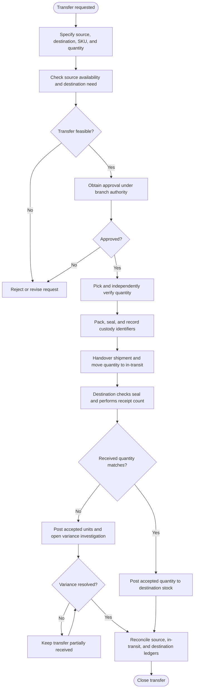
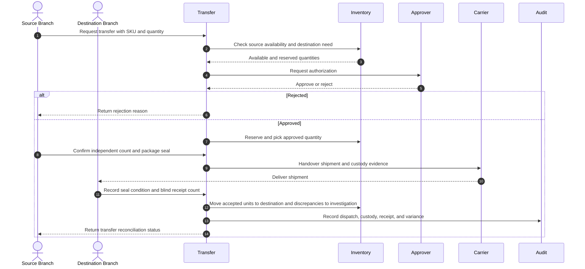
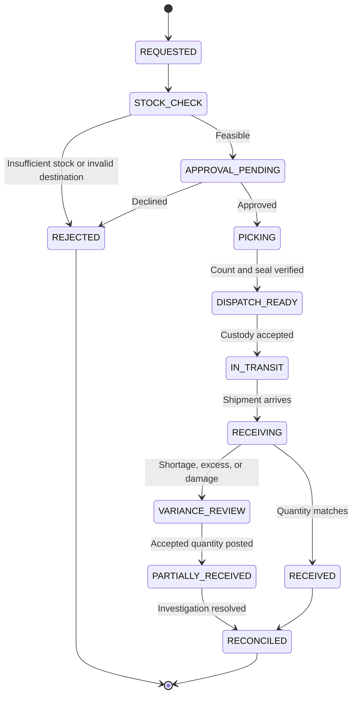

# Inter-Branch Stock Transfer and Transit Reconciliation

> **Domain:** Multi-branch retail, distributed inventory, logistics  
> **Document type:** To-Be reference workflow  
> **Status:** Reference design — validate with process owners before implementation  
> **Audience:** Business Analysts, Systems Analysts, product teams, and developers

## 1. Problem statement

Sending branch, carrier, and receiving branch may report different quantities. Removing stock from origin without tracking transit creates ghost inventory; automatically charging staff or drivers for unexplained shortages creates unsupported liability.

## 2. Objective and scope

**Objective:** Maintain custody and quantity traceability from transfer authorization through dispatch, transit, receipt, discrepancy investigation, and closure.

**In scope**
- Operational lifecycle from initiation through resolution and recordkeeping.
- Business decisions, system responsibilities, exception handling, and audit evidence.
- Minimum data and acceptance criteria needed for implementation planning.

**Out of scope**
- Organization-specific legal, tax, accounting, labor, or contractual conclusions.
- Fixed thresholds, fees, SLA targets, or financial outcomes not validated by the organization.
- Vendor-specific API contracts unless documented by the selected provider.

## 3. Actors and systems

| Actor / system | Responsibility |
|---|---|
| Origin branch | Requests, picks, packs, and dispatches transfer |
| Origin supervisor | Verifies quantity and handover evidence |
| Carrier / driver | Accepts custody and transports shipment |
| Destination branch | Inspects package and counts received units |
| Inventory control | Investigates discrepancies and approves adjustments |
| Inventory system | Tracks in-transit and branch stock balances |

## 4. Trigger, preconditions, and postconditions

**Trigger:** An authorized branch submits a stock transfer request and the source location accepts it for fulfillment.

**Preconditions**
- Source and destination locations, SKU, unit of measure, and requested quantity are valid.
- Available-to-transfer stock excludes reserved, damaged, quarantined, and blocked units.
- Transfer approval limits, dispatch authority, custody method, and receipt roles are defined.
- In-transit inventory accounting and partial receipt/shortage handling are specified.
- A unique transfer reference prevents duplicate dispatch.

**Postconditions**
- Business object has an explicit final or pending status.
- Material decisions, external references, and exceptions are traceable.
- Related financial, inventory, customer, or access records are synchronized or visibly pending.

## 5. Business process view

This flow describes the human and organizational process, independent of a specific application architecture.

## 6. System interaction view

This logical sequence shows system responsibilities. Adapt participants and messages to the selected architecture and provider contract.

## 7. Business rules

| ID | Rule |
|---|---|
| BR-001 | A transfer has a unique ID, source, destination, and approved line quantities. |
| BR-002 | Dispatch reduces origin available stock and creates in-transit balance; it does not increase destination stock. |
| BR-003 | Custody changes only when parties record handover evidence required by policy. |
| BR-004 | Seal IDs and package counts are evidence, not proof by themselves that contents are correct. |
| BR-005 | Destination records actual received quantity independently of dispatched quantity. |
| BR-006 | Shortages, overages, and damage remain discrepancy cases until investigated and approved. |
| BR-007 | No automatic staff, driver, or branch liability may be assigned solely from a quantity variance. |
| BR-008 | Inventory adjustment requires approval, reason code, evidence, and immutable audit history. |

Policy-dependent rules must be confirmed by the process owner and recorded with an effective date or version before implementation.

## 8. Data requirements

| Entity | Minimum fields |
|---|---|
| TransferHeader | transfer_id, source_location, destination_location, status, requested_by |
| TransferLine | sku, requested_qty, approved_qty, dispatched_qty, received_qty |
| Package | package_id, seal_id, weight, photo_refs, condition |
| CustodyEvent | transfer_id, from_party, to_party, accepted_at, evidence_ref |
| TransitBalance | transfer_id, sku, quantity, status |
| DiscrepancyCase | case_id, transfer_id, sku, variance_qty, reason, investigator, decision |
| InventoryAdjustment | adjustment_id, sku, location, quantity, approval_id, reason |

Use stable identifiers, explicit timestamps/time zones, currency and unit definitions where relevant, and versioned policy/rule references. Financial values must use integer minor units or fixed-precision decimal types, not binary floating-point arithmetic.

## 9. State model

The state names and transitions below describe the proposed lifecycle for this workflow. Confirm guards, role permissions, timeout transitions, and terminal-state behavior with the process owner and implementation team before production use.

## 10. Exceptions and recovery

| Scenario | Expected behavior and recovery |
|---|---|
| Seal broken or mismatched | Photograph and record condition; conduct witnessed opening and count. |
| Quantity short | Receive actual quantity; keep difference in investigation status, not automatic expense assignment. |
| Destination refuses delivery | Retain goods in transit/exception custody and record refusal reason. |
| Carrier scan missing | Escalate custody gap and obtain alternate evidence before closing. |
| System unavailable at handover | Use controlled offline manifest and reconcile both acknowledgements. |
| Transfer cancelled after dispatch | Create return transfer or reversal movement; never delete dispatch history. |

Every retryable action should define idempotency, retry limits, backoff, timeout, and manual escalation. Never treat an unknown external result as success.

## 11. Authorization, privacy, and audit

- Enforce permissions on the server/service boundary; hiding a button is not authorization.
- Apply least privilege and separation of duties for sensitive approvals, financial actions, inventory adjustments, or account changes.
- Record actor/service identity, timestamp, object ID, action, prior and new state, reason, correlation ID, and external reference where applicable.
- Protect personal and commercially sensitive data through purpose limitation, access control, retention, and secure evidence storage.
- Preserve history through append-only events or controlled reversals; do not silently overwrite material decisions.

## 12. Acceptance criteria

- **AC-01:** Given a transfer is dispatched, when inventory is posted, then origin available stock decreases and equal in-transit quantity is created.
- **AC-02:** Given destination receives fewer units than dispatched, when receipt is posted, then actual units enter destination stock and difference remains an open discrepancy.
- **AC-03:** Given a seal is reported damaged, when receipt is recorded, then evidence and witnessed inspection are required before closure.
- **AC-04:** Given a variance is unresolved, when adjustment is requested, then automatic liability assignment is prohibited and authorized review is required.
- **AC-05:** Given a transfer request is created, when it is accepted, then a unique transfer ID, source, destination, and approved line quantities are stored.

## 13. Operational metrics

- Transfer lead time by lane
- Dispatch-to-receipt quantity variance rate
- Transit inventory age
- Discrepancy resolution time
- Transfers with complete custody evidence

- **Transfer lead time:** destination receipt timestamp minus source dispatch timestamp; report median and P90.
- **Transfer fill rate:** accepted destination quantity ÷ dispatched quantity.
- **Transfer variance rate:** transfers with quantity/condition variance ÷ completed transfers.
- **In-transit aging:** open transfer value/count grouped by elapsed time since dispatch. Review weekly by lane and SKU.

Assign a named metric owner, reporting window, and baseline before setting a target. These are measurement definitions, not promised improvements.

## 14. Assumptions and open decisions

- Custody and carrier liability depend on contract, insurance, local law, and evidence.
- Cycle-count and adjustment approval thresholds must be configured.
- Confirm role names, authority limits, thresholds, timeouts, retention, and escalation ownership with stakeholders.
- Record unresolved decisions explicitly; do not silently convert assumptions into requirements.

## 15. Traceability

| Business rule | Acceptance criterion | Verification focus |
|---|---|---|
| BR-001 | AC-05 | Requirement and test coverage for the rule |
| BR-002 | AC-01 | Requirement and test coverage for the rule |
| BR-003 | AC-03 | Requirement and test coverage for the rule |
| BR-004 | AC-03 | Requirement and test coverage for the rule |
| BR-005 | AC-02 | Requirement and test coverage for the rule |
| BR-006 | AC-02 | Requirement and test coverage for the rule |
| BR-007 | AC-04 | Requirement and test coverage for the rule |
| BR-008 | AC-04 | Requirement and test coverage for the rule |

---

**Validation note:** This is a reusable reference pattern, not an approved policy for every organization. Confirm assumptions and provider-specific behavior before implementation.
