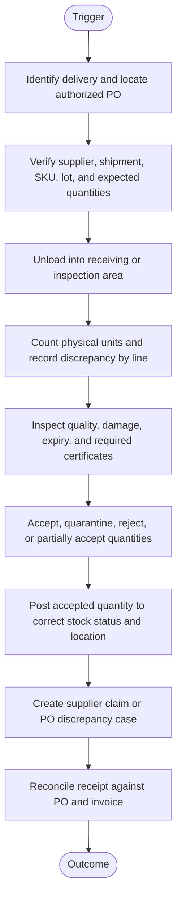
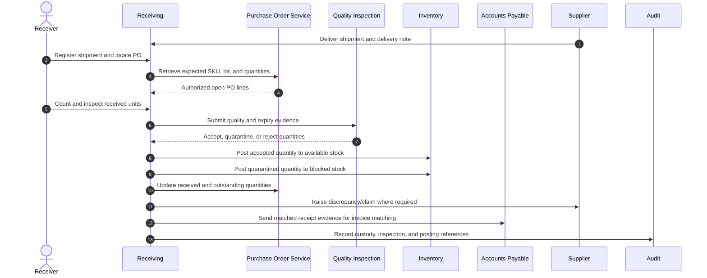
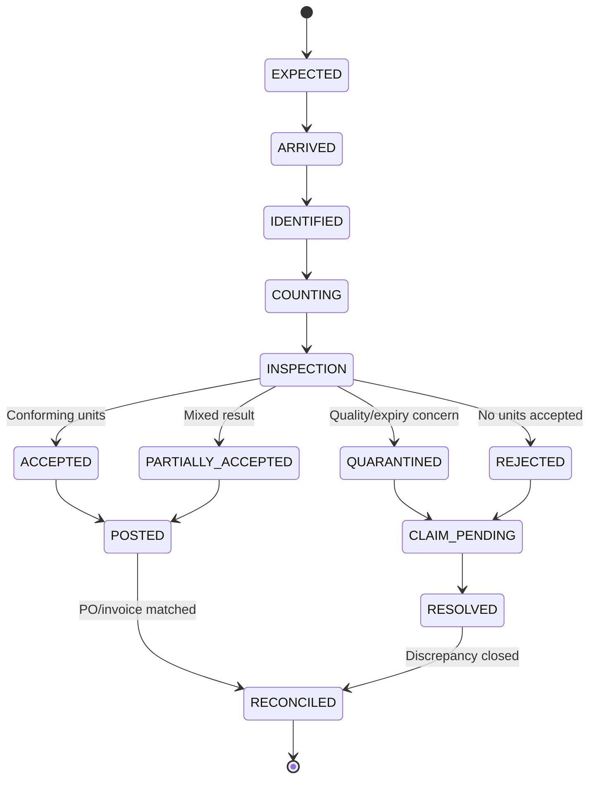

# Warehouse Goods Receipt and Quality Inspection

> **Domain:** Warehouse operations, WMS, procurement  
> **Document type:** To-Be reference workflow  
> **Status:** Reference design — validate with process owners before implementation  
> **Audience:** Business Analysts, Systems Analysts, product teams, and developers

## 1. Problem statement

Goods may arrive in quantities or condition different from the purchase order. If inventory is available before verification, the business may sell damaged, expired, or unaccepted goods.

## 2. Objective and scope

**Objective:** Record physical receipt against an authorized purchase order, segregate exceptions, and release only accepted quantities to available inventory.

**In scope**
- Operational lifecycle from initiation through resolution and recordkeeping.
- Business decisions, system responsibilities, exception handling, and audit evidence.
- Minimum data and acceptance criteria needed for implementation planning.

**Out of scope**
- Organization-specific legal, tax, accounting, labor, or contractual conclusions.
- Fixed thresholds, fees, SLA targets, or financial outcomes not validated by the organization.
- Vendor-specific API contracts unless documented by the selected provider.

## 3. Actors and systems

| Actor / system | Responsibility |
|---|---|
| Supplier driver | Delivers goods and documents |
| Receiving operator | Checks shipment identity and counts goods |
| Quality inspector | Inspects condition, batch, and expiry |
| Warehouse supervisor | Resolves discrepancies and approves exceptions |
| WMS / inventory ledger | Records receipt and stock status |
| Procurement / finance | Reconciles PO and supplier invoice |

## 4. Trigger, preconditions, and postconditions

**Trigger:** A valid business event or authorized user action initiates the workflow.

**Preconditions**
- Initiating actor or service is authenticated.
- Required master data, policy versions, and reference records are available.
- Requested object is in a state that permits the operation.
- Required permissions and segregation-of-duty controls are configured.

**Postconditions**
- Business object has an explicit final or pending status.
- Material decisions, external references, and exceptions are traceable.
- Related financial, inventory, customer, or access records are synchronized or visibly pending.

## 5. Business process view

This flow describes the human and organizational process, independent of a specific application architecture.

## 6. System interaction view

This logical sequence shows system responsibilities. Adapt participants and messages to the selected architecture and provider contract.

## 7. Business rules

| ID | Rule |
|---|---|
| BR-001 | A receipt must reference an authorized PO or documented exception. |
| BR-002 | Received, accepted, quarantined, and rejected quantities are recorded separately. |
| BR-003 | Available stock increases only for accepted quantities placed in an approved location. |
| BR-004 | Lot, serial, expiry, and traceability attributes are mandatory where product policy requires them. |
| BR-005 | Over-receipt tolerance is configured per supplier/SKU and not assumed. |
| BR-006 | Receiver and quality approver duties should be separated for controlled products where feasible. |
| BR-007 | Receipt corrections use reversal or adjustment events with reason and approval. |
| BR-008 | Supplier invoice matching uses ordered, received, and invoiced quantities under configured tolerance. |

Policy-dependent rules must be confirmed by the process owner and recorded with an effective date or version before implementation.

## 8. Data requirements

| Entity | Minimum fields |
|---|---|
| PurchaseOrder | po_id, supplier_id, sku, ordered_qty, tolerance, expected_date |
| GoodsReceipt | receipt_id, po_id, received_by, received_at, status |
| ReceiptLine | sku, received_qty, accepted_qty, rejected_qty, discrepancy_code |
| Inspection | lot, serial, expiry, condition, inspector_id, evidence |
| InventoryMovement | sku, location, stock_status, quantity, source_receipt |
| SupplierClaim | claim_id, po_id, receipt_id, reason, status, resolution |

Use stable identifiers, explicit timestamps/time zones, currency and unit definitions where relevant, and versioned policy/rule references. Financial values must use integer minor units or fixed-precision decimal types, not binary floating-point arithmetic.

## 9. State model

The following is a lifecycle scaffold. Rename, add, or remove states to reflect the domain and define permitted transitions in the implementation specification.

## 10. Exceptions and recovery

| Scenario | Expected behavior and recovery |
|---|---|
| No matching PO | Hold goods in receiving exception area pending procurement authorization. |
| Short or over delivery | Record actual quantity and require PO discrepancy resolution. |
| Damaged or expired goods | Quarantine and block availability; initiate supplier claim or rejection. |
| Lot or serial mismatch | Stop put-away until traceability is resolved. |
| WMS unavailable | Use controlled offline receipt records and reconcile before stock release. |
| Invoice quantity differs | Route to three-way match exception; do not alter receipt to force match. |

Every retryable action should define idempotency, retry limits, backoff, timeout, and manual escalation. Never treat an unknown external result as success.

## 11. Authorization, privacy, and audit

- Enforce permissions on the server/service boundary; hiding a button is not authorization.
- Apply least privilege and separation of duties for sensitive approvals, financial actions, inventory adjustments, or account changes.
- Record actor/service identity, timestamp, object ID, action, prior and new state, reason, correlation ID, and external reference where applicable.
- Protect personal and commercially sensitive data through purpose limitation, access control, retention, and secure evidence storage.
- Preserve history through append-only events or controlled reversals; do not silently overwrite material decisions.

## 12. Acceptance criteria

- **AC-01:** Given goods arrive without a valid PO, when receiving is attempted, then stock is held in exception status and not made available.
- **AC-02:** Given inspection rejects part of a delivery, when receipt is posted, then only accepted quantity becomes available.
- **AC-03:** Given required lot or expiry data is missing, when put-away is attempted, then validation blocks release.
- **AC-04:** Given WMS is offline, when an offline receipt is recorded, then it remains non-available until reconciliation completes.

## 13. Operational metrics

- Dock-to-stock time
- Receipt accuracy against PO
- Quarantine and rejection rate
- Supplier on-time/in-full performance
- Three-way match exception rate

Define numerator, denominator, source system, measurement window, owner, and baseline before setting targets. Metrics are measurement proposals, not promised improvements.

## 14. Assumptions and open decisions

- Inspection plans, expiry rules, over-receipt tolerances, and quarantine disposition depend on product category and regulation.
- Offline receipt must follow documented local control and reconciliation procedure.
- Confirm role names, authority limits, thresholds, timeouts, retention, and escalation ownership with stakeholders.
- Record unresolved decisions explicitly; do not silently convert assumptions into requirements.

## 15. Traceability

| Rule group | Acceptance criteria | Implementation evidence |
|---|---|---|
| BR-001 to BR-008 | AC-01 to AC-04 | Unit/integration tests, audit events, and process-owner sign-off |

---

**Validation note:** This is a reusable reference pattern, not an approved policy for every organization. Confirm assumptions and provider-specific behavior before implementation.
