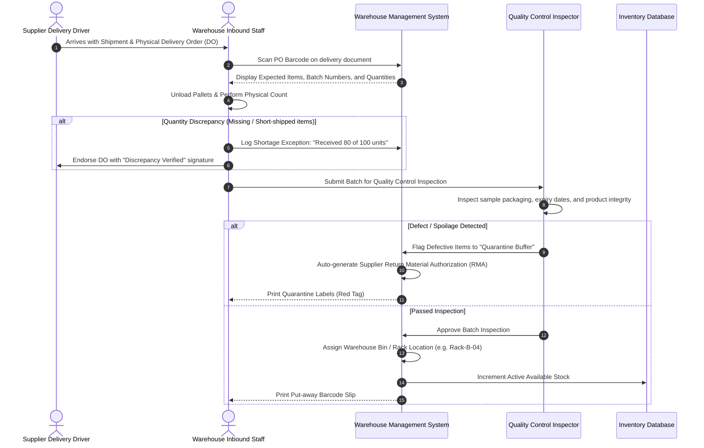

# Inbound Warehouse Receiving & Quality Control (QC) Flow

> **Domain:** Warehouse Management System (WMS), Supply Chain, Logistics  
> **Key Objective:** Inspect inbound deliveries, reconcile against Purchase Orders (PO), quarantine damaged goods, and update available inventory.

---

## 1. Process Sequence Flow

