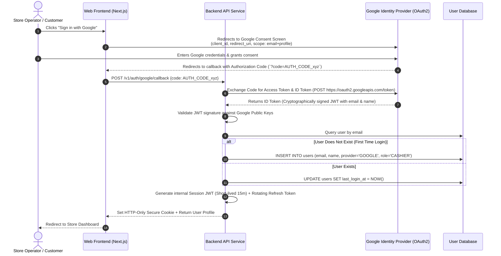

# Social OAuth 2.0 (Google / Apple) Authentication Flow

> **Domain:** User Identity, Single Sign-On (SSO), Authentication & Security  
> **Key Objective:** Securely authenticate customers using Google/Apple OAuth without storing raw passwords in your application database.

---

## 1. Process Sequence Flow

