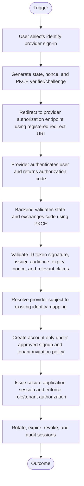
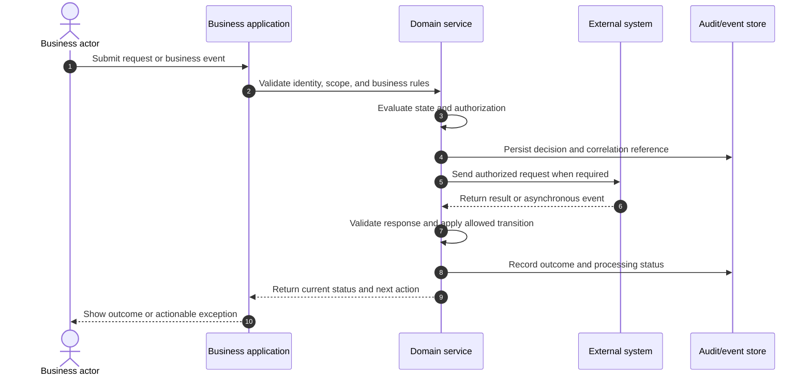
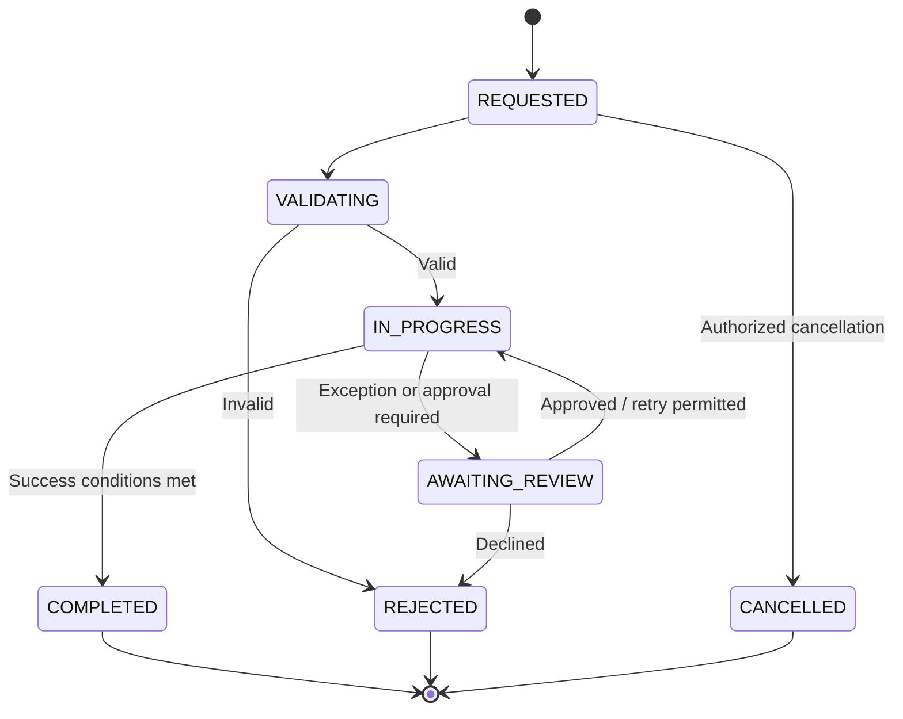

# OAuth 2.0 / OpenID Connect Sign-In and Account Linking

> **Domain:** Identity, authentication, SaaS applications  
> **Document type:** To-Be reference workflow  
> **Status:** Reference design — validate with process owners before implementation  
> **Audience:** Business Analysts, Systems Analysts, product teams, and developers

## 1. Problem statement

Social sign-in can expose accounts to takeover or incorrect account linking when redirect validation, token verification, tenant authorization, and session lifecycle are incomplete.

## 2. Objective and scope

**Objective:** Authenticate users through a trusted identity provider using authorization code flow with PKCE, validate identity tokens, and issue least-privilege application sessions.

**In scope**
- Operational lifecycle from initiation through resolution and recordkeeping.
- Business decisions, system responsibilities, exception handling, and audit evidence.
- Minimum data and acceptance criteria needed for implementation planning.

**Out of scope**
- Organization-specific legal, tax, accounting, labor, or contractual conclusions.
- Fixed thresholds, fees, SLA targets, or financial outcomes not validated by the organization.
- Vendor-specific API contracts unless documented by the selected provider.

## 3. Actors and systems

| Actor / system | Responsibility |
|---|---|
| End user | Starts sign-in and grants provider consent |
| Web/mobile client | Initiates authorization request and receives callback |
| Application backend | Exchanges code, validates tokens, and issues session |
| Identity provider | Authenticates user and returns authorization response |
| User database | Stores provider identity mapping and account status |
| Authorization service | Checks tenant membership and application roles |

## 4. Trigger, preconditions, and postconditions

**Trigger:** A valid business event or authorized user action initiates the workflow.

**Preconditions**
- Initiating actor or service is authenticated.
- Required master data, policy versions, and reference records are available.
- Requested object is in a state that permits the operation.
- Required permissions and segregation-of-duty controls are configured.

**Postconditions**
- Business object has an explicit final or pending status.
- Material decisions, external references, and exceptions are traceable.
- Related financial, inventory, customer, or access records are synchronized or visibly pending.

## 5. Business process view

This flow describes the human and organizational process, independent of a specific application architecture.

## 6. System interaction view

This logical sequence shows system responsibilities. Adapt participants and messages to the selected architecture and provider contract.

## 7. Business rules

| ID | Rule |
|---|---|
| BR-001 | Use Authorization Code Flow with PKCE for public clients; never embed client secrets in browser/mobile code. |
| BR-002 | Validate state to mitigate CSRF and nonce to bind ID token to authorization request. |
| BR-003 | Validate ID token signature, issuer, audience, expiry, nonce, and relevant claims using provider metadata/JWKS. |
| BR-004 | Use provider subject (issuer + sub) as stable external identity key; email alone is not a safe account-link key. |
| BR-005 | Account linking requires authenticated existing session or separate verified linking challenge. |
| BR-006 | Default role assignment must be least privilege and must not grant privileged tenant roles from provider claims alone. |
| BR-007 | Redirect URIs must be exact registered values; reject open redirects and untrusted return URLs. |
| BR-008 | Sessions use secure, HttpOnly, appropriate SameSite cookies or platform-secure storage, with rotation and revocation controls. |

Policy-dependent rules must be confirmed by the process owner and recorded with an effective date or version before implementation.

## 8. Data requirements

| Entity | Minimum fields |
|---|---|
| ExternalIdentity | issuer, subject, user_id, linked_at, provider |
| AuthAttempt | state_hash, nonce_hash, pkce_challenge, redirect_uri, expires_at, status |
| User | user_id, status, created_at, verified_attributes |
| TenantMembership | user_id, tenant_id, role, status, granted_by |
| Session | session_id, user_id, issued_at, expires_at, revoked_at, device_ref |
| SecurityEvent | event_id, user_id, event_type, timestamp, risk_context |

Use stable identifiers, explicit timestamps/time zones, currency and unit definitions where relevant, and versioned policy/rule references. Financial values must use integer minor units or fixed-precision decimal types, not binary floating-point arithmetic.

## 9. State model

The following is a lifecycle scaffold. Rename, add, or remove states to reflect the domain and define permitted transitions in the implementation specification.

## 10. Exceptions and recovery

| Scenario | Expected behavior and recovery |
|---|---|
| State mismatch or missing state | Reject callback and restart authentication. |
| Code expired or reused | Reject exchange and initiate a fresh authorization request. |
| ID token claim invalid | Reject authentication and record security event without creating session. |
| Email matches existing account but subject differs | Do not auto-link; require explicit verified account-link process. |
| User not invited to tenant | Authenticate identity if allowed but deny tenant access and route to onboarding/request access. |
| Provider key rotation | Refresh trusted JWKS metadata and fail closed if signature cannot be verified. |
| Session refresh replay detected | Revoke token family and require reauthentication. |

Every retryable action should define idempotency, retry limits, backoff, timeout, and manual escalation. Never treat an unknown external result as success.

## 11. Authorization, privacy, and audit

- Enforce permissions on the server/service boundary; hiding a button is not authorization.
- Apply least privilege and separation of duties for sensitive approvals, financial actions, inventory adjustments, or account changes.
- Record actor/service identity, timestamp, object ID, action, prior and new state, reason, correlation ID, and external reference where applicable.
- Protect personal and commercially sensitive data through purpose limitation, access control, retention, and secure evidence storage.
- Preserve history through append-only events or controlled reversals; do not silently overwrite material decisions.

## 12. Acceptance criteria

- **AC-01:** Given callback contains invalid state, when processed, then authentication is rejected and no session is issued.
- **AC-02:** Given an ID token has invalid issuer, audience, signature, expiry, or nonce, when validated, then account creation and session issuance are blocked.
- **AC-03:** Given an email matches an existing user but provider subject is not linked, when sign-in occurs, then automatic account linking is not performed.
- **AC-04:** Given a user has no tenant membership, when accessing tenant resources, then authorization denies access despite successful authentication.

## 13. Operational metrics

- Authentication success and failure rate by reason
- Account-linking review incidents
- Invalid token/callback rejection count
- Session revocation and refresh replay events
- Sign-in latency and provider availability

Define numerator, denominator, source system, measurement window, owner, and baseline before setting targets. Metrics are measurement proposals, not promised improvements.

## 14. Assumptions and open decisions

- Use current provider documentation and OIDC discovery metadata; this pattern is not a substitute for a security review.
- Provider-specific scopes, consent, refresh-token behavior, and account recovery must be documented separately.
- Confirm role names, authority limits, thresholds, timeouts, retention, and escalation ownership with stakeholders.
- Record unresolved decisions explicitly; do not silently convert assumptions into requirements.

## 15. Traceability

| Rule group | Acceptance criteria | Implementation evidence |
|---|---|---|
| BR-001 to BR-008 | AC-01 to AC-04 | Unit/integration tests, audit events, and process-owner sign-off |

---

**Validation note:** This is a reusable reference pattern, not an approved policy for every organization. Confirm assumptions and provider-specific behavior before implementation.
