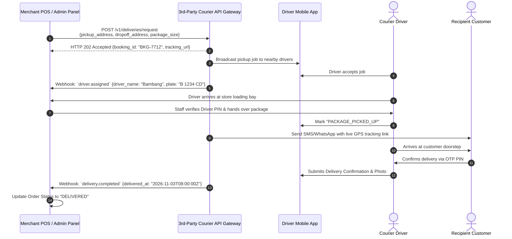

# Third-Party On-Demand Courier API Dispatch & Tracking Flow

> **Domain:** On-Demand Logistics (GrabExpress, GoSend, Lalamove, Uber Direct)  
> **Key Objective:** Automatically request nearest courier pickup, handle driver assignment, and stream real-time GPS tracking.

---

## 1. Process Sequence Flow

