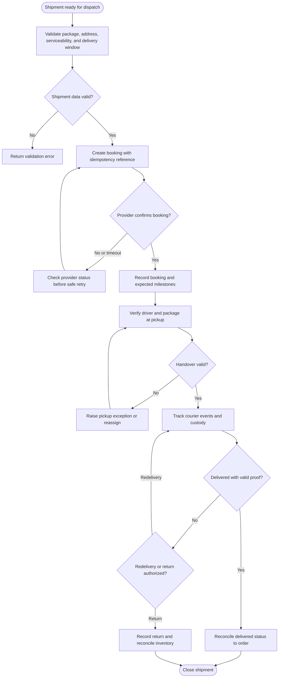
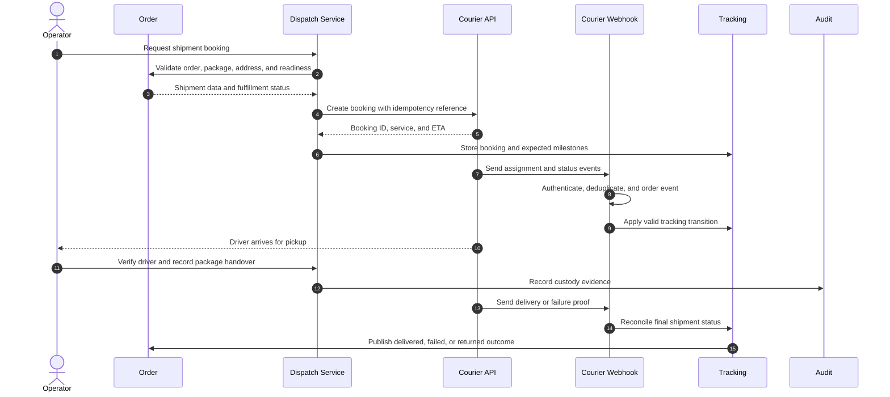
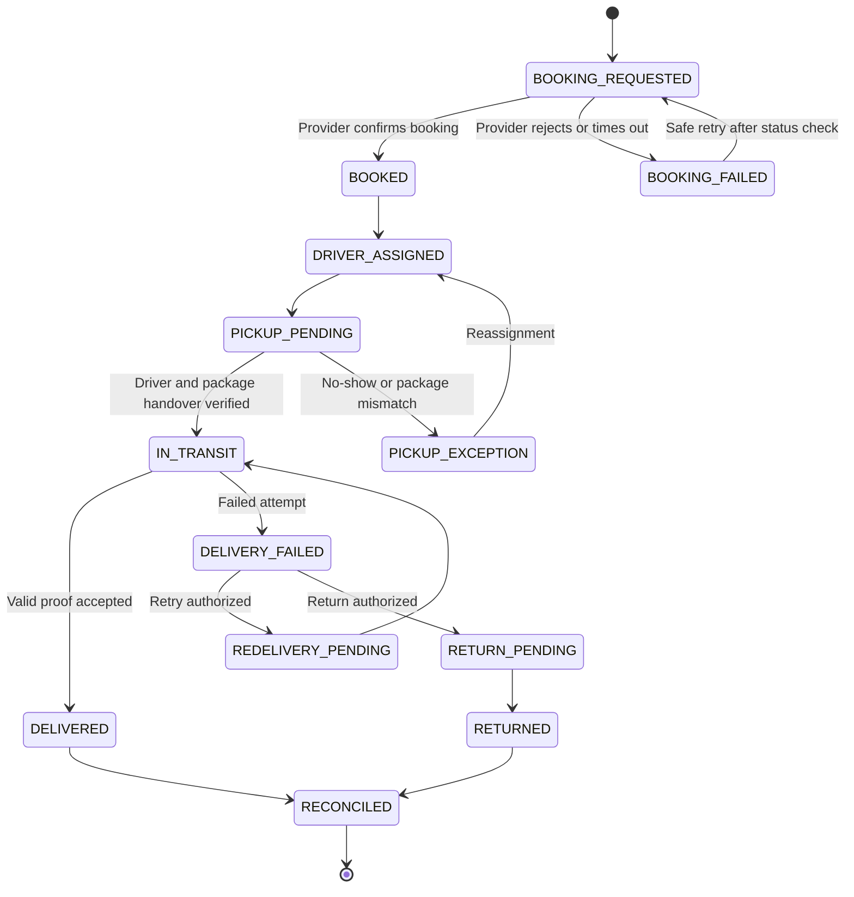

# Third-Party Courier Booking and Delivery Tracking

> **Domain:** Last-mile logistics, marketplace, retail fulfillment  
> **Document type:** To-Be reference workflow  
> **Status:** Reference design — validate with process owners before implementation  
> **Audience:** Business Analysts, Systems Analysts, product teams, and developers

## 1. Problem statement

Courier assignment and tracking are external dependencies. Repeated booking requests can create duplicate pickups, and unverified callbacks can cause premature delivery completion.

## 2. Objective and scope

**Objective:** Create and track courier jobs using idempotent booking, authenticated status updates, custody evidence, and exception recovery.

**In scope**
- Operational lifecycle from initiation through resolution and recordkeeping.
- Business decisions, system responsibilities, exception handling, and audit evidence.
- Minimum data and acceptance criteria needed for implementation planning.

**Out of scope**
- Organization-specific legal, tax, accounting, labor, or contractual conclusions.
- Fixed thresholds, fees, SLA targets, or financial outcomes not validated by the organization.
- Vendor-specific API contracts unless documented by the selected provider.

## 3. Actors and systems

| Actor / system | Responsibility |
|---|---|
| Merchant application | Requests booking and maintains order/shipment state |
| Dispatch operator | Reviews booking and manages exceptions |
| Courier platform | Assigns driver and emits delivery events |
| Courier driver | Collects and delivers package |
| Recipient | Receives package and confirms handover |

## 4. Trigger, preconditions, and postconditions

**Trigger:** An order is packed and marked ready for shipment, and the merchant requests a courier booking.

**Preconditions**
- Order, package dimensions/weight, pickup address, delivery address, and recipient contact are validated.
- Carrier serviceability, service level, quoted cost, and delivery constraints are available.
- Merchant reference and booking idempotency key are generated before provider submission.
- Pickup custody verification and proof-of-delivery requirements are defined.
- Cancellation, redelivery, return-to-origin, and provider outage procedures are configured.

**Postconditions**
- Business object has an explicit final or pending status.
- Material decisions, external references, and exceptions are traceable.
- Related financial, inventory, customer, or access records are synchronized or visibly pending.

## 5. Business process view

This flow describes the human and organizational process, independent of a specific application architecture.

## 6. System interaction view

The sequence models shipment readiness, carrier booking, idempotency lookup, driver assignment, verified pickup custody, tracking callbacks, delivery proof, and return/retry outcomes.

## 7. Business rules

| ID | Rule |
|---|---|
| BR-001 | A shipment has one merchant reference and stable booking idempotency key. |
| BR-002 | Do not create a second booking while the first is unresolved; query provider status first. |
| BR-003 | Driver identity and pickup handover follow merchant/provider controls. |
| BR-004 | Callbacks are authenticated, deduplicated, and checked against valid status transitions. |
| BR-005 | Delivered status requires provider-confirmed proof according to service contract. |
| BR-006 | Customer location and contact details are shared only as necessary for fulfillment. |
| BR-007 | Cancellation fees, redelivery, insurance, and return-to-origin rules must be explicit. |
| BR-008 | Courier completion does not automatically prove customer acceptance for high-risk goods unless policy says so. |

Policy-dependent rules must be confirmed by the process owner and recorded with an effective date or version before implementation.

## 8. Data requirements

| Entity | Minimum fields |
|---|---|
| Shipment | shipment_id, order_id, carrier, merchant_reference, status |
| BookingRequest | request_id, idempotency_key, payload_version, response_code |
| CourierBooking | provider_booking_id, tracking_url, service_level, quoted_cost |
| DriverAssignment | driver_id, vehicle_ref, assigned_at, verified_by |
| ShipmentEvent | provider_event_id, event_type, occurred_at, received_at |
| DeliveryProof | proof_type, evidence_ref, recipient_confirmation, captured_at |

Use stable identifiers, explicit timestamps/time zones, currency and unit definitions where relevant, and versioned policy/rule references. Financial values must use integer minor units or fixed-precision decimal types, not binary floating-point arithmetic.

## 9. State model

The state names and transitions below describe the proposed lifecycle for this workflow. Confirm guards, role permissions, timeout transitions, and terminal-state behavior with the process owner and implementation team before production use.

## 10. Exceptions and recovery

| Scenario | Expected behavior and recovery |
|---|---|
| Booking request times out | Query provider by merchant reference before retrying. |
| No driver assigned | Keep shipment in BOOKING_PENDING and retry or route to manual dispatch. |
| Driver identity mismatch | Do not hand over package; escalate and reassign. |
| Pickup scan missing | Record custody exception and obtain documented confirmation. |
| Delivery attempt fails | Record reason and follow recipient contact/redelivery policy. |
| Duplicate or out-of-order callback | Deduplicate and reconcile provider's current shipment state. |
| Provider outage | Keep order ready for dispatch and use approved alternate carrier workflow. |

Every retryable action should define idempotency, retry limits, backoff, timeout, and manual escalation. Never treat an unknown external result as success.

## 11. Authorization, privacy, and audit

- Enforce permissions on the server/service boundary; hiding a button is not authorization.
- Apply least privilege and separation of duties for sensitive approvals, financial actions, inventory adjustments, or account changes.
- Record actor/service identity, timestamp, object ID, action, prior and new state, reason, correlation ID, and external reference where applicable.
- Protect personal and commercially sensitive data through purpose limitation, access control, retention, and secure evidence storage.
- Preserve history through append-only events or controlled reversals; do not silently overwrite material decisions.

## 12. Acceptance criteria

- **AC-01:** Given booking request times out, when retry is initiated, then provider lookup occurs before a second booking is created.
- **AC-02:** Given driver identity does not match provider assignment, when pickup is attempted, then handover is blocked and an exception is recorded.
- **AC-03:** Given a duplicate delivered callback arrives, when processed, then shipment is completed once and audit history is preserved.
- **AC-04:** Given delivery fails, when failure callback is received, then shipment enters a recoverable exception state rather than DELIVERED.
- **AC-05:** Given a shipment is booked, when customer contact/location details are sent to the carrier, then only fields necessary for fulfillment are shared.
- **AC-06:** Given cancellation, redelivery, or return-to-origin is requested, when provider policy applies a fee or restriction, then the configured rule and evidence are recorded.
- **AC-07:** Given high-risk goods are delivered, when courier completion is received, then customer acceptance is not assumed unless the approved policy permits it.

## 13. Operational metrics

- Booking success and driver assignment time
- Pickup and delivery SLA attainment
- Failed delivery rate by reason
- Duplicate booking prevention count
- Courier invoice versus quoted cost variance

- **Booking success rate:** provider-confirmed bookings ÷ valid booking requests.
- **On-time delivery rate:** delivered shipments meeting promised delivery window ÷ delivered shipments.
- **Failed delivery rate:** shipments with a failed delivery attempt ÷ shipments dispatched.
- **Courier cost variance:** actual billed cost minus accepted quote, by carrier/service. Review weekly by lane and carrier.

Assign a named metric owner, reporting window, and baseline before setting a target. These are measurement definitions, not promised improvements.

## 14. Assumptions and open decisions

- Provider APIs, proof-of-delivery mechanisms, serviceability, insurance, and cancellation rules differ by carrier.
- Tracking links may expose personal data; access and expiry should be controlled.
- Confirm role names, authority limits, thresholds, timeouts, retention, and escalation ownership with stakeholders.
- Record unresolved decisions explicitly; do not silently convert assumptions into requirements.

## 15. Traceability

| Business rule | Acceptance criterion | Verification focus |
|---|---|---|
| BR-001 | AC-01 | Requirement and test coverage for the rule |
| BR-002 | AC-01 | Requirement and test coverage for the rule |
| BR-003 | AC-02 | Requirement and test coverage for the rule |
| BR-004 | AC-03 | Requirement and test coverage for the rule |
| BR-005 | AC-04 | Requirement and test coverage for the rule |
| BR-006 | AC-05 | Requirement and test coverage for the rule |
| BR-007 | AC-06 | Requirement and test coverage for the rule |
| BR-008 | AC-07 | Requirement and test coverage for the rule |

---

**Validation note:** This is a reusable reference pattern, not an approved policy for every organization. Confirm assumptions and provider-specific behavior before implementation.
