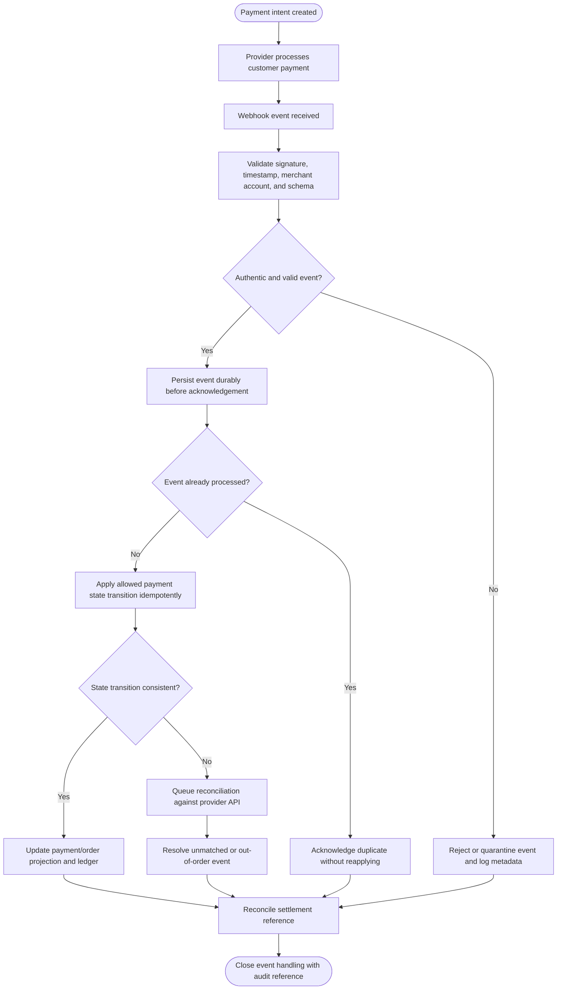
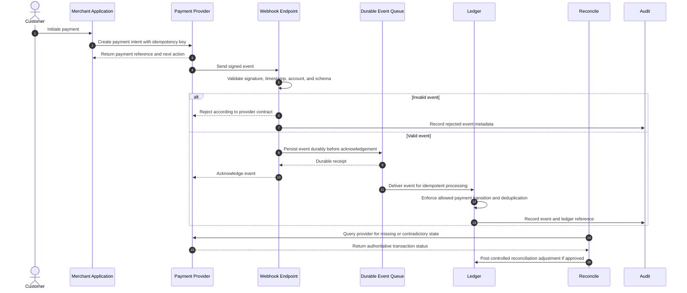
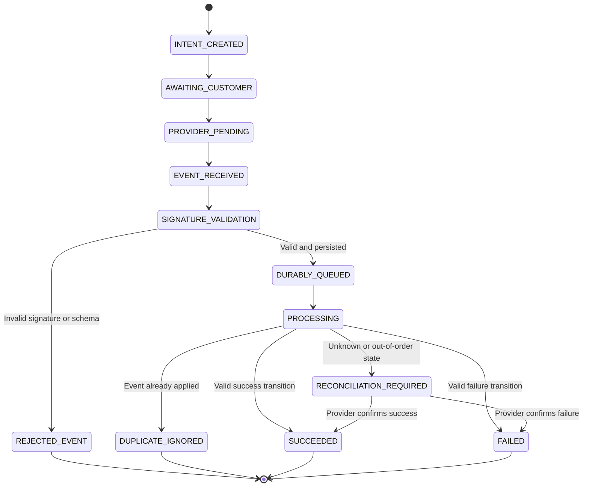

# Payment Webhook Processing and Reconciliation

> **Domain:** Payment integrations, POS, e-commerce  
> **Document type:** To-Be reference workflow  
> **Status:** Reference design — validate with process owners before implementation  
> **Audience:** Business Analysts, Systems Analysts, product teams, and developers

## 1. Problem statement

A provider may confirm payment while the merchant application is offline or webhook delivery is delayed. Blindly retrying payment or trusting screenshots can create duplicate charges or false paid status.

## 2. Objective and scope

**Objective:** Process provider notifications securely and idempotently, reconcile uncertain transactions against provider truth, and expose safe recovery states.

**In scope**
- Operational lifecycle from initiation through resolution and recordkeeping.
- Business decisions, system responsibilities, exception handling, and audit evidence.
- Minimum data and acceptance criteria needed for implementation planning.

**Out of scope**
- Organization-specific legal, tax, accounting, labor, or contractual conclusions.
- Fixed thresholds, fees, SLA targets, or financial outcomes not validated by the organization.
- Vendor-specific API contracts unless documented by the selected provider.

## 3. Actors and systems

| Actor / system | Responsibility |
|---|---|
| Customer | Initiates payment and may provide reference details |
| Merchant application | Creates payment intent and controls order state |
| Payment provider | Authorizes, captures, reverses, and emits events |
| Webhook endpoint | Authenticates and records provider events |
| Reconciliation worker | Queries provider and resolves uncertain states |
| Support operator | Handles manual review under controlled permission |

## 4. Trigger, preconditions, and postconditions

**Trigger:** A payment provider sends an event to the merchant's registered webhook endpoint for a previously created payment intent or transaction reference.

**Preconditions**
- Merchant/provider account, endpoint, signing secret or verification key, and supported event schema are configured.
- Payment intent and merchant reference are persisted before asynchronous callback processing.
- Event identifiers, idempotency keys, and allowed payment-state transitions are defined.
- Durable event storage/queue and retry/dead-letter handling are available.
- Settlement reconciliation ownership and provider lookup capability are established.

**Postconditions**
- Business object has an explicit final or pending status.
- Material decisions, external references, and exceptions are traceable.
- Related financial, inventory, customer, or access records are synchronized or visibly pending.

## 5. Business process view

This flow describes the human and organizational process, independent of a specific application architecture.

## 6. System interaction view

This logical sequence shows system responsibilities. Adapt participants and messages to the selected architecture and provider contract.

## 7. Business rules

| ID | Rule |
|---|---|
| BR-001 | A client redirect or customer screenshot is not authoritative proof of payment. |
| BR-002 | Webhook signatures and provider account identity are validated before processing. |
| BR-003 | Persist event identity and outcome; duplicate events must be harmless. |
| BR-004 | Payment state transitions follow provider-specific state machine and reject invalid regressions. |
| BR-005 | Use stable idempotency keys for payment creation, capture, refund, and retry where supported. |
| BR-006 | Do not ask a customer to pay again until original transaction state is checked with provider. |
| BR-007 | Manual confirmation requires privileged role, evidence, reason, and later reconciliation. |
| BR-008 | Authorization, capture, settlement, refund, and bank payout are distinct states. |

Policy-dependent rules must be confirmed by the process owner and recorded with an effective date or version before implementation.

## 8. Data requirements

| Entity | Minimum fields |
|---|---|
| PaymentIntent | payment_id, order_id, provider, merchant_ref, amount, currency, idempotency_key |
| ProviderEvent | event_id, event_type, signature_valid, received_at, payload_hash, processing_status |
| PaymentStateHistory | payment_id, from_state, to_state, source_event, changed_at |
| ReconciliationCase | case_id, payment_id, reason, provider_status, resolution |
| Refund | refund_id, payment_id, amount, provider_ref, status |
| SettlementRecord | provider_batch, gross, fees, net, settlement_date, bank_reference |

Use stable identifiers, explicit timestamps/time zones, currency and unit definitions where relevant, and versioned policy/rule references. Financial values must use integer minor units or fixed-precision decimal types, not binary floating-point arithmetic.

## 9. State model

The state names and transitions below describe the proposed lifecycle for this workflow. Confirm guards, role permissions, timeout transitions, and terminal-state behavior with the process owner and implementation team before production use.

## 10. Exceptions and recovery

| Scenario | Expected behavior and recovery |
|---|---|
| Webhook signature invalid | Reject event, record security telemetry, and do not change payment state. |
| Webhook arrives before local order commit | Persist event for retry/reconciliation; do not drop it. |
| Webhook is duplicated | Acknowledge after deduplication without duplicate side effects. |
| Provider API unavailable | Keep payment UNKNOWN or RECONCILIATION_PENDING; retry with backoff. |
| Customer reports debit but provider status unknown | Open reconciliation case; do not initiate a second charge. |
| Amount or currency mismatch | Quarantine transaction and require finance/support review. |
| Out-of-order event | Fetch authoritative provider state and apply only valid transition. |

Every retryable action should define idempotency, retry limits, backoff, timeout, and manual escalation. Never treat an unknown external result as success.

## 11. Authorization, privacy, and audit

- Enforce permissions on the server/service boundary; hiding a button is not authorization.
- Apply least privilege and separation of duties for sensitive approvals, financial actions, inventory adjustments, or account changes.
- Record actor/service identity, timestamp, object ID, action, prior and new state, reason, correlation ID, and external reference where applicable.
- Protect personal and commercially sensitive data through purpose limitation, access control, retention, and secure evidence storage.
- Preserve history through append-only events or controlled reversals; do not silently overwrite material decisions.

## 12. Acceptance criteria

- **AC-01:** Given an invalid webhook signature, when received, then no payment state changes and the event is rejected.
- **AC-02:** Given the same provider event is delivered twice, when processed, then only one business side effect occurs.
- **AC-03:** Given a customer reports debit while provider state is unknown, when support opens a case, then a second payment request is blocked pending reconciliation.
- **AC-04:** Given provider amount or currency differs from order, when event is processed, then payment is quarantined for review.

## 13. Operational metrics

- Webhook delivery-to-processing latency
- Duplicate event rate and deduplication count
- Unknown payment resolution time
- Payment/order state mismatch rate
- Settlement reconciliation variance

Define numerator, denominator, source system, measurement window, owner, and baseline before setting targets. Metrics are measurement proposals, not promised improvements.

## 14. Assumptions and open decisions

- Signature validation, acknowledgement timing, and state transitions follow each provider's official contract.
- Offline/manual confirmation is not a generic bypass; use only provider-supported verification.
- Confirm role names, authority limits, thresholds, timeouts, retention, and escalation ownership with stakeholders.
- Record unresolved decisions explicitly; do not silently convert assumptions into requirements.

## 15. Traceability

| Rule group | Acceptance criteria | Implementation evidence |
|---|---|---|
| BR-001 to BR-008 | AC-01 to AC-04 | Unit/integration tests, audit events, and process-owner sign-off |

---

**Validation note:** This is a reusable reference pattern, not an approved policy for every organization. Confirm assumptions and provider-specific behavior before implementation.
