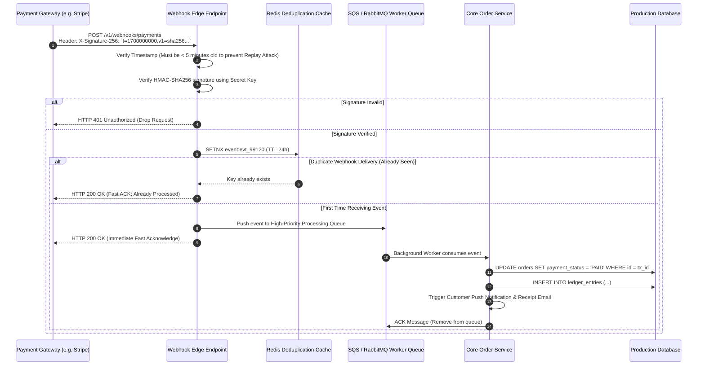

# Asynchronous Webhook Payment Settlement & HMAC Signature Flow

> **Domain:** Payment Gateways (Stripe, Midtrans, PayPal), Fintech, Microservices  
> **Key Objective:** Securely process asynchronous payment confirmations, guard against replay attacks, and handle worker retries.

---

## 1. Process Sequence Flow

