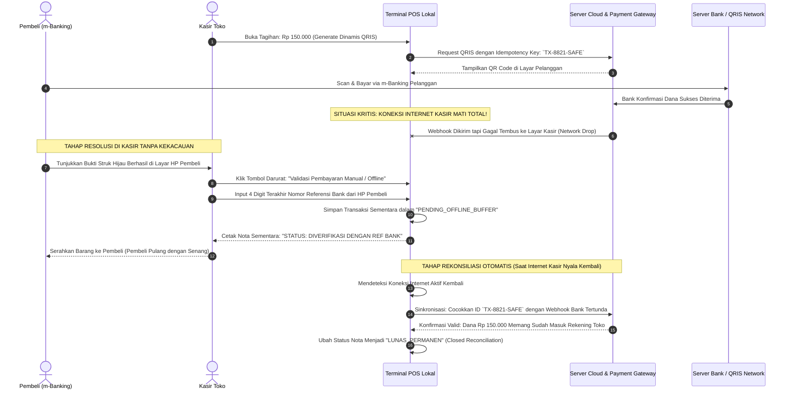

# Payment Webhook, Offline Network Drop & Zero-Loss Recovery Flow

> **Domain:** Payment Gateway (QRIS, Midtrans, Stripe, OVO/GoPay), POS Kasir, E-Commerce  
> **Core Mission:** Menyelamatkan toko dari situasi kritis ketika pelanggan sudah membayar (uang terpotong di m-Banking/QRIS), tetapi internet di kasir mendadak mati sehingga pesanan dianggap belum bayar.

---

## 1. Masalah Nyata & Situasi Panik di Meja Kasir

Kekacauan paling sering terjadi di kasir modern:
1. **Internet Kasir Tiba-Tiba Putus (Network Drop):** Pembeli melakukan scan QRIS, saldo rekening pembeli sudah terpotong Rp 150.000. Tapi wifi kasir mendadak mati. Kasir menolak memberikan barang karena di layar kasir statusnya masih *"Menunggu Pembayaran"*. Pembeli marah karena merasa sudah bayar.
2. **Double Charge (Terdebet Dua Kali):** Karena panik nota tidak keluar, kasir menyuruh pembeli scan QRIS sekali lagi. Akhirnya uang pembeli terpotong dua kali.
3. **Webhook Terlambat Tiba:** Notifikasi dari bank baru tiba 10 menit kemudian setelah pembeli meninggalkan toko.

---

## 2. Diagram Alur Sistem: "Resilient Offline-Ready Payment Protocol"

---

## 3. Checklist Aturan Sistem (Untuk Tim Programmer & Bisnis)

* [ ] **Kunci Unik Idempotency Key:** Setiap kode QRIS atau tagihan kartu wajib memiliki *Idempotency-Key* unik per transaksi. Jika kasir mencoba mengklik cetak ulang, sistem dilarang keras membuat QR baru yang bisa membuat pembeli terdebet dua kali.
* [ ] **Fitur Validasi Referensi Bank di Kasir:** Berikan kasir tombol khusus untuk memasukkan nomor referensi bank (*RRN / Retrieval Reference Number*) dari HP pelanggan, sehingga barang bisa langsung diserahkan tanpa harus menunggu internet hidup kembali.
* [ ] **Antrean Sinkronisasi Latar Belakang (Background Queue):** Begitu internet kasir kembali stabil, terminal POS otomatis melakukan penyisiran (*polling*) ke server pusat untuk melunaskan transaksi-transaksi yang sempat tersangkut di mode offline.

---

## 4. Dampak Operasional bagi Bisnis

* **Menyelamatkan Reputasi Toko:** Nol keributan di depan meja kasir saat jaringan operator internet sedang *down*.
* **Nol Kerugian Finansial:** Toko tetap aman karena nomor referensi bank dicatat secara valid di dalam database kasir dan otomatis dicocokkan kembali dengan rekening koran bank saat internet kembali online.
