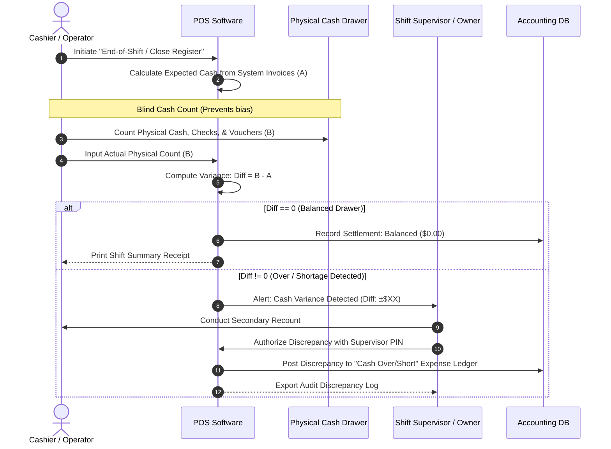
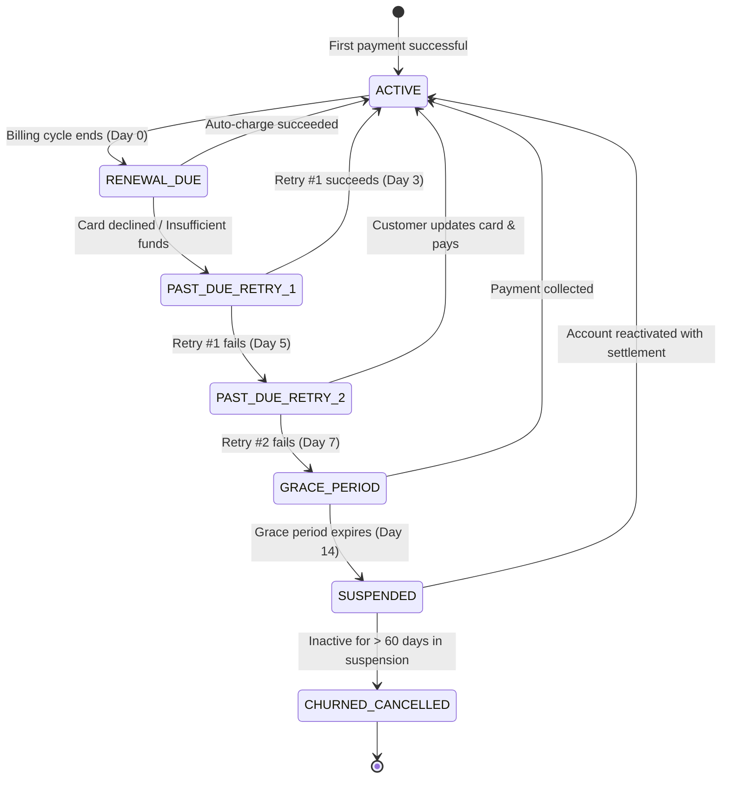

# 📊 Visual Business Flows — The Mermaid.js Business Process Library

<div align="center">

[](https://opensource.org/licenses/MIT)
[](https://mermaid.js.org/)
[](https://github.com)
[](https://github.com)
[](https://github.com/reviveproject4-source)

**A curated, open-source collection of 30+ real-world business process workflows, sequence diagrams, and operational state machines written in native Mermaid.js markdown. Free to copy, customize, and embed in your PRDs, Notion, or GitHub documentation.**

[Explore Library](#-workflow-catalog) • [Why Visual Flows?](#-why-mermaid-for-business-processes) • [Sister Project: OpenBSA](https://github.com/reviveproject4-source/OpenBSA) • [Hire the Author](#-custom-workflow-consulting)

</div>

---

## 💡 Why Mermaid for Business Processes?

Most business workflow diagrams suffer from three major problems:
1. **Trapped in Proprietary Tools:** Stored in Visio, Lucidchart, or Miro where team members need paid licenses or exports to view them.
2. **Outdated Immediately:** When business logic changes, nobody updates the exported PNG images.
3. **Disconnected from Code:** Developers work in Git and Markdown, not design canvases.

**Visual Business Flows** solves this with **Diagrams-as-Code**:
- **Plain Text:** Every diagram is written in human-readable Markdown code blocks (```` ```mermaid ````).
- **Native Rendering:** Renders instantly in GitHub previews, Notion, GitLab, Obsidian, and VS Code without plugins.
- **Version Controlled:** Track process changes, diffs, and pull requests directly in Git.

---

## ⚡ Live Previews: Copy-Paste Ready Diagrams

### 1. End-of-Day POS Cashier Reconciliation & Drawer Balancing


---

### 2. SaaS Subscription Dunning & Grace Period Flow


---

### 3. Multi-Vendor Marketplace Escrow Split Flow
```mermaid
flowchart TD
    Buyer([Customer / Shopper]) -->|Purchases Cart ($100)| Gateway[Payment Gateway Escrow]
    Gateway -->|Hold Funds Until Delivery Confirmed| Escrow[(Escrow Wallet)]
    
    Courier[Courier / Delivery] -->|Delivery Status: CONFIRMED| OrderService[Order Engine]
    OrderService --> ReleaseTrigger{Release Conditions Met?}
    
    ReleaseTrigger -->|No Disputes Filed within 48h| Splitter[Commission & Escrow Splitter]
    
    Splitter -->|10% Marketplace Commission: $10| PlatformWallet[(Platform Revenue Account)]
    Splitter -->|90% Net Vendor Payout: $90| VendorWallet[(Vendor Merchant Balance)]
    
    VendorWallet --> Withdraw[Vendor Weekly Bank Auto-Withdrawal]
```

---

## 📂 Workflow Catalog

Browse our modular workflow library organized by operational domain:

### 1. [`01-retail-and-pos/`](./01-retail-and-pos/)
* **`pos-daily-reconciliation.md`** — End-of-shift register balancing, blind count protocol, and variance logging.
* **`order-to-delivery-flow.md`** — Point-of-sale order placement, kitchen/warehouse dispatch, and courier handover.
* **`returns-and-refunds.md`** — In-store product returns, exchange workflows, and ledger credit adjustments.
* **`low-stock-alert-and-restock.md`** — Automated re-order point trigger, supplier purchase order (PO), and restocking.

### 2. [`02-crm-and-customer-retention/`](./02-crm-and-customer-retention/)
* **`dormant-customer-reactivation.md`** — Automated trigger flagging customers inactive for >60 days into win-back campaigns.
* **`customer-onboarding-journey.md`** — Multi-tier membership registration, point accrual, and tier upgrades.
* **`complaint-and-ticket-resolution.md`** — Customer complaint escalation protocol from frontline agent to manager.

### 3. [`03-financial-and-billing/`](./03-financial-and-billing/)
* **`subscription-billing-and-dunning.md`** — Recurring billing cycles, card decline retries, dunning notifications, and suspension.
* **`multi-vendor-escrow-split.md`** — Multi-party escrow settlement, commission fee deductions, and vendor disbursement.
* **`expense-approval-hierarchy.md`** — Operational expense requests with multi-tier approval thresholds (Staff -> Manager -> Owner).

### 4. [`04-supply-chain-and-inventory/`](./04-supply-chain-and-inventory/)
* **`warehouse-goods-receipt.md`** — Inbound shipment receiving, barcode scan verification, and defect quarantine.
* **`inter-branch-stock-transfer.md`** — Inventory transfer request between branch stores with in-transit tracking.
* **`dead-stock-liquidation.md`** — Slow-moving stock identification, automated discount step-downs, and bundled clearance.

### 5. [`05-system-integrations/`](./05-system-integrations/)
* **`webhook-payment-settlement.md`** — Secure asynchronous webhook notification handling with HMAC signature validation.
* **`third-party-courier-dispatch.md`** — API dispatch to third-party shipping partners (Grab/GoSend/DHL) with real-time tracking.
* **`oauth-google-login-flow.md`** — Fast social authentication flow linking Google OAuth to internal tenant user profiles.

---

## 🛠️ How to Use These Diagrams

1. **Find the workflow** you need from the catalog above.
2. Open the `.md` file and locate the Mermaid code block starting with ```` ```mermaid ```` and ending with ```` ``` ````.
3. **Copy the code** and paste it directly into:
   * **GitHub:** Paste into any `README.md`, Issue, or Pull Request description.
   * **Notion:** Type `/mermaid` and paste the code inside the block.
   * **Mermaid Live Editor:** Test or export to SVG/PNG at [mermaid.live](https://mermaid.live).

---

## 🔗 The Ecosystem

* **[OpenBSA](https://github.com/reviveproject4-source/OpenBSA)** — Complete open-source Business & System Analyst toolkit (PRDs, SRS, ADRs, and BDD scenarios).
* **[ROTARI](https://github.com/reviveproject4-source/ROTARI)** — Live multi-tenant small business management platform demonstrating these workflows in practice.

---

## 👨‍💼 Custom Workflow Consulting

Need custom workflow modeling, process gap analysis, or developer-ready system specifications for your startup or business?

* **Author:** Tri Raida (Business Systems Analyst | Operator-Turned-Analyst)
* **Services:** Business Process Optimization, As-Is vs. To-Be Mapping, PRD/SRS Documentation.
* **Email:** [tri.raida.consulting@gmail.com](mailto:tri.raida.consulting@gmail.com)
* **GitHub:** [@reviveproject4-source](https://github.com/reviveproject4-source)

---

## ⭐️ Support & Contribution

If these visual flows saved your team hours of drawing boxes and arrows:
* **Give this repo a Star (⭐️)** to help more analysts and developers find it.
* Feel free to submit Pull Requests with new business patterns! (See [CONTRIBUTING.md](./CONTRIBUTING.md)).

---

## 📄 License

Distributed under the MIT License. See [`LICENSE`](./LICENSE) for details.

*(c) 2026 Tri Raida. Built with ❤️ for practical business builders worldwide.*
