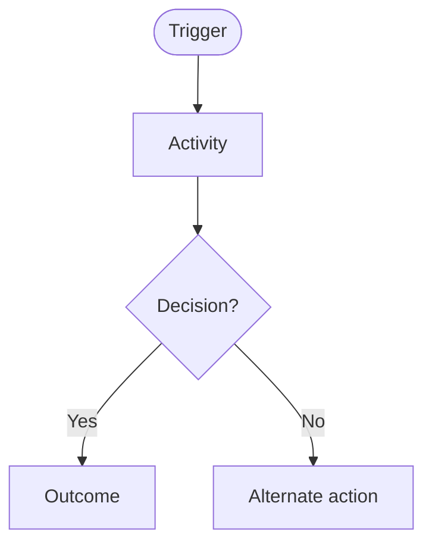
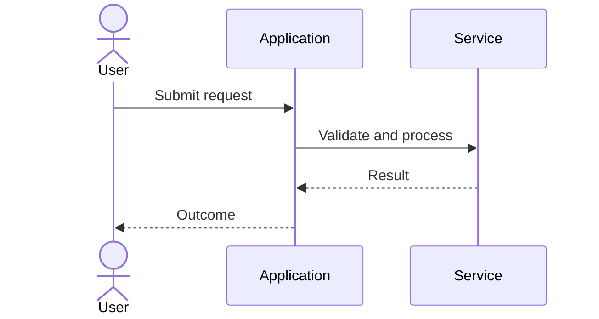

# [Workflow name]

> **Domain:** [Business domain]  
> **Document type:** [As-Is / To-Be / Reference pattern]  
> **Status:** [Draft / In review / Reference design]  
> **Owner / reviewer:** [Role or team, if known]

## 1. Problem statement

Describe the operational problem, who experiences it, why it matters, and what evidence or observation supports it. Separate observed facts from hypotheses.

## 2. Objective and scope

**Objective:** [Measurable or observable outcome the workflow supports.]

**In scope**
- [Included process boundary]

**Out of scope**
- [Excluded process or decision]

## 3. Actors and systems

| Actor / system | Responsibility | Notes / authority |
|---|---|---|
| [Role/system] | [Action or responsibility] | [Limits or assumptions] |

## 4. Trigger, preconditions, and postconditions

**Trigger:** [Event that starts the process.]

**Preconditions**
- [What must be true before the process starts]

**Postconditions**
- [What must be true when the process completes]

## 5. Business process view

Show the human/organizational process: roles, handoffs, decisions, approvals, and evidence. Use a flowchart.

## 6. System interaction view

Show system responsibilities, messages, validations, and external dependencies. Do not use this diagram as a substitute for the business process view.

## 7. Business rules

| ID | Rule | Rationale / source | System implication |
|---|---|---|---|
| BR-001 | [Unambiguous rule] | [Policy, observation, or assumption] | [Validation or behavior] |

## 8. Data requirements

| Data item / entity | Required fields | Source | Validation / sensitivity |
|---|---|---|---|
| [Entity] | [Fields] | [System/role] | [Rules] |

## 9. States and status transitions

List valid states, allowed transitions, who may trigger them, and terminal states. Add a state diagram when lifecycle behavior is important.

## 10. Exceptions and recovery

| Scenario | Expected behavior | Owner | Recovery / evidence |
|---|---|---|---|
| [Failure or alternate case] | [System/business response] | [Role] | [Retry, escalation, or manual action] |

## 11. Authorization and audit

Specify role permissions, segregation of duties, sensitive actions, audit events, retention assumptions, and any required approval.

## 12. Acceptance criteria

Write testable Given/When/Then criteria.

- **AC-01:** Given [context], when [event], then [observable result].
- **AC-02:** Given [exception], when [event], then [safe failure/recovery result].

## 13. Metrics and controls

Define metric formulas, data sources, review cadence, and baseline requirements. Do not promise an improvement without evidence.

## 14. Assumptions and open questions

- [Assumption to validate]
- [Question requiring stakeholder decision]

## 15. Traceability

| Business rule | Acceptance criteria | Related data / process step |
|---|---|---|
| BR-001 | AC-01 | [Reference] |

---

**Validation note:** Identify which parts are illustrative and which have been confirmed with process owners. Do not present an unvalidated reference pattern as an approved organizational policy.
